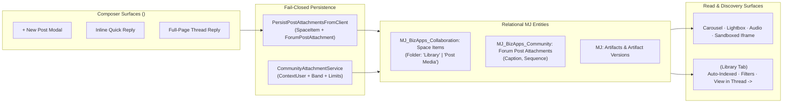

# BizApps Community — Embedded MJ Artifacts, Rich Media Carousels & Auto-Indexed Media Library Specification

**Status:** Implemented & Verified  
**Schema:** `__mj_BizAppsCommunity` & `__mj_BizAppsCollaboration` (built cleanly on existing `ForumPostAttachment`, `ForumArtifactPost`, `SpaceItem`, `MJ: Artifacts`, and `MJ: Artifact Versions` entities)  
**Key Packages:** `@mj-biz-apps/community-core`, `@mj-biz-apps/community-server`, `@mj-biz-apps/community-ng`

---

## 1. Purpose & Capabilities

Members routinely share multi-step screenshots, architecture walkthrough videos, voice memos, PDFs/spreadsheets, and generated **MJ Artifacts** across forum posts, Q&A answers, idea proposals, playbooks, and thread replies. Without structured attachment rendering and auto-indexing, media gets trapped inside individual threads and cannot be discovered across a Space.

This specification defines four integrated capabilities:

1. **Domain Contracts & Two-Tier Library Routing (`@mj-biz-apps/community-core`)**:
   - Unified `CommunityAttachmentItem` discriminated union (`CommunityArtifactAttachmentItem | CommunityFileAttachmentItem`) spanning `image`, `video`, `audio`, `artifact`, and `file`.
   - `ResolveDefaultFeatureInLibrary(kind, entryType)` defaults `Feature in Space Library` (`SpaceItem.Folder = 'Library'`) to `true` for embedded MJ Artifacts and Playbook/Collaborative Doc entries, and `false` (`SpaceItem.Folder = 'Post Media'`) for casual post/reply media—while keeping every attachment auto-indexed in the Space Media Library.
   - `GroupPostAttachmentsForDisplay` preserves author `sequence` ordering across `visualMedia`, `audioTracks`, `artifacts`, and `files`.
   - Strict MIME allowlists (`COMMUNITY_ALLOWED_MIME_TYPES` rejecting `text/html`, `image/svg+xml`, and script-capable files), per-file (`10 MiB`), per-post count (`12`), aggregate byte (`50 MiB`), durable `data:` URL (`10 MiB`), and caption (`300` chars) validation, plus `SanitizeCommunityAttachmentUrl` and `SanitizePersistedAttachmentUrl` (blocking transient `blob:` and placeholder `attachments.local` URLs at every persistence boundary).
2. **Fail-Closed Server & Entity Persistence (`@mj-biz-apps/community-server` & `@mj-biz-apps/community-core-entities-server`)**:
   - `CommunityAttachmentServerService` and `ForumPostAttachmentServerEntity` enforce authenticated `ContextUser` identity, `Space` + `Forum` + `VisibilityBand` (`Shared` vs `Team`) authorization, strict `MJ: Files` <-> `ArtifactVersion.FileID` binding, authoritative `MJ: Files` / `MJ: Artifact Versions` MIME/size/URL checks (`ValidateAuthoritativeFileRecord`, `ValidateAuthoritativeArtifactVersionRecord`), aggregate post byte limits, and compensating rollback when `SpaceItem` or `ForumPostAttachment` persistence fails.
   - Bounded `RunView` pagination (`DEFAULT_LIBRARY_PAGE_SIZE = 50`, `MAX_LIBRARY_PAGE_SIZE = 100`) for `QuerySpaceMediaLibrary`.
3. **Interactive Gallery & Composer Picker (`@mj-biz-apps/community-ng`)**:
   - **`CommunityAttachmentGalleryComponent` (`<mjc-attachment-gallery>`)**: Standalone `OnPush` viewer supporting single-image click-to-lightbox, mixed multi-media carousels (`1 / N` counter + thumbnail strip + keyboard `ArrowLeft`/`ArrowRight`/`Home`/`End`), native `<video controls preload="metadata">`, single/multi-track Audio Switcher (`Track 1 of N`), sandboxed Embedded MJ Artifact cards (`<iframe sandbox="allow-scripts" [srcdoc]="...">` + CSP-locked SVG wrapper + Markdown/JSON/Code preview + Full Preview modal), and downloadable file chips.
   - **`CommunityAttachmentPickerComponent` (`<mjc-attachment-picker>`)**: Integrated into the `+ New Post` modal, inline feed quick-reply composer, and Full-Page Thread View reply composer with drag-and-drop multi-file staging, searchable `MJ: Artifacts` picker popover with optional version pinning, editable captions, up/down reordering, `Feature in Space Library` toggle, and fail-visible compensating rollback (`PersistPostAttachmentsFromClient`, `PersistAskSharePost`, `PersistDetailReply`).
4. **Auto-Indexed Space Media & Artifacts Library Tab (`@mj-biz-apps/community-ng`)**:
   - Top-level **Library** tab (`key: 'media-library'`, label `'Library'`, icon `'fa-solid fa-photo-film'`) in `CommunityHubResource`, persisted cleanly via `UserInfoEngine.Instance` (`MJ: User Settings`, never `localStorage` or `sessionStorage`).
   - Automatically indexes all attachments across posts and replies in the active Space (or all accessible Spaces when `'All Spaces'` is selected) via `BuildMediaLibraryEntries`.
   - Type filter pills (`All · Images · Video · Audio · Artifacts · Files`), Scope pills (`All Media & Files`, `Featured Library`, `My Uploads`), Space selector, and free-text search across filename, artifact title, caption, and source thread title.
   - Visual thumbnail grid for images/videos with click-to-lightbox, clean cards for audio/artifacts/files with sandboxed artifact preview modal, and **"View in Thread →"** on every item jumping directly into `#mjc-full-thread-view`.

---

## 2. Architecture & Data Flow

---

## 3. Security, Accessibility & OpenApp v3 Compliance

- **Zero `any` / Zero `unknown` Casts**: Verified via `node scripts/check-type-safety.mjs` across all handwritten `.ts` files.
- **No `localStorage` / `sessionStorage`**: Active tab (`media-library`) and Library filter preferences (`mediaLibraryKind`, `mediaLibraryScope`) persist exclusively via `UserInfoEngine.Instance` (`CommunityHubPreferences`).
- **Iframe Sandboxing & URL Sanitization**: All HTML and SVG artifact previews render inside `<iframe sandbox="allow-scripts" [srcdoc]="...">` (never `allow-same-origin`); SVG previews enforce a strict CSP (`default-src 'none'`). Attachment URLs pass `SanitizeCommunityAttachmentUrl`.
- **100% `--mj-*` Design Tokens & `OnPush`**: Zero raw hex/rgb/hsl color literals across `community-attachment-gallery.*`, `community-attachment-picker.*`, and `community-media-library.*`; all components use `ChangeDetectionStrategy.OnPush`.
- **WCAG 2.1 AA**: Full keyboard navigation (`ArrowLeft`/`ArrowRight`/`Escape`/`Tab` focus trapping + focus restoration in lightboxes & artifact modals) and `0` critical/serious axe-core violations across all 5 Community Hub tabs.
