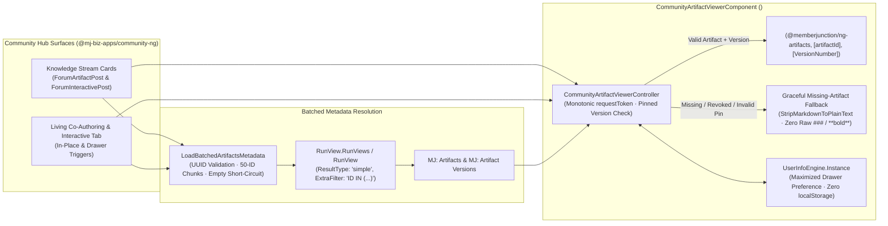

# BizApps Community — `@memberjunction/ng-artifacts` In-Place & Slide-Over Forum Viewer Specification

**Status:** Implemented & Verified  
**Target Trunk:** `next` (`@memberjunction/*@6.3.0-edge.1`)  
**Packages:** `@mj-biz-apps/community-ng`, `@mj-biz-apps/community-integration-tests`  
**Schema Changes:** None (reuses existing `ForumArtifactPost`, `ForumInteractivePost`, `ForumPost`, `MJ: Artifacts`, and `MJ: Artifact Versions` entities)

---

## 1. Purpose & Scope

`BizApps Community` stores versioned document and interactive experience references on `ForumArtifactPost` (`ArtifactID` / `PinnedArtifactVersionID`) and `ForumInteractivePost` (`ComponentArtifactID` / `PinnedArtifactVersionID`). Previously, post previews relied on bespoke Markdown-to-HTML rendering. This specification replaces that custom rendering path with a theme-native Angular wrapper (`CommunityArtifactViewerComponent`) around MemberJunction's canonical `@memberjunction/ng-artifacts` (`<mj-artifact-viewer-panel>`) component while keeping high-volume conversational replies as fast relational rows.

### Explicit Non-Goals

- No database schema or migration changes (`migrations/**`, `migrations-pg/**`, and `metadata/entities/.polymorphic-fk-entity-fields.json` remain untouched).
- No authentication or security subsystem changes (`**/auth/**`, `**/security/**`).
- No migration of high-volume `ForumPost` discussion replies into `MJ: Artifacts`.
- No upgrades of `@memberjunction/*` packages beyond the repository's pinned `6.3.0-edge.1` version.

---

## 2. Architectural Rubric: `MJ Docs (MJ: Artifacts) vs. MJ: Comments vs. Quick Notes`

Mirrored in [`CLAUDE.md`](../../../CLAUDE.md) and [`AGENTS.md`](../../../AGENTS.md):

| Category | Backing Store & Viewer | Use Cases | BizApps Community Entities |
| --- | --- | --- | --- |
| **Category A — MJ Docs (`MJ: Artifacts`)** | `MJ: Artifacts` + `MJ: Artifact Versions`, rendered in-place or in a slide-over drawer via `@memberjunction/ng-artifacts` (`<mj-artifact-viewer-panel>` wrapped by `CommunityArtifactViewerComponent`) | Versioned, rich, shareable documents, slides, sheets, and interactive components requiring version pinning, rich rendering, or collaborative authoring | **`ForumArtifactPost`** (`ArtifactID` / `PinnedArtifactVersionID`), **`ForumInteractivePost`** (`ComponentArtifactID` / `PinnedArtifactVersionID`), and version-pinned artifact attachments in `ForumPostAttachment` |
| **Category B — `MJ: Comments`** | `MJ: Comments` (inline / record-anchored contextual commentary) | Passage-anchored review remarks, editorial notes, and record-scoped contextual annotations | Inline contextual commentary anchored to artifacts, documents, or entity records |
| **Category C — Quick Notes / Relational Records** | Relational `__mj_BizAppsCommunity` tables queried via batched `RunViews` (`ResultType: 'simple'`) and `fnCommunityForumAccess` RLS | High-volume, low-ceremony conversational discussion threads, Q&A replies, reactions, and moderation flags | **High-volume `ForumPost` replies remain Category C relational records** alongside `ForumQuestionPost`, `ForumAnswerPost`, `ForumIdeaPost`, `ForumPostReaction`, and `ForumPostFlag` |

---

## 3. Component & Batched `RunView` Architecture

### Key Engineering Guarantees

1. **Dependency Pinning**: `@memberjunction/ng-artifacts` is declared in `packages/Angular/package.json` as `"^6.3.0-edge.1"` under `peerDependencies` and `"6.3.0-edge.1"` under `devDependencies`, matching the repository's caret-pin and dependency-model CI gates.
2. **Modern Angular & Strict Type Safety**: Standalone `ChangeDetectionStrategy.OnPush` component using `@if`/`@switch` control flow, `inject()` DI, zero `any`, zero `unknown`, zero `BaseEntity.Get()`/`.Set()`, and zero `window.print()`.
3. **Batched `RunView` Queries (Zero N+1)**: `LoadBatchedArtifactsMetadata` validates and deduplicates UUIDs (`BuildValidatedUuidInFilter`), short-circuits on empty ID sets with zero executed queries, chunks into 50-ID windows (`DEFAULT_ARTIFACT_BATCH_CHUNK_SIZE = 50`), and resolves `MJ: Artifacts` and `MJ: Artifact Versions` via `ResultType: 'simple'` with `ExtraFilter: "ID IN (...)"`.
4. **`PinnedArtifactVersionID` Pass-Through & Fail-Closed Resolution**: `ResolveArtifactViewerState` confirms the referenced artifact exists and that any `PinnedArtifactVersionID` belongs to that exact artifact before binding `[VersionNumber]` on `<mj-artifact-viewer-panel>`.
5. **Stale-Response Cancellation**: `CommunityArtifactViewerController` tracks a monotonic `requestToken` so rapid card switching or mid-load dismissal never flashes out-of-order responses under `OnPush`.
6. **Keyboard Accessibility & Focus Management**: `Escape` immediately closes the `drawer` (canceling in-flight loads and restoring focus to the triggering element), backdrop click and close button dismiss cleanly, and `Tab` / `Shift+Tab` trap focus inside `role="dialog" aria-modal="true"`.
7. **Semantic `--mj-*` Theming & User Preferences**: Zero raw `#hex`, `rgb()`, `rgba()`, or `hsl()` color literals in Angular `.css`/`.html`/`.ts` files; maximized drawer preference persists through `UserInfoEngine.Instance` (`bizapps-community.artifactViewerMaximized`), never `localStorage` or `sessionStorage`.
8. **Graceful Missing-Artifact Fallback**: Missing, revoked, or invalidly pinned artifacts transition to `'missing'` (or `'error'` on transport failure) and render a themed fallback banner using `StripMarkdownToPlainText` (zero raw `###`, `**bold**`, or code-fence leakage) while preserving Category C relational `ForumPost` replies.
9. **OpenApp v3 Registration & Navigation Parity**: All 25 `metadata/entities/` entities retain active uncommented `@RegisterClass(BaseFormComponent, '<EntityName>')` classes retained via `GeneratedFormsModule` and reachable from `mj-app.json` (`startupExport: "LoadBizAppsCommunityClient"`), and `CommunityHubResource` retains `@RegisterClass(BaseResourceComponent, 'CommunityHubResource')`, `<mj-page-layout>`, deferred `NotifyLoadStarted()`, `NotifyLoadComplete()`, and matching `metadata/applications/.applications.json` `DefaultNavItems`.

---

## 4. Critical User Journeys

1. **Pinned `ForumArtifactPost` & `ForumInteractivePost` Viewing (Community Member)**:
   - Opens the Community Hub via Explorer `DefaultNavItems` (`CommunityHubResource`) and filters the knowledge stream or Living Co-Authoring tab.
   - Selects a `ForumArtifactPost` (`ArtifactID` + `PinnedArtifactVersionID`) or `ForumInteractivePost` (`ComponentArtifactID` + `PinnedArtifactVersionID`).
   - Views the exact pinned version inside `<mjc-community-artifact-viewer>` (`<mj-artifact-viewer-panel>`) in-place or in the slide-over drawer without losing feed scroll or filter state.
   - Presses `Escape` (or clicks Close/backdrop) to dismiss the drawer and restore focus to the triggering card button.
2. **Missing or Revoked Artifact Fallback (Community Moderator)**:
   - Opens a `ForumArtifactPost` or `ForumInteractivePost` whose referenced artifact was deleted, revoked by RLS, or carries an unavailable `PinnedArtifactVersionID`.
   - Sees a clean, Markdown-free themed fallback banner with structured diagnostic IDs while continuing to read and moderate all Category C relational `ForumPost` replies.
3. **Architecture Classification (BizApps Engineer)**:
   - Consults the `MJ Docs (MJ: Artifacts) vs. MJ: Comments vs. Quick Notes` rubric in `CLAUDE.md` / `AGENTS.md` before designing a new Community feature.
   - Classifies versioned documents and interactive experiences as Category A (`MJ: Artifacts`), anchored annotations as Category B (`MJ: Comments`), and high-volume conversational replies as Category C relational entities.
4. **Multi-Viewport & Light/Dark Theme Drawer Polish (Desktop, Tablet & Mobile Member)**:
   - Opens the Community Hub across Desktop (`1440×900`), Tablet Landscape (`1024×768`), Tablet Portrait (`768×1024`), and Mobile (`390×844`) viewports under both Light and Dark `--mj-*` themes.
   - Verifies sticky header, navigation chrome, search bar, filter chips, multi-column stream, FontAwesome icon rendering, slide-over artifact viewer drawer open/maximize/`Escape`-to-close transitions, and zero horizontal overflow, zero broken images, and zero console/page errors.

---

## 5. Verification Matrix

| Layer | Suite / Command | What It Certifies |
| --- | --- | --- |
| **Build & Static Gates** | `pnpm run build`, `node scripts/check-type-safety.mjs`, `node scripts/check-downstream-names.mjs`, `node .github/scripts/check-caret-pins.mjs`, `node .github/scripts/check-dependency-model.mjs`, `./.github/scripts/validate-metadata-directory-order.sh` | Clean TypeScript + Angular compilation across all 8 packages, zero `any`/`unknown`/`.Get()`/`.Set()`, zero downstream app names, caret peer pins, dependency model, and metadata directory order |
| **Angular Unit Tests** | `packages/Angular/src/__tests__/forum-artifact-viewer.component.spec.ts`, `design-tokens-and-openapp-parity.spec.ts`, `docs-rubric-contract.spec.ts` | Viewer state machine, `PinnedArtifactVersionID` pass-through, `ForumInteractivePost.ComponentArtifactID` alignment, `Escape`/backdrop close, batched `RunView` filter generation, `--mj-*` CSS regex gate, zero `window.print()`/`localStorage`, 25-entity OpenApp form + nav parity, and rubric/doc synchronization |
| **Cross-Stack Integration & Adversarial Suite** | `packages/IntegrationTests/world/community-artifact-world.mjs`, `checks/forum-artifact-post-viewer.check.mjs`, `checks/forum-artifact-adversarial-boundaries.check.mjs`, `src/__tests__/community-seed-density.spec.ts` | 65 realistic domain-neutral records across 11 entity groups (`PRAGMA foreign_keys = ON`), batched `RunViews` (0 N+1), cross-tenant RLS denial, muted/removed user denials, revoked artifact fallback preserving relational replies, invalid/cross-artifact pin rejection, and SQL injection rejection |
| **Multi-Viewport Playwright & OpenApp Readiness** | `node test-harnesses/integration.mjs`, `pnpm run test:e2e`, `pnpm run report:openapp-readiness` | 8-cell (`4 viewports × 2 themes`) headless Chromium verification with FontAwesome icons, axe-core WCAG 2.1 AA (`0` violations), `0` console/page errors, and `sf-readiness/v3` OpenApp readiness report |
