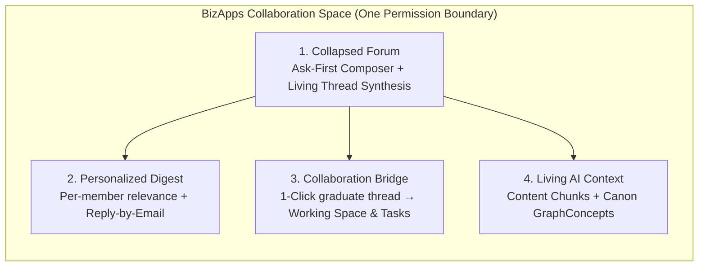
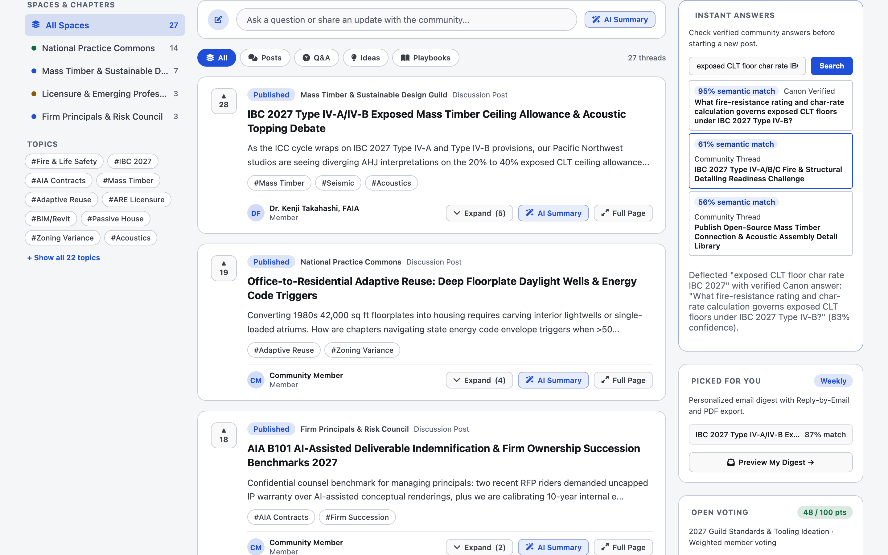
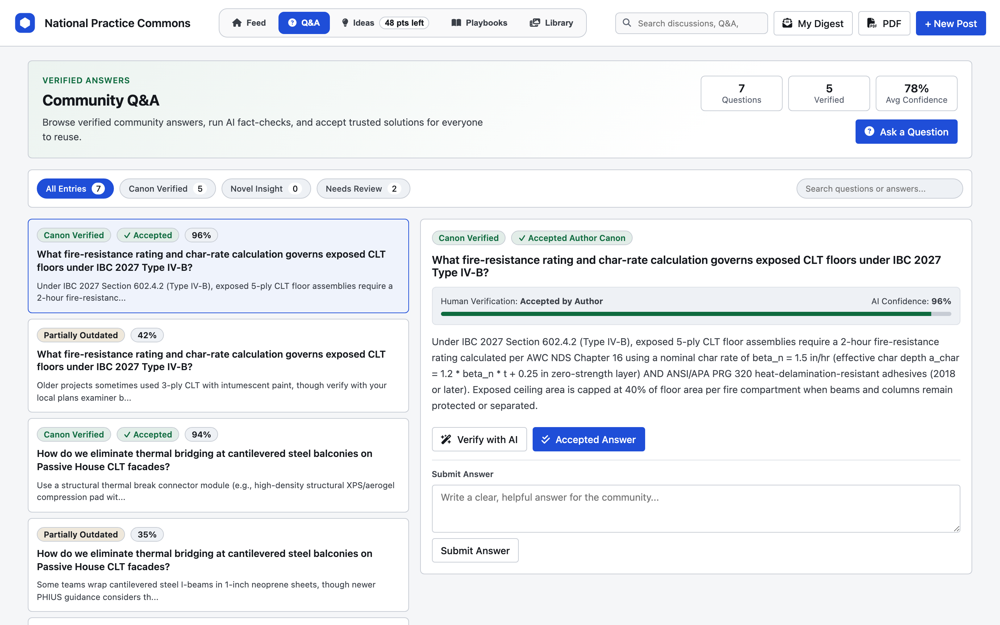
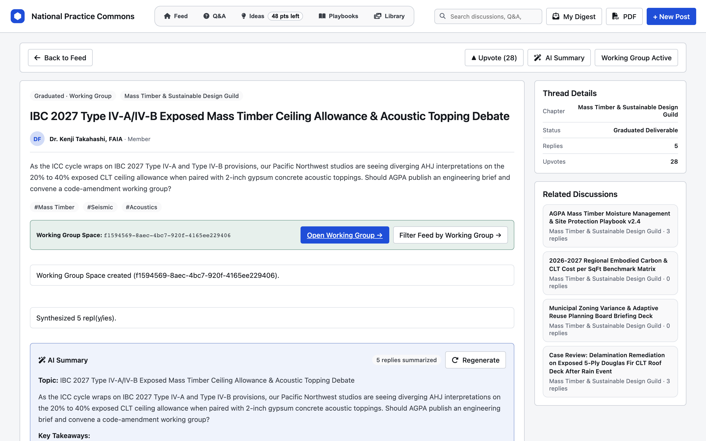
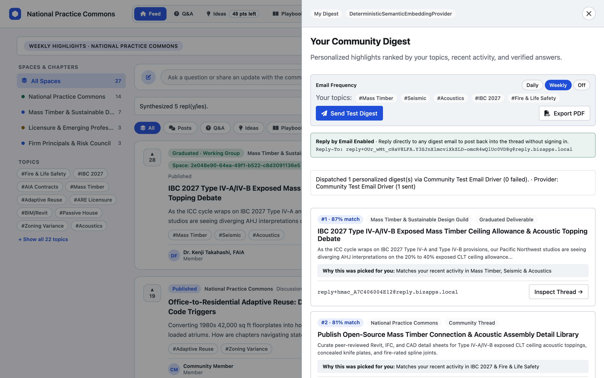
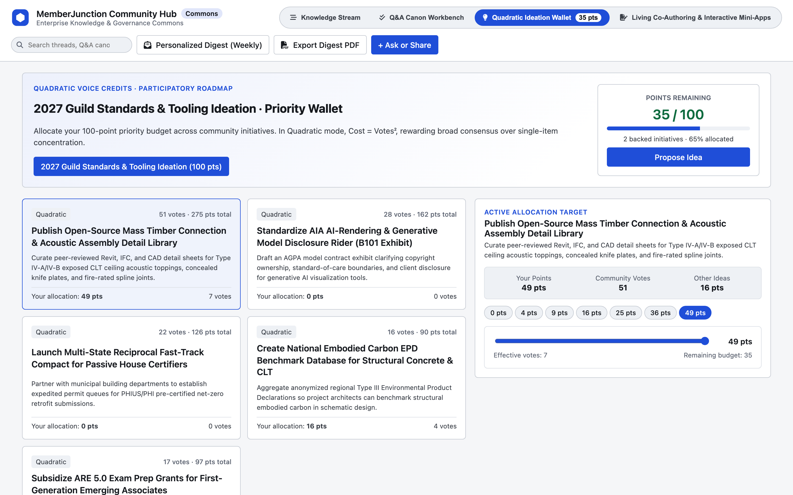
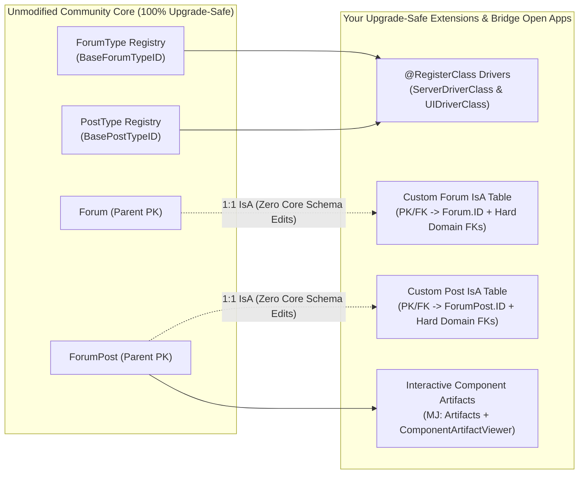

  <picture>
    <source media="(prefers-color-scheme: dark)" srcset="https://github.com/MemberJunction/MJ/raw/main/MJ_logo_dark.png">
    <source media="(prefers-color-scheme: light)" srcset="https://github.com/MemberJunction/MJ/raw/main/MJ_logo.webp">
    
  </picture>

<h1 align="center">Community</h1>

  <strong>AI-native discussions, self-collapsing threads, and personalized digests where every conversation stays in your database and makes your AI smarter.</strong>

  A free <a href="https://github.com/MemberJunction/MJ">MemberJunction</a> Open App built on <a href="https://github.com/MemberJunction/bizapps-collaboration">BizApps Collaboration</a> 
  for professional associations, trade groups, chapters, cohorts, and member organizations.

  
  
  
  

  <a href="#why-community">Why</a> &middot;
  <a href="#four-ideas">Four ideas</a> &middot;
  <a href="#feature-showcase">Showcase</a> &middot;
  <a href="#built-for">Built for</a> &middot;
  <a href="#features">Features</a> &middot;
  <a href="#how-it-works">How it works</a> &middot;
  <a href="#extend-it">Extend it</a> &middot;
  <a href="#quality--verification">Quality</a> &middot;
  <a href="#roadmap">Roadmap</a> &middot;
  <a href="docs/COMMUNITY_GUIDE.md">Feature Guide</a> &middot;
  <a href="scripts/world/README.md">ARCH-WORLD</a>

---

## Why Community

Every member organization runs on the knowledge of its people: how peers solve regulatory changes, which templates actually work in practice, what questions keep coming up across chapters, and who in the membership has done the work before.

Yet traditional online forums trap that institutional memory in a separate silo and bury the answers inside 40-reply chronological threads full of *"+1"* and *"Following"*. Worse, because the forum lives outside your core data platform, your organization's AI agents cannot learn from what your members discussed yesterday without scraping public web pages or bypassing permissions.

**BizApps Community is our gift to the member-organization market: a completely free, open-code, AI-native community that runs inside your own MemberJunction instance.** Every discussion thread, peer solution, and shared document lives in your database, obeys the exact same permission boundary (`fnCollaborationAccess`) as your working spaces, and compounds the intelligence of every AI agent your organization runs—at zero software cost.

---

## Four ideas

1. **Collapsed by default, complete on demand.**
   A thread with 25 replies shouldn't require 12 minutes of scrolling to find the answer. When a discussion reaches threshold or resolves a question, **Community** maintains a **Living Thread Synthesis** (`AISummary`) at the top of the card—distilling the consensus takeaways, nuances, and shared files with inline citations back to the exact human replies. Low-signal acknowledgments (*"Thanks!"*, *"Following"*) collapse into reaction counters while every voice remains one click away.
2. **Ask first, post second.**
   As a member types a question in the composer, the space's AI checks years of past threads, library files (`SpaceItem`), and organizational Canon in real time—answering common questions immediately and, when the question is genuinely new, suggesting which subject-matter peers in the community to `@invite`.
3. **Tied into Collaboration in one click.**
   In legacy forums, high-energy discussions die inside a thread. Because **Community** is built directly on [**BizApps Collaboration**](https://github.com/MemberJunction/bizapps-collaboration), any forum thread can **graduate into a working Collaboration Space** (a task force, committee, or cohort) in one click—automatically inviting the thread's contributors as `SpaceMember` seats, mounting shared attachments into the Space Library (`SpaceItem`), and seeding initial `BizApps Tasks`.
4. **Your inbox and your AI share the same context.**
   Members who live in email get a **personalized daily or weekly brief** ranked by their profile, tags, and peer affinity—with **zero-login reply-by-email** (`Reply-To: reply+<token>`). Meanwhile, every approved post and synthesis flows into `MJ: Content Item Chunks` and your organizational Canon (`MJ: Graph Concepts`), strictly bounded by `fnCollaborationAccess(@UserID)` and `agentMayQuote`.

---

## Feature Showcase

Captured directly from the compiled Angular 21 `CommunityHubResource` running against the **American Guild of Practicing Architects (`ARCH-WORLD`)** showcase dataset with `0` console/page errors and `0` WCAG 2.1 AA violations. See the [**Feature & Architecture Showcase Guide (`docs/COMMUNITY_GUIDE.md`)**](docs/COMMUNITY_GUIDE.md) for deep architectural walkthroughs and Mermaid sequence diagrams.

### 1. Knowledge Stream & Hybrid Semantic Ask-First Deflection

*3-column Knowledge Stream with dynamic Spaces & Topic Tags on the left, multi-turn discussions in the center, and real-time hybrid semantic Ask-First deflection (`0.65` cosine + `0.35` lexical/tag + epistemic boost) on the right.*

### 2. Verified Q&A Canon Workbench (Epistemic Grading)

*Dual human + AI epistemic answer grading (`Canon Verified` >= 0.85 vs. `Partially Outdated`), confidence rubric bars, single-accepted-answer server enforcement, and 1-click Canon promotion.*

### 3. Living Thread Synthesis & Idempotent 1-Click Graduation

*Slide-over Thread Detail Drawer distilling multi-turn debates into structured Key Takeaways, Open Questions, and `[n]` Contributor Citations, paired with idempotent 1-click graduation into a BizApps Collaboration Working Space.*

### 4. Embedding-Personalized Digest & HMAC Reply-by-Email

*Per-member embedding-ranked brief with `"Why this was picked for you"` explanations, `UserInfoEngine.Instance` cadence persistence, MJ `CommunicationEngine` dispatch (`CommunityTestCommunicationProvider`), and RFC 5321 compact HMAC-SHA256 `Reply-To` tokens.*

### 5. Quadratic Ideation Wallet ($\text{Cost} = \text{Votes}^2$)

*100-point campaign-isolated priority wallets enforcing $\text{Cost} = \text{Votes}^2$ with refund-on-revote atomic `TransactionGroup` persistence.*

---

## Built for

| | |
|---|---|
| 🌐 **Open member forums & Q&A** | Peer-to-peer problem solving across your entire membership, where resolved threads become living, cited answers instead of buried archive pages. |
| 🗺️ **Chapters & regional networks** | Each chapter space combines local discussions, shared templates, and local events while inheriting national playbooks and permissions. |
| 🔬 **Special interest groups & sections** | Practice areas, technical sections, and role-based peer networks synced automatically from your membership records (`SpaceMember.SyncSource`). |
| ⚡ **Working task forces spun from discussions** | Start a broad conversation in the forum; when 10 members want to co-author a standard or comment letter, spin up a child Collaboration Space with tasks and a shared library in one click. |
| 🎓 **Learning cohorts & masterminds** | Pair structured cohort spaces with topic channels, peer Q&A, and personalized weekly syntheses. |

---

## Features

Community is pre-release (`0.1.0`). ✅ is designed in the baseline specification, 🚧 is in active build, and 🗺️ is planned on the [roadmap](#roadmap).

### Discussions, Epistemic Q&A, Docs Co-Authoring & Interactive Posts

| | Feature |
|---|---|
| ✅ | **Ask-First Composer:** `Community.AskFirstDeflection` fuses semantic embedding cosine similarity (`0.65`) with stemmed lexical/tag overlap (`0.35`) and epistemic canon boosts (`Verified > Accepted > Unverified`), surfaced live while typing by `AskFirstDeflectionWidgetComponent` and `CommunityHubResource`'s Ask/Share modal. |
| ✅ | **Living Thread Synthesis (`AISummary`):** `Community.LivingThreadSynthesis` rebuilds a bounded (`MaxReplyCount`/`MaxCharsPerPost`) executive-summary markdown with structured `KeyTakeaways`, `OpenQuestions`, and `ContributorCitations` (`[n]` attribution), rendered cleanly inside the thread detail drawer. |
| ✅ | **Dual Human + AI Epistemic Answer Grading (`ForumQuestionPost` & `ForumAnswerPost`):** the Q&A single-accepted-answer invariant is enforced server-side (`AnswerPostServerDriver.ValidateAcceptedAnswerChange`), and `Community.EpistemicAnswerGrading` grades every answer 0.000–1.000, setting `VerificationStatus = 'AI_Verified'` only at or above 0.85. |
| ✅ | **Participatory Point-Allocation & Quadratic Ideation (`ForumIdeaCampaign` & `ForumIdeaPost`):** `100-point` member wallets and Quadratic Voting ($\text{Cost} = \text{Votes}^2$) are enforced both server-side (`IdeaPostServerDriver.ValidateAllocationChange`, with refund-on-revote) and live client-side (`QuadraticVotingSliderComponent`). |
| 🚧 | **Native Polls & Structured Intakes (`ForumFormPost`):** hard-FK integration with **`BizApps Forms`** (`__mj_BizAppsForms`) for inline single-click polls, multi-question surveys, and structured case intakes. |
| 🚧 | **MJ Core Collaborative Docs, Slides & Sheets (`ForumArtifactPost`):** live Yjs co-editing on `MJ: Artifacts` (`.doc.md`, `.slides.json`, `.sheet.json`) with passage-anchored comment threads, AI `Suggest` redlines, and custom Community `BaseDocumentBlock` embeds. |
| 🚧 | **AI-Generated Interactive Component Artifacts (`ForumInteractivePost`):** describe a trivia challenge, compliance simulation, or ROI calculator in natural language and let the AI Assistant generate a versioned **`MJ: Artifact` (`ArtifactType = 'Component'`)** rendered via `@memberjunction/ng-artifacts` (`ComponentArtifactViewerComponent`) with built-in storage, version history, permission checks, and live leaderboards (`ForumInteractiveSession`). |

### Personalized Digests & Reply-by-Email

| | Feature |
|---|---|
| ✅ | **Per-Member Personalized Brief (`CommunityEmbeddingPersonalizationService` + `Community.SendPersonalizedDigest`):** ranks candidate threads per member using pluggable `ICommunityEmbeddingProvider` (`DeterministicSemanticEmbeddingProvider` out of the box, or MJ `AIEngine` embeddings at runtime), recency half-life decay, epistemic boosts, and diversity-aware re-ranking—with `"Why this was picked for you"` explanations surfaced both in email and inside `CommunityHubResource`'s **Personalized Digest** preview drawer. |
| ✅ | **MJ `CommunicationEngine` Integration & Test Driver (`CommunityTestCommunicationProvider`):** dispatches personalized HTML + plaintext digest emails through MemberJunction's `CommunicationEngine` and `BaseCommunicationProvider` (`'Community Test Email Driver'` for zero-credential CI/E2E/staging verification). |
| ✅ | **Zero-Login Inbound Reply-by-Email (`Community.ProcessInboundDigestReply`):** every digest item carries an HMAC-SHA256 signed `Reply-To` token (`reply+<payload>.<sig>@<domain>`) binding member, forum, root post, email, and TTL. Inbound replies verify the signature, re-check server-side `Forum`/`ForumMember` posting permissions, strip quoted email chrome, and persist a reply `ForumPost`. |

### Collaboration Bridge, Anonymous Access & AI Context

| | Feature |
|---|---|
| ✅ | **1-Click "Spin Up Working Space":** `ThreadGraduationService.ValidateAndBuildGraduationPlan` promotes any active `ForumPost` thread into a child Collaboration `Space` (`PromotedToSpaceID`) with contributor seats and starter tasks — idempotent, so re-graduating an already-promoted thread returns the existing Space rather than creating a duplicate. |
| 🚧 | **Configurable Anonymous Access (`None` \| `TeaserOnly` \| `FullRead`):** `CommunityPublicEdgeService` projects teaser-truncated public threads server-side; the `/community` route and SEO `QAPage` JSON-LD are not yet built. |
| ✅ | **1-Click "Promote to Canon":** `ThreadGraduationService.ValidateAndBuildCanonPromotion` promotes a Q&A answer into the forum's Knowledge Canon (`ForumQuestionPost.AICanonAnswerPostID`), access-checked to the question author or a forum moderator and idempotent against the question's current canon answer. |
| ✅ | **Database-Level Permission Boundary:** all forum and post reads evaluate `__mj_BizAppsCommunity.fnCommunityForumAccess(@UserID)` and `__mj_BizAppsCollaboration.fnCollaborationAccess(@UserID)` across `Team` and `Shared` bands. |

---

## How it works

`BizApps Community` installs into schema `__mj_BizAppsCommunity` and builds on four hard upstream dependencies—[`BizApps Collaboration`](https://github.com/MemberJunction/bizapps-collaboration), `BizApps Common`, `BizApps Tasks`, and `BizApps Forms`—using **100% hard SQL `FOREIGN KEY` constraints** and MemberJunction's `IsA` entity inheritance:

| Table | Role |
|---|---|
| `CommunitySpace` | `IsA` shared-primary-key extension on `__mj_BizAppsCollaboration.Space(ID)` holding community-wide settings (`Slug`, `CommunityKind`, `AnonymousReadMode`, `AskFirstEnabled`, `DefaultDigestCadence`). |
| `ForumType` & `Forum` | Extensible forum container registry (`ServerDriverClass`, `UIDriverClass`, `ExtensionEntity` `IsA` child table) and hierarchical `Forum` channels (`ParentForumID`, `VisibilityBand`, `PostingPolicy`). |
| `ForumRoleType` & `ForumMember` | Per-forum participant roles (`forum-admin`, `moderator`, `topic-host`, `expert-reviewer`, `contributor`, `observer`, `muted`) with explicit capability bit flags and domain-expert vote weight multipliers. |
| `PostType` & `ForumPost` | Extensible post plug-in registry (`PlacementRule` `Root Only \| Reply Only \| Both`, `ExtensionEntity` `IsA` child table) and unified `ForumPost` base table for root posts and replies, with polymorphic entity links (`LinkedEntityID` + `LinkedRecordID`). |
| `ForumQuestionPost` & `ForumAnswerPost` | `IsA` `ForumPost` subtype tables for Q&A questions and dual human/AI epistemic rubric-graded answers. |
| `ForumIdeaCampaign` & `ForumIdeaPost` | `IsA` `Forum` and `IsA` `ForumPost` subtype tables for 100-point budget allocation and quadratic voting (`ForumIdeaAllocation`). |
| `ForumFormPost` | `IsA` `ForumPost` subtype table with hard SQL Foreign Keys to `__mj_BizAppsForms.Form(ID)` and `FormDistribution(ID)`. |
| `ForumArtifactPost` | `IsA` `ForumPost` subtype table with hard SQL Foreign Keys to `__mj.Artifact(ID)`, `__mj.ArtifactVersion(ID)`, and `__mj_BizAppsCollaboration.SpaceItem(ID)` for live Yjs co-edited Docs, Slides, and Sheets. |
| `ForumInteractivePost` & `ForumInteractiveSession` | `IsA` `ForumPost` subtype table with hard SQL Foreign Keys to `__mj.Artifact(ID)` (`ComponentArtifactID`), `__mj.ArtifactVersion(ID)`, and `__mj_BizAppsCollaboration.SpaceItem(ID)`—storing and rendering AI-generated interactive games, simulations, and calculators as versioned **Interactive Component Artifacts** (`ComponentArtifactViewerComponent`) with version-tracked session leaderboards. |

### Packages Topology

| Package | Role | Key Exports |
|---|---|---|
| `@mj-biz-apps/community-core` | Pure domain rules & math | Band permissions, quadratic voting calculations, Living Thread Synthesis thresholds, anonymous post redaction, 4-tier configuration cascade. |
| `@mj-biz-apps/community-entities` | Subtype directory & resolvers | `ForumSubtypeDirectory`, `PostSubtypeDirectory`, `EntitySubtypeResolver` registrations for dynamic `IsA` typing. |
| `@mj-biz-apps/community-engine-base` | Browser-safe metadata engine | `CommunityEngineBase` with O(1) in-memory lookups, metadata cache, and 4-tier settings resolution shared across client and server. |
| `@mj-biz-apps/community-core-entities-server` | Server drivers & entity extensions | `BaseForumServerDriver`, `BasePostServerDriver`, `CommunitySpaceServerDriver`, `CommunityEngine`. |
| `@mj-biz-apps/community-actions` | Server actions | Ask-First deflection, Epistemic Answer Grading, Living Thread Synthesis, and PDF digest generation. |
| `@mj-biz-apps/community-server` | Host bootstrap & public edge | `LoadBizAppsCommunityServer`, `CommunityPublicEdgeService`, `ThreadGraduationService`, custom DocumentBlocks. |
| `@mj-biz-apps/community-ng-widgets` | Angular embeddable widgets | `BaseForumUIDriver`, `BasePostUIDriver`, `CommunitySpaceUIDriver`, `<mj-community-forum-card>`, `<mj-community-post-view>`. |
| `@mj-biz-apps/community-ng` | Angular Explorer surface & Hub | `LoadBizAppsCommunityClient`, `CommunityHubResource` (`BaseResourceComponent` with `<mj-page-layout>`), Dual Form Registration parity. |

---

## Extend it

### Why BizApps Community Is the Most Extensible Community Platform Ever Built — Without Forking Core

Historically, organizations choosing community software faced a false choice between two broken models:

| Traditional Approach | Why It Breaks Down |
|---|---|
| **1. Closed Legacy SaaS Black Boxes** | You are locked into rigid, vendor-hardcoded thread types and bolted-on widgets. You cannot add real relational tables, custom post mechanics, or domain-specific workflows—and your community data lives in someone else's silo. |
| **2. "Fork-and-Maintain" Open Source** | You get the source code, but the moment you add custom columns to core forum tables or patch server/UI files for your industry's workflows, **you violate core and break your upgrade path**. Every upstream release becomes a painful merge-conflict project. |
| **3. MemberJunction Upgrade-Safe Open App Extensibility (`BizApps Community`)** | Built from day one on MemberJunction's metadata, `IsA` table inheritance, and `@RegisterClass` polymorphism. **You extend schema, server logic, UI rendering, and AI behavior through first-class extension points without ever touching a single line of Community Core—so you stay 100% upgrade-safe forever.** |

See [**Extensibility Architecture (`docs/EXTENSIBILITY_PLAN.md`)**](docs/EXTENSIBILITY_PLAN.md) for full driver interfaces, ERDs, and SQL examples.

---

### Zero-CAC Higher Logic Wedge Architecture

`BizApps Community` delivers the complete association & member-community replacement wedge natively on MemberJunction with zero external SaaS seat fees:

1. **Embedding Personalization (`@mj-biz-apps/community-core`):** `CommunityEmbeddingPersonalizationService` (`BaseSingleton`) uses a pluggable `ICommunityEmbeddingProvider` (`DeterministicSemanticEmbeddingProvider` with 128-dim concept clusters + stemmed feature hashing + character trigrams out of the box, or MJ `AIEngine` embeddings at runtime) to build recency-decayed member interest profiles and re-rank candidate threads with diversity penalties and `"Why this was picked for you"` explanations.
2. **MJ `CommunicationEngine` Digest & Reply-by-Email (`@mj-biz-apps/community-actions`):** `Community.SendPersonalizedDigest` dispatches per-member HTML + plaintext digests through `CommunicationEngine` (`CommunityTestCommunicationProvider` registered as `'Community Test Email Driver'` for deterministic CI/staging testing). Each item carries an HMAC-SHA256 `Reply-To` token (`reply+<payload>.<sig>@<domain>`) verified by `Community.ProcessInboundDigestReply`, which re-checks server-side posting permissions, strips quoted email chrome, and appends a reply `ForumPost`.
3. **Hybrid Ask-First, Living Synthesis & 1-Click Graduation:** `AskFirstDeflectionAction` fuses semantic cosine similarity (`0.65`) with lexical/tag overlap (`0.35`) and epistemic canon boosts; `LivingThreadSynthesisAction` emits structured `KeyTakeaways`, `OpenQuestions`, and `ContributorCitations`; and `ThreadGraduationService.GraduateThreadToSpace` idempotently graduates threads into Collaboration `Spaces` carrying the synthesized summary onto the Space and starter `BizApps Tasks` task.
4. **Hub UX & `UserInfoEngine` Preferences (`@mj-biz-apps/community-ng`):** `CommunityHubResource` renders the **Personalized Digest** preview drawer, live semantic Ask-First deflection, structured synthesis citations, 1-click Working Space link, and persists cadence/topic/tab preferences via `UserInfoEngine.Instance`.

See [**Zero-CAC Higher Logic Wedge Specification (`.mj/specs/bizapps-community-zero-cac-higher-logic-wedge/spec.md`)**](.mj/specs/bizapps-community-zero-cac-higher-logic-wedge/spec.md).

---

## Quality & Verification

`BizApps Community` ships across **8 packages**, **25 entities** (the full `__mj_BizAppsCommunity` schema — `CommunitySpace`, `ForumType`, `PostType`, `ForumRoleType`, `Forum`, `ForumIdeaCampaign`, `ForumMember`, `ForumTopicTag`, `ForumPost` and its 8 `IsA` subtypes, `ForumInteractiveSession`, `ForumPostTag`, `ForumPostReaction`, `ForumPostAttachment`, `ForumIdeaAllocation`, `CommunityMemberProfile`, `ForumSubscription`, and `ForumPostFlag`), and **6 Community Actions** (`Community.AskFirstDeflection`, `Community.EpistemicAnswerGrading`, `Community.LivingThreadSynthesis`, `Community.ExportDigestPDF`, `Community.SendPersonalizedDigest`, `Community.ProcessInboundDigestReply`), each verified by `pnpm run test`:

- **Domain rules & drivers** (`@mj-biz-apps/community-core`, `-core-entities-server`): quadratic voting with refund-on-revote, the Q&A single-accepted-answer invariant, poll single/multi-choice enforcement, and Interactive Component attempt limits + per-`ScoringMode` leaderboard resolution — all pure-function tested, then re-verified through the real server drivers that call them.
- **`CommunityEngineBase`** (`@mj-biz-apps/community-engine-base`): a `BaseEngine<CommunityEngineBase>` subclass (matching `CollaborationEngineBase`) with `Config()`/`Load()`-backed metadata loading, O(1) ID/Code caches invalidated on every reload, and the full 4-tier configuration cascade (`ForumType.Configuration -> Space.Configuration -> Forum.Configuration -> PostType.Configuration`).
- **`CommunityHubResource`** (`@mj-biz-apps/community-ng`): the `Application.DefaultNavItems` `CommunityHubResource` driver — `@RegisterClass(BaseResourceComponent, 'CommunityHubResource')`, `OnPush`, wrapped in `<mj-page-layout>`, `NotifyLoadStarted` deferred out of `ngOnInit` via `queueMicrotask` — hosting the 4 Community Hub tabs (Knowledge Stream, Q&A Canon Workbench, Quadratic Ideation Wallet, Living Co-Authoring & Interactive Mini-Apps), the Ask-First and Quadratic Voting widgets, and a Digest PDF export button that calls `Community.ExportDigestPDF` via `GraphQLActionClient` (never `window.print()`).
- **Dual Form Registration Parity**: all 25 entities retain an active, uncommented `@RegisterClass(BaseFormComponent, '<EntityName>')` class, verified by reading the compiled source (the real `@memberjunction/ng-shared` dependency chain needs an Angular-CLI bundler to resolve, which this repo's lightweight `node --test` runner does not have).
- **`--mj-*` design tokens**: zero raw `#hex` / `rgb()` / `rgba()` / `hsl()` color literals across every `.ts`/`.html`/`.css` file in `@mj-biz-apps/community-ng` and `-ng-widgets` (outside CodeGen's own `generated/` output), enforced by a regex scan.
- **Headless Playwright + axe-core WCAG 2.1 AA** (`e2e/community-hub.spec.mjs`, `pnpm run test:e2e`): drives a real Chromium browser through all 4 Hub tabs, keyboard navigation (arrow keys + Enter), the Ask-First widget, the Quadratic Voting slider (asserting `Cost = Votes^2` against the real `CommunityRules` math, not a re-implementation), the Digest export button, and the `ARCH-WORLD` 1440x900 marketing screenshot suite (`docs/screenshots/01-knowledge-stream-overview.png` through `05-quadratic-ideation-wallet.png`) — asserting `0` page errors, `0` console errors, and `0` critical/serious WCAG 2.1 AA violations, with reports and screenshots saved under `e2e/reports/`, `e2e/screenshots/`, and `docs/screenshots/`.
- **Architect Association World Model (`ARCH-WORLD`, `scripts/world/`)**: persistent deterministic integration and smoke-test dataset modeled after `ORD-WORLD` ([`scripts/world/README.md`](scripts/world/README.md)). Seeds **26 AGPA members** across 9 personas, **4 Community Spaces** (including a `Private`/`Team`-band Principals council), **12 Forums** across all **6 `ForumType` codes**, **22 Topic Tags**, **68 Posts & multi-turn threads** across all **13 `PostType` codes**, and **25 Quadratic Ideation allocations** via idempotent natural-key loading (`LoadArchitectAssociationWorld`) and a deliberate no-op `TeardownArchitectAssociationWorld` so consecutive test cycles and live smoke inspections run repeatably without destructive cleanup.
- **OpenApp v3 5-pillar readiness** (`scripts/openapp-readiness.mjs`, `pnpm run report:openapp-readiness`): `formParity`, `navParity`, `designTokens`, `seedDensity` (`scripts/seed-world.*`, `>= 25` records across 3 Collaboration Spaces), and the Playwright browser-smoke result above, consolidated into `e2e/reports/openapp-readiness-report.json`.
- **Seed & rehearsal workflows**: `scripts/seed-world.sql` / `.pg.sql` / `.mjs` seed the 3 demo Collaboration Spaces (Customer Community Portal, Partner & ISV Enablement Network, Internal Engineering Guild) across every `ForumType` and `PostType`; `scripts/pg-finalize.mjs` patches the PostgreSQL migration conversion's known gaps (skipped triggers, boolean-literal casts).
- **Zero downstream/sibling name leaks**: `node scripts/check-downstream-names.mjs` scans `packages/`, `metadata/`, and `migrations/` for a hardcoded `voting`/`issues`/`credentialing`/`sonar`/`accounting`-style name and exits non-zero if it finds one.

---

## Roadmap

| Phase | Focus |
|---|---|
| **Phase 1** | Core `IsA` schema (`__mj_BizAppsCommunity`), `ForumType` & `PostType` registries, 4-level configuration cascade, `fnCommunityForumAccess`, and `@mj-biz-apps/community-entities`. |
| **Phase 2** | `BaseForumServerDriver` & `BasePostServerDriver` runtime, `CommunityPublicEdge` (`/community` anonymous `TeaserOnly`/`FullRead`), Q&A epistemic rubric grading, and 100-point ideation wallets. |
| **Phase 3** | MJ Core Docs/Slides/Sheets live Yjs co-editing (`ForumArtifactPost` + custom `BaseDocumentBlock`s), `BizApps Forms` inline polls (`ForumFormPost`), and AI Interactive Component Artifact builder (`ForumInteractivePost` + `ComponentArtifactViewerComponent`). |
| **Phase 4** | Personalized digests, HMAC Reply-by-Email, downstream bridge Open Apps (`mj-bizapps-community-voting`, `mj-bizapps-community-issues`, `mj-bizapps-community-credentialing`), and health probes (`BIZAPPS.COMMUNITY.*`). |

---

## Documentation

- [**Feature & Architecture Showcase Guide (`docs/COMMUNITY_GUIDE.md`)**](docs/COMMUNITY_GUIDE.md) — Comprehensive walkthrough of Personalized Digests, HMAC Reply-by-Email, Hybrid Ask-First Deflection, Epistemic Q&A Canon, Living Thread Synthesis, 1-Click Graduation, Quadratic Voting, and `ARCH-WORLD` quickstart commands with embedded screenshots and Mermaid diagrams.
- [**Architect Association `ARCH-WORLD` World Model (`scripts/world/README.md`)**](scripts/world/README.md) — Entity graph, scale summary, natural-key idempotency contract, and persistent no-op teardown design for the American Guild of Practicing Architects (`ARCH-WORLD`) integration dataset.
- [**Master Architecture & Full IsA Schema Plan (`plans/plan.md`)**](plans/plan.md) — Complete SQL DDL, Mermaid ERDs, access TVF, and 7-Wave implementation blueprint.
- [**ForumType, PostType & Peer SpaceType Extensibility Plan (`docs/EXTENSIBILITY_PLAN.md`)**](docs/EXTENSIBILITY_PLAN.md) — Deep dive into `IsA` hard-FK subtype tables, 4-tier configuration cascade (`ForumOverridable`), per-forum roles, MJ Docs/Slides/Sheets integration, Interactive Component Artifacts, and peer Collaboration `SpaceType` interop.
- [**3 Divergent Interactive UX Concepts (`docs/ux/community-3-divergent-ux-concepts.html`)**](docs/ux/community-3-divergent-ux-concepts.html) — Interactive HTML showcase comparing 3 divergent UX philosophies (*Calm Knowledge Stream*, *Adaptive Bento + Split Workbench*, and *AI Concierge Portal + Canon Atlas*) uniting Community, Committees, Core Collaboration, and Secure Messaging.
- [**Interactive AI-Native Community UX Prototype (`docs/ux/interactive-community-prototype.html`)**](docs/ux/interactive-community-prototype.html) — Self-contained interactive HTML prototype of the Collapsed Forum, Ask-First Composer, Living Thread Synthesis, and Collaboration Space graduation flow.
- [**CLAUDE.md**](CLAUDE.md) — Metadata, migration, and workspace authoring rules.
