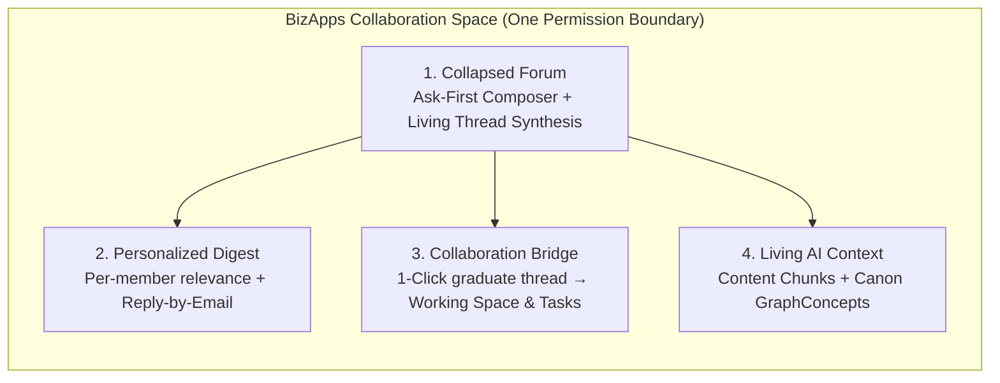

  <picture>
    <source media="(prefers-color-scheme: dark)" srcset="https://github.com/MemberJunction/MJ/raw/main/MJ_logo_dark.png">
    <source media="(prefers-color-scheme: light)" srcset="https://github.com/MemberJunction/MJ/raw/main/MJ_logo.webp">
    
  </picture>

<h1 align="center">Community</h1>

  <strong>AI-native discussions, self-collapsing threads, and personalized digests where every conversation stays in your database and makes your AI smarter.</strong>

  A free <a href="https://github.com/MemberJunction/MJ">MemberJunction</a> Open App built on <a href="https://github.com/MemberJunction/bizapps-collaboration">BizApps Collaboration</a> 
  for professional associations, trade groups, chapters, cohorts, and member organizations.

  
  
  
  

  <a href="#why-community">Why</a> &middot;
  <a href="#four-ideas">Four ideas</a> &middot;
  <a href="#built-for">Built for</a> &middot;
  <a href="#features">Features</a> &middot;
  <a href="#how-it-works">How it works</a> &middot;
  <a href="#extend-it">Extend it</a> &middot;
  <a href="#roadmap">Roadmap</a> &middot;
  <a href="#documentation">Docs</a>

---

## Why Community

Every member organization runs on the knowledge of its people: how peers solve regulatory changes, which templates actually work in practice, what questions keep coming up across chapters, and who in the membership has done the work before.

Yet traditional online forums trap that institutional memory in a separate silo and bury the answers inside 40-reply chronological threads full of *"+1"* and *"Following"*. Worse, because the forum lives outside your core data platform, your organization's AI agents cannot learn from what your members discussed yesterday without scraping public web pages or bypassing permissions.

**BizApps Community is our gift to the member-organization market: a completely free, open-code, AI-native community that runs inside your own MemberJunction instance.** Every discussion thread, peer solution, and shared document lives in your database, obeys the exact same permission boundary (`fnCollaborationAccess`) as your working spaces, and compounds the intelligence of every AI agent your organization runs—at zero software cost.

---

## Four ideas

1. **Collapsed by default, complete on demand.**
   A thread with 25 replies shouldn't require 12 minutes of scrolling to find the answer. When a discussion reaches threshold or resolves a question, **Community** maintains a **Living Thread Synthesis** (`AISummary`) at the top of the card—distilling the consensus takeaways, nuances, and shared files with inline citations back to the exact human replies. Low-signal acknowledgments (*"Thanks!"*, *"Following"*) collapse into reaction counters while every voice remains one click away.
2. **Ask first, post second.**
   As a member types a question in the composer, the space's AI checks years of past threads, library files (`SpaceItem`), and organizational Canon in real time—answering common questions immediately and, when the question is genuinely new, suggesting which subject-matter peers in the community to `@invite`.
3. **Tied into Collaboration in one click.**
   In legacy forums, high-energy discussions die inside a thread. Because **Community** is built directly on [**BizApps Collaboration**](https://github.com/MemberJunction/bizapps-collaboration), any forum thread can **graduate into a working Collaboration Space** (a task force, committee, or cohort) in one click—automatically inviting the thread's contributors as `SpaceMember` seats, mounting shared attachments into the Space Library (`SpaceItem`), and seeding initial `BizApps Tasks`.
4. **Your inbox and your AI share the same context.**
   Members who live in email get a **personalized daily or weekly brief** ranked by their profile, tags, and peer affinity—with **zero-login reply-by-email** (`Reply-To: reply+<token>`). Meanwhile, every approved post and synthesis flows into `MJ: Content Item Chunks` and your organizational Canon (`MJ: Graph Concepts`), strictly bounded by `fnCollaborationAccess(@UserID)` and `agentMayQuote`.

---

## Built for

| | |
|---|---|
| 🌐 **Open member forums & Q&A** | Peer-to-peer problem solving across your entire membership, where resolved threads become living, cited answers instead of buried archive pages. |
| 🗺️ **Chapters & regional networks** | Each chapter space combines local discussions, shared templates, and local events while inheriting national playbooks and permissions. |
| 🔬 **Special interest groups & sections** | Practice areas, technical sections, and role-based peer networks synced automatically from your membership records (`SpaceMember.SyncSource`). |
| ⚡ **Working task forces spun from discussions** | Start a broad conversation in the forum; when 10 members want to co-author a standard or comment letter, spin up a child Collaboration Space with tasks and a shared library in one click. |
| 🎓 **Learning cohorts & masterminds** | Pair structured cohort spaces with topic channels, peer Q&A, and personalized weekly syntheses. |

---

## Features

Community is pre-release (`0.1.0`). ✅ is designed in the baseline specification, 🚧 is in active build, and 🗺️ is planned on the [roadmap](#roadmap).

### Discussions & the Collapsed Forum UX

| | Feature |
|---|---|
| 🚧 | **Ask-First Composer:** real-time search over reachable threads, Space Library files (`SpaceItem`), and Canon concepts as the member types, with automatic expert `@invite` suggestions. |
| 🚧 | **Living Thread Synthesis (`AISummary`):** automatic, citation-backed summary of multi-reply threads with 1-click toggle between *Key Cited Replies* and *All Chronological Replies*. |
| 🚧 | **Noise Auto-Collapse:** short "+1 / Following / Thanks" replies fold into reaction strips so discussions stay clean and scannable. |
| 🚧 | **Thread Types:** `Discussion`, `Question` (with Accepted Answer), `Announcement`, `Idea`, and `Poll`. |
| 🚧 | **Unified Space Library Attachments:** every file attached to a post or inbound email is stored as a `SpaceItem` on `MJ: Files` and indexed by `ContentUploadIngestor`. |

### Personalized Digests & Reply-by-Email

| | Feature |
|---|---|
| 🗺️ | **Per-Member Personalized Brief:** each member's daily or weekly digest is scored individually using their `MJ: Content Item Tags` affinity vector, role/specialty attributes on `Person`, and thread velocity. |
| 🗺️ | **"Needs Your Expertise" Prompts:** digests highlight 1–2 unanswered peer questions that match the recipient's demonstrated expertise. |
| 🗺️ | **Zero-Login Inbound Reply-by-Email:** HMAC-authenticated `Reply-To` addresses let members reply to any thread—and attach files—directly from their email client. |

### Collaboration Bridge & AI Context

| | Feature |
|---|---|
| 🚧 | **1-Click "Spin Up Working Space":** promote any active `ForumThread` into a child Collaboration `Space` (`PromotedSpaceID`) with contributor seats, library files, and starter tasks. |
| 🗺️ | **1-Click "Promote to Canon":** graduate a resolved thread synthesis into an `MJ: Graph Concept` (`PromotedGraphConceptID`) with `SourcedFrom` provenance edges. |
| 🚧 | **Database-Level Permission Boundary:** all thread and post reads evaluate `__mj_BizAppsCollaboration.fnCollaborationAccess(@UserID)` across `Team` and `Shared` bands. |
| 🗺️ | **Built-In Health & Live Verification Probes:** ships `BIZAPPS.COMMUNITY.*` `GREEN` / `YELLOW` / `RED` health signals and rolled-back savepoint smoke tests. |

---

## How it works

`BizApps Community` installs into schema `__mj_BizAppsCommunity` as a companion Open App to [`BizApps Collaboration`](https://github.com/MemberJunction/bizapps-collaboration) (`__mj_BizAppsCollaboration`):

| Table | Role |
|---|---|
| `CommunitySpace` | IsA shared-primary-key extension on `__mj_BizAppsCollaboration.Space(ID)` holding community-specific settings (`Slug`, `DefaultDigestFrequency`, `ModerationMode`, `AllowInboundEmailPost`, `AutoCollapseThreshold`). |
| `ForumCategory` | Optional topic channels within a Space (`SpaceID`, `Band` `Team \| Shared`, `DefaultThreadType`, `Sequence`). |
| `ForumThread` | Discussion threads (`SpaceID`, `CategoryID`, `ThreadType`, `Band`, `Status`, `AcceptedPostID`, `AISummary`, `PromotedSpaceID`, `PromotedGraphConceptID`). |
| `ForumPost` | Posts and nested replies (`ThreadID`, `SpaceID`, `ParentPostID`, `AuthorUserID`, `AuthorPersonID`, `IsLowSignalNoise`, `PostedVia`, `Status`). |
| `ForumPostAttachment` | Join linking a `ForumPost` to a `__mj_BizAppsCollaboration.SpaceItem(ID)` so every attachment lives in the Space's Resource Library. |
| `ForumReaction` | Reactions (`Helpful`, `Like`, `Insightful`, `Agree`, `Endorse`) driving both peer recognition and synthesis ranking. |
| `ForumSubscription` & `ForumThreadFollow` | Per-space digest cadence, channel preferences, topic interest weights, and per-thread follow/mute overrides. |

---

## Extend it

Like every MemberJunction Open App, **Community** follows MJ's extensibility pattern:
- **Space Type Drivers:** `CommunitySpaceServerDriver` extends `BaseSpaceTypeServerDriver` and `CommunitySpaceUIDriver` extends `BaseSpaceTypeUIDriver`, contributing the **Discussions** tab to any `Community` space (and optionally to `Committee`, `Cohort`, or custom space types).
- **Entity Subclasses & Hooks:** Subclass `MJForumThreadEntityServer` or `MJForumPostEntityServer` via `@RegisterClass` to add custom pre/post save hooks, custom moderation classifiers, or custom digest scoring rules.

---

## Roadmap

| Phase | Focus |
|---|---|
| **Phase 1** | Core schema (`__mj_BizAppsCommunity`), RLS via `fnCollaborationAccess`, `CommunitySpaceServerDriver` & `CommunitySpaceUIDriver`, Ask-First Composer, Collapsed Living Synthesis cards, and 1-Click "Spin Up Working Space". |
| **Phase 2** | `ForumSubscription` relevance scoring engine, scheduled Personalized Daily/Weekly Digest generator, and HMAC-authenticated Inbound Reply-by-Email Server Extension. |
| **Phase 3** | AI-assisted moderation queue, Member & Expert Directory with expertise badges derived from accepted answers, and 1-Click "Promote to Canon (`GraphConcept`)". |
| **Phase 4** | Health probes (`BIZAPPS.COMMUNITY.*`), embeddable community widgets, and automated bulk archive import tooling. |

---

## Documentation

- [**Architecture & Implementation Plan**](plans/plan.md) — Detailed schema, driver contracts, digest scoring model, and phased build plan.
- [**Interactive AI-Native Community UX Prototype**](docs/ux/interactive-community-prototype.html) — Self-contained interactive HTML prototype of the Collapsed Forum, Ask-First Composer, Living Thread Synthesis, and Collaboration Space graduation flow.
- [**CLAUDE.md**](CLAUDE.md) — Metadata, migration, and workspace authoring rules.
