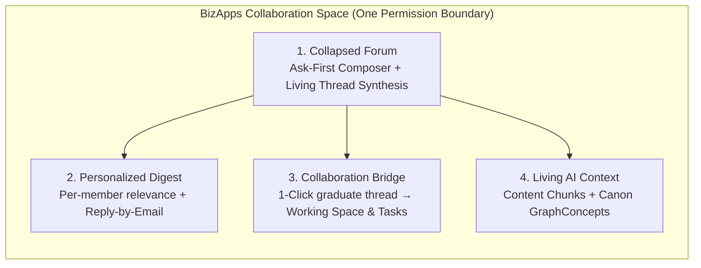

  <picture>
    <source media="(prefers-color-scheme: dark)" srcset="https://github.com/MemberJunction/MJ/raw/main/MJ_logo_dark.png">
    <source media="(prefers-color-scheme: light)" srcset="https://github.com/MemberJunction/MJ/raw/main/MJ_logo.webp">
    
  </picture>

<h1 align="center">Community</h1>

  <strong>AI-native discussions, self-collapsing threads, and personalized digests where every conversation stays in your database and makes your AI smarter.</strong>

  A free <a href="https://github.com/MemberJunction/MJ">MemberJunction</a> Open App built on <a href="https://github.com/MemberJunction/bizapps-collaboration">BizApps Collaboration</a> 
  for professional associations, trade groups, chapters, cohorts, and member organizations.

  
  
  
  

  <a href="#why-community">Why</a> &middot;
  <a href="#four-ideas">Four ideas</a> &middot;
  <a href="#built-for">Built for</a> &middot;
  <a href="#features">Features</a> &middot;
  <a href="#how-it-works">How it works</a> &middot;
  <a href="#extend-it">Extend it</a> &middot;
  <a href="#roadmap">Roadmap</a> &middot;
  <a href="#documentation">Docs</a>

---

## Why Community

Every member organization runs on the knowledge of its people: how peers solve regulatory changes, which templates actually work in practice, what questions keep coming up across chapters, and who in the membership has done the work before.

Yet traditional online forums trap that institutional memory in a separate silo and bury the answers inside 40-reply chronological threads full of *"+1"* and *"Following"*. Worse, because the forum lives outside your core data platform, your organization's AI agents cannot learn from what your members discussed yesterday without scraping public web pages or bypassing permissions.

**BizApps Community is our gift to the member-organization market: a completely free, open-code, AI-native community that runs inside your own MemberJunction instance.** Every discussion thread, peer solution, and shared document lives in your database, obeys the exact same permission boundary (`fnCollaborationAccess`) as your working spaces, and compounds the intelligence of every AI agent your organization runs—at zero software cost.

---

## Four ideas

1. **Collapsed by default, complete on demand.**
   A thread with 25 replies shouldn't require 12 minutes of scrolling to find the answer. When a discussion reaches threshold or resolves a question, **Community** maintains a **Living Thread Synthesis** (`AISummary`) at the top of the card—distilling the consensus takeaways, nuances, and shared files with inline citations back to the exact human replies. Low-signal acknowledgments (*"Thanks!"*, *"Following"*) collapse into reaction counters while every voice remains one click away.
2. **Ask first, post second.**
   As a member types a question in the composer, the space's AI checks years of past threads, library files (`SpaceItem`), and organizational Canon in real time—answering common questions immediately and, when the question is genuinely new, suggesting which subject-matter peers in the community to `@invite`.
3. **Tied into Collaboration in one click.**
   In legacy forums, high-energy discussions die inside a thread. Because **Community** is built directly on [**BizApps Collaboration**](https://github.com/MemberJunction/bizapps-collaboration), any forum thread can **graduate into a working Collaboration Space** (a task force, committee, or cohort) in one click—automatically inviting the thread's contributors as `SpaceMember` seats, mounting shared attachments into the Space Library (`SpaceItem`), and seeding initial `BizApps Tasks`.
4. **Your inbox and your AI share the same context.**
   Members who live in email get a **personalized daily or weekly brief** ranked by their profile, tags, and peer affinity—with **zero-login reply-by-email** (`Reply-To: reply+<token>`). Meanwhile, every approved post and synthesis flows into `MJ: Content Item Chunks` and your organizational Canon (`MJ: Graph Concepts`), strictly bounded by `fnCollaborationAccess(@UserID)` and `agentMayQuote`.

---

## Built for

| | |
|---|---|
| 🌐 **Open member forums & Q&A** | Peer-to-peer problem solving across your entire membership, where resolved threads become living, cited answers instead of buried archive pages. |
| 🗺️ **Chapters & regional networks** | Each chapter space combines local discussions, shared templates, and local events while inheriting national playbooks and permissions. |
| 🔬 **Special interest groups & sections** | Practice areas, technical sections, and role-based peer networks synced automatically from your membership records (`SpaceMember.SyncSource`). |
| ⚡ **Working task forces spun from discussions** | Start a broad conversation in the forum; when 10 members want to co-author a standard or comment letter, spin up a child Collaboration Space with tasks and a shared library in one click. |
| 🎓 **Learning cohorts & masterminds** | Pair structured cohort spaces with topic channels, peer Q&A, and personalized weekly syntheses. |

---

## Features

Community is pre-release (`0.1.0`). ✅ is designed in the baseline specification, 🚧 is in active build, and 🗺️ is planned on the [roadmap](#roadmap).

### Discussions, Epistemic Q&A, Docs Co-Authoring & Interactive Posts

| | Feature |
|---|---|
| 🚧 | **Ask-First Composer:** real-time search over reachable posts, Space Library files (`SpaceItem`), and Canon concepts as the member types, with automatic expert `@invite` suggestions. |
| 🚧 | **Living Thread Synthesis (`AISummary`):** automatic, citation-backed summary of multi-reply threads with 1-click toggle between *Key Cited Replies* and *All Chronological Replies*. |
| 🚧 | **Dual Human + AI Epistemic Answer Grading (`ForumQuestionPost` & `ForumAnswerPost`):** Stack Overflow-style `+1 / -1` voting (weighted by domain-expert roles) paired with an asynchronous MJ Agent Rubric grading Canon alignment, completeness, and temporal freshness. |
| 🚧 | **Participatory Point-Allocation & Quadratic Ideation (`ForumIdeaCampaign` & `ForumIdeaPost`):** `100-point` member wallets or Quadratic Voting ($\text{Cost} = \text{Votes}^2$) with demographic/tier slicing via `BizApps Common`. |
| 🚧 | **Native Polls & Structured Intakes (`ForumFormPost`):** hard-FK integration with **`BizApps Forms`** (`__mj_BizAppsForms`) for inline single-click polls, multi-question surveys, and structured case intakes. |
| 🚧 | **MJ Core Collaborative Docs, Slides & Sheets (`ForumArtifactPost`):** live Yjs co-editing on `MJ: Artifacts` (`.doc.md`, `.slides.json`, `.sheet.json`) with passage-anchored comment threads, AI `Suggest` redlines, and custom Community `BaseDocumentBlock` embeds. |
| 🚧 | **AI-Generated Interactive Games & Mini-Apps (`ForumInteractivePost`):** describe a trivia challenge, compliance simulation, or ROI calculator in natural language and let the AI Assistant spin up a live sandboxed `<mj-react-component>` with leaderboards inside the post. |

### Personalized Digests & Reply-by-Email

| | Feature |
|---|---|
| 🗺️ | **Per-Member Personalized Brief:** each member's daily or weekly digest is scored individually using their `MJ: Content Item Tags` affinity vector, role/specialty attributes on `Person`, and thread velocity. |
| 🗺️ | **"Needs Your Expertise" Prompts:** digests highlight 1–2 unanswered peer questions that match the recipient's demonstrated expertise. |
| 🗺️ | **Zero-Login Inbound Reply-by-Email:** HMAC-authenticated `Reply-To` addresses let members reply to any thread—and attach files—directly from their email client. |

### Collaboration Bridge, Anonymous Access & AI Context

| | Feature |
|---|---|
| 🚧 | **1-Click "Spin Up Working Space":** promote any active `ForumPost` thread into a child Collaboration `Space` (`PromotedSpaceID`) with contributor seats, library files, and starter tasks. |
| 🚧 | **Configurable Anonymous Access (`None` \| `TeaserOnly` \| `FullRead`):** public edge (`/community`) with SEO-friendly `QAPage` JSON-LD, teaser reply truncation, and intent-preserving login gates. |
| 🗺️ | **1-Click "Promote to Canon":** graduate a resolved thread synthesis or co-authored artifact into an `MJ: Graph Concept` with `SourcedFrom` provenance edges. |
| 🚧 | **Database-Level Permission Boundary:** all forum and post reads evaluate `__mj_BizAppsCommunity.fnCommunityForumAccess(@UserID)` and `__mj_BizAppsCollaboration.fnCollaborationAccess(@UserID)` across `Team` and `Shared` bands. |

---

## How it works

`BizApps Community` installs into schema `__mj_BizAppsCommunity` and builds on four hard upstream dependencies—[`BizApps Collaboration`](https://github.com/MemberJunction/bizapps-collaboration), `BizApps Common`, `BizApps Tasks`, and `BizApps Forms`—using **100% hard SQL `FOREIGN KEY` constraints** and MemberJunction's `IsA` entity inheritance:

| Table | Role |
|---|---|
| `CommunitySpace` | `IsA` shared-primary-key extension on `__mj_BizAppsCollaboration.Space(ID)` holding community-wide settings (`Slug`, `AnonymousAccessMode`, `Configuration`). |
| `ForumType` & `Forum` | Extensible forum/sub-forum container registry (`ServerDriverClass`, `UIDriverClass`, `ForumExtensionEntity` `IsA` child table) and hierarchical `Forum` channels (`ParentForumID`, `Band`, `Configuration`). |
| `ForumRoleType` & `ForumMemberRole` | Per-forum participant roles (`forum-admin`, `moderator`, `topic-host`, `expert-reviewer`) with sub-forum inheritance and domain-expert vote weight multipliers. |
| `PostType` & `ForumPost` | Extensible post plug-in registry (`AllowedPlacement` `RootOnly \| ReplyOnly \| Both`, `PostExtensionEntity` `IsA` child table) and unified `ForumPost` base table for both root posts (`ParentPostID IS NULL`) and replies. |
| `ForumQuestionPost` & `ForumAnswerPost` | `IsA` `ForumPost` subtype tables for Q&A questions and dual human/AI epistemic rubric-graded answers. |
| `ForumIdeaCampaign` & `ForumIdeaPost` | `IsA` `Forum` and `IsA` `ForumPost` subtype tables for 100-point budget allocation (`ForumIdeaWallet`) and quadratic voting (`ForumIdeaAllocation`). |
| `ForumFormPost` | `IsA` `ForumPost` subtype table with hard SQL Foreign Keys to `__mj_BizAppsForms.Form(ID)` and `FormDistribution(ID)`. |
| `ForumArtifactPost` | `IsA` `ForumPost` subtype table with hard SQL Foreign Keys to `__mj.Artifact(ID)`, `__mj.ArtifactVersion(ID)`, and `__mj_BizAppsCollaboration.SpaceItem(ID)` for live Yjs co-edited Docs, Slides, and Sheets. |
| `ForumInteractivePost` & `ForumInteractiveSession` | `IsA` `ForumPost` subtype table and session leaderboard log for AI-generated interactive games, simulations, and calculators hosted in `<mj-react-component>`. |

---

## Extend it

Following the exact extensibility model of [`BizApps Collaboration`](https://github.com/MemberJunction/bizapps-collaboration), **Community** is extensible along two axes without touching core tables or adding soft polymorphic keys:

1. **Forum Types (`ForumType`) & Post Types (`PostType`):** Register a `BaseForumServerDriver` / `BaseForumUIDriver` or `BasePostServerDriver` / `BasePostUIDriver` via `@RegisterClass` and attach a 1:1 `IsA` child table (`ForumExtensionEntity` or `PostExtensionEntity`) with real SQL Foreign Keys.
2. **4-Level Settings Cascade:** Configure allowed `PostType`s and feature switches at Global (`MJ: Application Settings`) → `ForumType.Configuration` → `CommunitySpace.Configuration` → `Forum.Configuration` (cascading down `ParentForumID` sub-forums).
3. **Downstream Bridge Open Apps (`mj-bizapps-community-*`):** Optional sibling domains (`mj-bizapps-community-voting`, `mj-bizapps-community-issues`, `mj-bizapps-community-credentialing`) ship as downstream bridge Open Apps that depend on both apps and declare `IsA` subtype tables (`ForumVotingAssembly`, `ForumBallotPost`, `ForumIssuePost`) with enforced SQL Foreign Keys.

See [**Extensibility Architecture (`docs/EXTENSIBILITY_PLAN.md`)**](docs/EXTENSIBILITY_PLAN.md) for full driver interfaces, ERDs, and SQL examples.

---

## Roadmap

| Phase | Focus |
|---|---|
| **Phase 1** | Core `IsA` schema (`__mj_BizAppsCommunity`), `ForumType` & `PostType` registries, 4-level configuration cascade, `fnCommunityForumAccess`, and `@mj-biz-apps/community-entities`. |
| **Phase 2** | `BaseForumServerDriver` & `BasePostServerDriver` runtime, `CommunityPublicEdge` (`/community` anonymous `TeaserOnly`/`FullRead`), Q&A epistemic rubric grading, and 100-point ideation wallets. |
| **Phase 3** | MJ Core Docs/Slides/Sheets live Yjs co-editing (`ForumArtifactPost` + custom `BaseDocumentBlock`s), `BizApps Forms` inline polls (`ForumFormPost`), and AI Interactive Game/Mini-App builder (`ForumInteractivePost`). |
| **Phase 4** | Personalized digests, HMAC Reply-by-Email, downstream bridge Open Apps (`mj-bizapps-community-voting`, `mj-bizapps-community-issues`, `mj-bizapps-community-credentialing`), and health probes (`BIZAPPS.COMMUNITY.*`). |

---

## Documentation

- [**Master Architecture, Full IsA Schema & Work Plan (`plans/plan.md`)**](plans/plan.md) — Complete 33-table SQL DDL, Mermaid ERDs, anonymous access TVF, and phased engineering plan.
- [**ForumType & PostType Extensibility Plan (`docs/EXTENSIBILITY_PLAN.md`)**](docs/EXTENSIBILITY_PLAN.md) — Deep dive into `IsA` hard-FK subtype tables, 4-level configuration cascade, per-forum roles, MJ Docs/Slides/Sheets integration, AI interactive games, and downstream bridge Open Apps.
- [**Interactive AI-Native Community UX Prototype (`docs/ux/interactive-community-prototype.html`)**](docs/ux/interactive-community-prototype.html) — Self-contained interactive HTML prototype of the Collapsed Forum, Ask-First Composer, Living Thread Synthesis, and Collaboration Space graduation flow.
- [**CLAUDE.md**](CLAUDE.md) — Metadata, migration, and workspace authoring rules.

