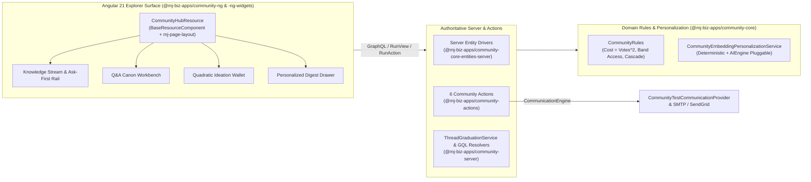
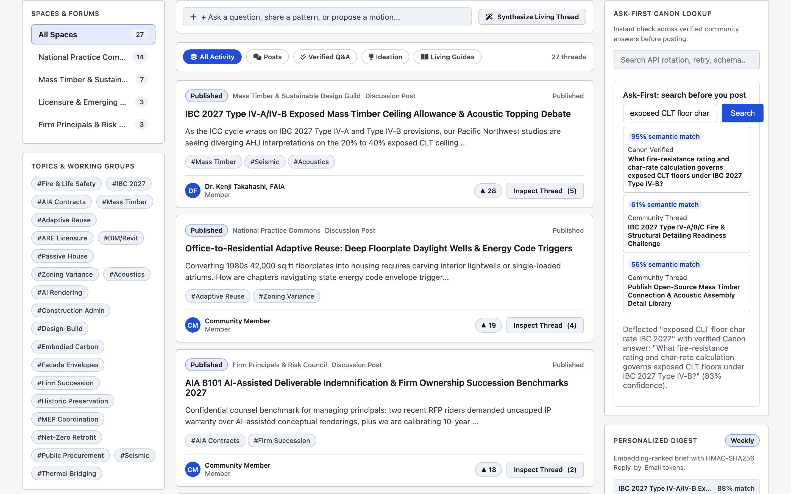
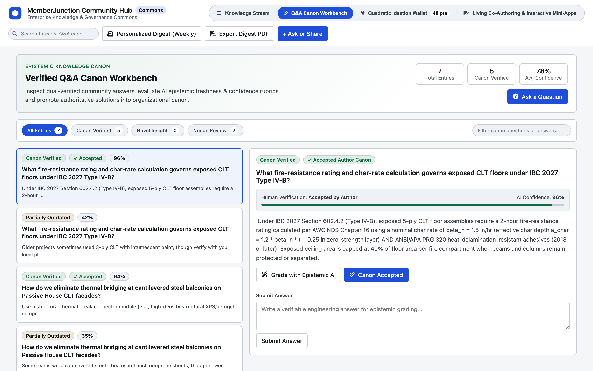
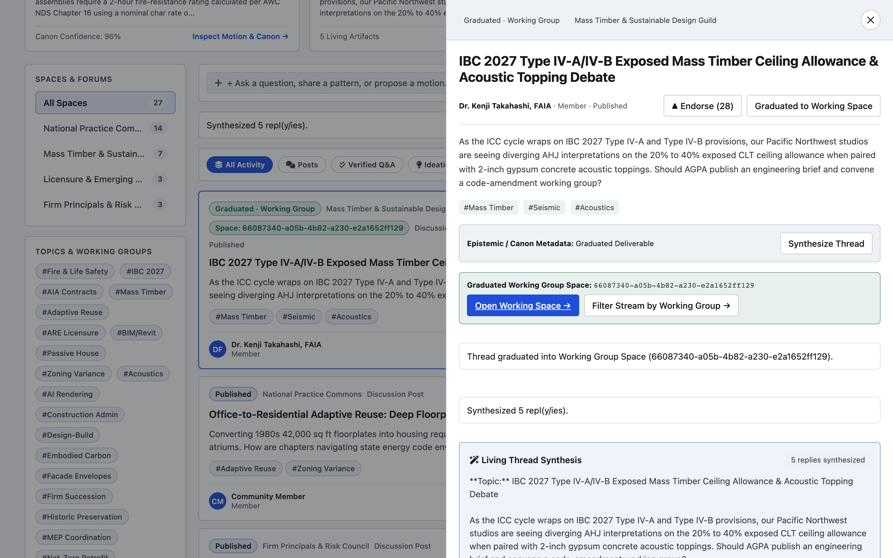
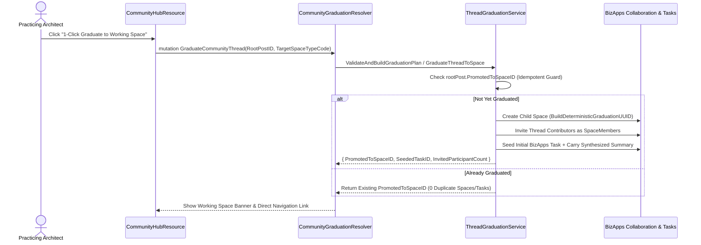
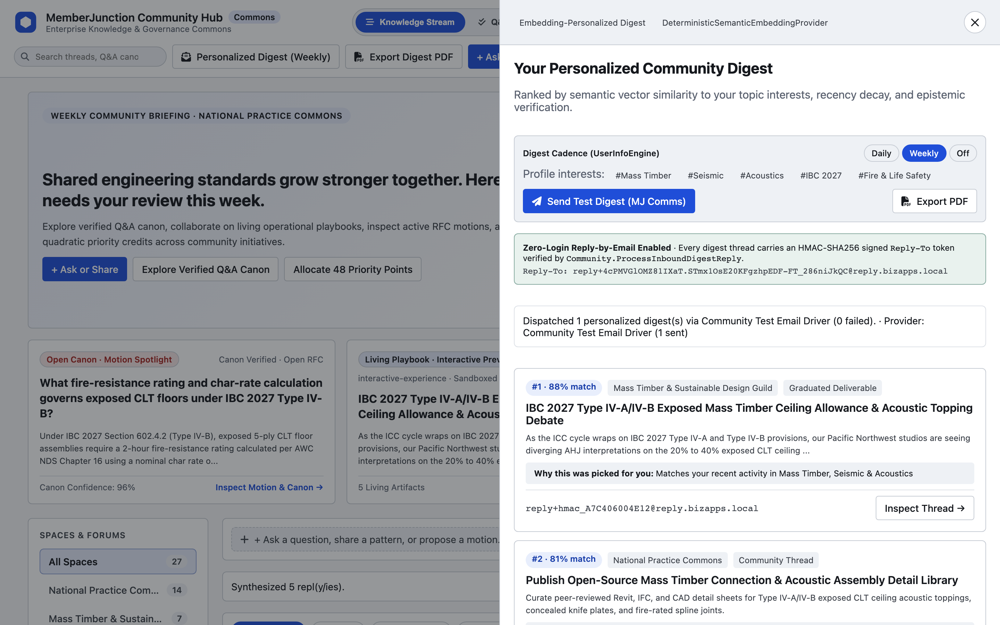
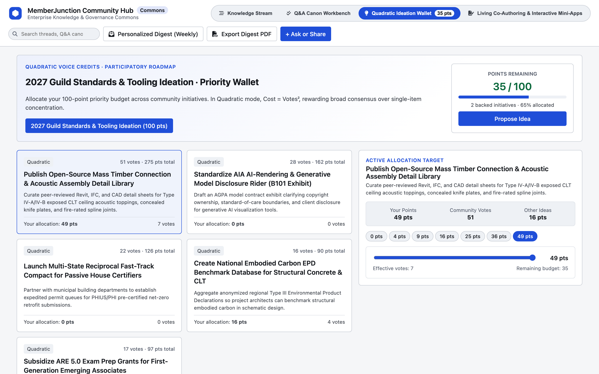

# BizApps Community — Feature & Architecture Showcase Guide

**BizApps Community** (`@mj-biz-apps/community-*`) is an AI-native, upgrade-safe MemberJunction Open App built directly on [**BizApps Collaboration**](https://github.com/MemberJunction/bizapps-collaboration) inside schema `__mj_BizAppsCommunity`. Every discussion, verified Q&A canon entry, living synthesis, quadratic vote, and email reply lives inside your MemberJunction database under one unified permission boundary (`fnCommunityForumAccess` + `fnCollaborationAccess`) and feeds your AI agents directly.

This guide walks through each flagship capability, the underlying TypeScript / GraphQL / Action architecture, and the **American Guild of Practicing Architects (`ARCH-WORLD`)** persistent integration & showcase dataset.

---

## Table of Contents

1. [Platform Showcase & Core Architecture](#1-platform-showcase--core-architecture)
2. [Knowledge Stream & Hybrid Semantic Ask-First Deflection](#2-knowledge-stream--hybrid-semantic-ask-first-deflection)
3. [Epistemic Q&A Canon Workbench](#3-epistemic-qa-canon-workbench)
4. [Living Thread Synthesis & Idempotent 1-Click Working Space Graduation](#4-living-thread-synthesis--idempotent-1-click-working-space-graduation)
5. [Embedding-Personalized Digest & Zero-Login HMAC Reply-by-Email Loop](#5-embedding-personalized-digest--zero-login-hmac-reply-by-email-loop)
6. [Quadratic Ideation Wallet & Voice-Credit Allocation](#6-quadratic-ideation-wallet--voice-credit-allocation)
7. [`ARCH-WORLD` Persistent Integration & Smoke-Test Dataset](#7-arch-world-persistent-integration--smoke-test-dataset)
8. [Quickstart: Loading `ARCH-WORLD` & Running All Verification Suites](#8-quickstart-loading-arch-world--running-all-verification-suites)

---

## 1. Platform Showcase & Core Architecture

BizApps Community spans **8 workspace packages**, **25 entities** in `__mj_BizAppsCommunity`, and **6 MemberJunction Actions**, compiled and verified across SQL Server (`migrations/`) and PostgreSQL (`migrations-pg/`) dialects:



---

## 2. Knowledge Stream & Hybrid Semantic Ask-First Deflection



### How Hybrid Semantic Ask-First Deflection Works

Traditional forums let members post duplicate questions and wait hours for answers that already exist in institutional memory. **Community.AskFirstDeflection** (`AskFirstDeflectionAction`) intercepts questions *while the member types*—in both the right-rail **Ask-First Canon Lookup** (`AskFirstDeflectionWidgetComponent`) and the **`+ Ask or Share`** composer modal:

1. **Pluggable Semantic Vector Similarity (`0.65` weight)**: Uses `ICommunityEmbeddingProvider` (`DeterministicSemanticEmbeddingProvider` 128-dimensional concept-cluster + stemmed feature-hash + trigram vectors out of the box, or MJ `AIEngine` embeddings at runtime) to compute `CosineSimilarity` against candidate threads, Q&A answers, and playbooks within the member's authorized `AllowedForumIDs`.
2. **Stemmed Lexical & Tag Overlap (`0.35` weight)**: Combines normalized token overlap with official `ForumTopicTag` matches (`#Mass Timber`, `#IBC 2027`, `#Passive House`).
3. **Epistemic Canon Boost**: Prioritizes **`Canon Verified`** and author-accepted answers over unverified or outdated replies (`Verified > Accepted > Unverified`).
4. **Live Deflection Result**: When confidence exceeds threshold, the widget deflects with synthesized markdown, `% semantic match` confidence score, and direct `[n]` citations—or suggests the right `PostType` and title if the question is genuinely new.

---

## 3. Epistemic Q&A Canon Workbench



### Dual Human + AI Epistemic Verification

Unlike flat Q&A boards where outdated 2019 answers sit indistinguishable from current building code canon, BizApps Community tracks **dual human + AI epistemic provenance** on `ForumQuestionPost` and `ForumAnswerPost`:

- **Single-Accepted-Answer Invariant**: Enforced authoritatively server-side in `AnswerPostServerDriver.ValidateAcceptedAnswerChange` so a question can never silently hold two accepted answers.
- **AI Epistemic Rubric Grading (`Community.EpistemicAnswerGrading`)**: `EpistemicAnswerGradingAction` evaluates technical specificity, code/policy citations, and currency on a `0.000–1.000` scale. Only answers scoring `>= 0.85` qualify for `VerificationStatus = 'AI_Verified'` and the **`Canon Verified`** badge; stale advice is surfaced clearly as **`Partially Outdated`**.
- **1-Click Canon Promotion (`PromoteCommunityAnswerToCanon`)**: Authorized question authors or forum moderators promote verified answers into `ForumQuestionPost.AICanonAnswerPostID` idempotently via GraphQL.

---

## 4. Living Thread Synthesis & Idempotent 1-Click Working Space Graduation



### Living Thread Synthesis (`Community.LivingThreadSynthesis`)

Long multi-turn debates—such as a 5-reply IBC 2027 Type IV-A/IV-B exposed mass timber ceiling debate across code officials, structural engineers, and project architects—collapse into an executive brief on demand:

- `SynthesizeLivingThread` / `LivingThreadSynthesisAction` processes bounded thread replies (`MaxReplyCount`, `MaxCharsPerPost`) and persists `SummaryMarkdown` (`AIExecutiveSummary`) onto the root `ForumPost`.
- Emits structured **`KeyTakeaways`**, **`OpenQuestions`**, and **`ContributorCitations`** (`[1]`, `[2]`, … attributed to real contributor names and roles) rendered cleanly in the slide-over Thread Detail Drawer.

### Idempotent 1-Click Graduation to Collaboration Working Spaces

When consensus forms and members are ready to produce a deliverable (a code amendment brief, committee standard, or joint template), any authorized thread graduates into a live **BizApps Collaboration Working Space** (`working-group`):



Re-clicking or retrying `GraduateCommunityThread` for an already-promoted thread deterministically returns the existing `PromotedToSpaceID` with zero duplicate Spaces, seats, or tasks.

---

## 5. Embedding-Personalized Digest & Zero-Login HMAC Reply-by-Email Loop



### Personalized Ranking Without External API Keys

`CommunityEmbeddingPersonalizationService` (`BaseSingleton` in `@mj-biz-apps/community-core`) builds a per-member `MemberInterestProfile` from authored posts, replies, reactions, forum subscriptions, and `ExpertiseTagsJSON`, applying exponential recency half-life decay and diversity-aware re-ranking:

- **Zero-API-Key Deterministic Baseline + Pluggable Runtime**: Ships with `DeterministicSemanticEmbeddingProvider` (128-dim vectors) for deterministic CI, E2E, and offline runs, while hosts can plug in MJ `AIEngine` embedding models via `ICommunityEmbeddingProvider`.
- **Transparent Explanations**: Every ranked item includes its `% match` chip and `"Why this was picked for you"` rationale (e.g., matching `#Mass Timber` / `#IBC 2027` affinity or cold-start popularity fallback for newly joined members).
- **Preference Persistence via `UserInfoEngine.Instance`**: Cadence (`Daily` / `Weekly` / `Off`), active topic filter, active tab, and porch collapse state persist through `MJ: User Settings` via `UserInfoEngine.Instance` (never `localStorage`).

### MJ `CommunicationEngine` & RFC 5321 HMAC-SHA256 Reply-by-Email

```mermaid
flowchart LR
  Send["Community.SendPersonalizedDigest<br/>(SendPersonalizedCommunityDigestAction)"]
  Comms["MJ CommunicationEngine<br/>(CommunityTestCommunicationProvider / SMTP)"]
  Inbox["Member Inbox<br/>Reply-To: reply+&lt;token&gt;.&lt;hmac&gt;@domain<br/>(&lt;= 64 octets local-part)"]
  Inbound["Community.ProcessInboundDigestReply<br/>(ProcessInboundDigestReplyAction)"]
  Forum["ForumPost Reply Persisted<br/>(Quoted Chrome Stripped)"]

  Send -->|"Ranks per member + Signs HMAC-SHA256"| Comms
  Comms --> Inbox
  Inbox -->|"Member replies directly by email"| Inbound
  Inbound -->|"1. Verify HMAC + TTL<br/>2. Re-check ForumMember permissions<br/>3. StripQuotedEmailReply"| Forum
```



- **Fail-Closed Security**: `ProcessInboundDigestReplyAction` verifies the HMAC-SHA256 signature, TTL, and sender identity, re-checks server-side `Forum` / `ForumMember` posting permissions (rejecting muted or removed users like `Victor Kroll` with zero writes), strips quoted email reply chrome (`StripQuotedEmailReply`), and persists a clean child `ForumPost`.
- **Server-Side Digest PDF Export**: Clicking **Export Digest PDF** invokes `Community.ExportDigestPDF` (`ExportCommunityDigestPDFAction`) using `pdfkit`—never `window.print()`.

---

## 6. Quadratic Ideation Wallet & Voice-Credit Allocation



### Participatory Governance with $\text{Cost} = \text{Votes}^2$

Simple upvoting lets a vocal minority stack every ballot. **Community** supports **Quadratic Ideation Campaigns** (`ForumIdeaCampaign` + `ForumIdeaPost` + `ForumIdeaAllocation`):

- **100-Point Campaign-Isolated Wallets**: Each campaign grants members an independent voice-credit budget (e.g., `100 pts`), isolated strictly per `ForumIdeaCampaign` so budgets never bleed across campaigns.
- **Quadratic Math (`Cost = Votes²`)**: Casting `6` effective votes on *Open-Source Mass Timber Connection & Acoustic Assembly Detail Library* costs `36` points; pushing to `7` votes costs `49` points (leaving `35 / 100` points if `16` points are allocated to *Embodied Carbon EPD Database*).
- **Refund-on-Revote & Atomic Persistence**: `IdeaAllocationServerDriver` and `PersistIdeaAllocationAtomic` execute inside a MemberJunction `TransactionGroup`, refunding prior points when re-allocating and cleanly deleting the `ForumIdeaAllocation` row when withdrawn to `0` (preserving `CHECK (PointsAllocated > 0)`).

---

## 7. `ARCH-WORLD` Persistent Integration & Smoke-Test Dataset

The **American Guild of Practicing Architects (AGPA)** world model (`ARCH-WORLD`, located in `scripts/world/`) grounds every capability in a realistic professional association dataset—modeled after the `ORD-WORLD` pattern:

| Entity Group | Minimum Target | `ARCH-WORLD` Seeded | Highlights |
| --- | ---: | ---: | --- |
| **Members** (`ARCH_MEMBERS`) | >= 24 | **26** | Principals, Project Architects, Structural/BIM Leads, Passive House Specialists, Emerging Associates, Code Officials, Chapter Presidents, Moderators, Cold-Start New Member, Muted Member |
| **Community Spaces** (`ARCH_COMMUNITY_SPACES`) | 4 | **4** | National Practice Commons, Mass Timber & Sustainable Design Guild, Licensure & Emerging Professionals Network, Firm Principals & Risk Council (`Private` / `Team` band) |
| **Forums** (`ARCH_FORUMS`) | >= 10 | **13** | Covers all **6 `ForumType` codes** (`general-discussion`, `qa-knowledge-base`, `ideation-campaign`, `playbooks-and-docs`, `peer-case-rounds`, `live-events-and-amas`) |
| **Topic Tags** (`ARCH_TOPIC_TAGS`) | >= 20 | **22** | `#Mass Timber`, `#IBC 2027`, `#Passive House`, `#AIA Contracts`, `#BIM/Revit`, `#ARE Licensure`, `#Embodied Carbon`, and 15 more |
| **Posts & Threads** (`ARCH_POSTS`) | >= 60 | **68** | Covers all **13 `PostType` codes**, 3–5 turn debates, Canon Verified Q&A, Peer Case Rounds, Living Playbooks, Live AMAs, Interactive Quiz, and Locked Charter |
| **Quadratic Allocations** (`ARCH_IDEA_ALLOCATIONS`) | — | **25** | 21 distinct AGPA members allocating voice credits across 5 guild standards proposals |

- **Idempotent Natural-Key Loader (`LoadArchitectAssociationWorld`)**: Upserts every entity in FK-safe order (`createdCount === 0` on second load).
- **Deliberate No-Op Teardown (`TeardownArchitectAssociationWorld`)**: Leaves the seeded world intact (`{ preserved: true }`) so Explorer smoke testing, repeat integration cycles, and Playwright visual capture run against live persisted data.

See [`scripts/world/README.md`](../scripts/world/README.md) for full entity graph diagrams and natural-key contracts.

---

## 8. Quickstart: Loading `ARCH-WORLD` & Running All Verification Suites

### Inspect or Load `ARCH-WORLD`

```bash
# Print ARCH-WORLD dataset density summary
node scripts/world/arch-world-data.mjs

# Run seed + ARCH-WORLD persistent integration suite (2 consecutive cycles with no-op teardown)
node --test scripts/seed-world.test.mjs

# Run ARCH-WORLD integration suite standalone
node --test scripts/world/arch-world-integration.mjs
```

### Run Full Workspace Build, Unit Tests, Playwright E2E & OpenApp v3 Readiness

```bash
# Full verification pipeline:
# 1. Build all 8 workspace packages
# 2. Downstream name leak & strict zero-any type-safety checks
# 3. SQL Server / PostgreSQL migration parity verification
# 4. Seed & ARCH-WORLD integration suites + all package unit tests
# 5. Real Angular 21 Playwright E2E + axe-core WCAG 2.1 AA + 5 marketing screenshots
# 6. OpenApp v3 Readiness Report (e2e/reports/openapp-readiness-report.json)
pnpm run test
```

### Individual Targeted Commands

```bash
# Run Playwright E2E & regenerate marketing screenshots only
pnpm run test:e2e

# Generate OpenApp v3 5-pillar readiness report
pnpm run report:openapp-readiness
```

### Further Reading

- [**Root `README.md`**](../README.md) — High-level overview, package topology, and roadmap.
- [**`scripts/world/README.md`**](../scripts/world/README.md) — `ARCH-WORLD` entity taxonomy, natural keys, and repeat-run invariance.
- [**`docs/EXTENSIBILITY_PLAN.md`**](./EXTENSIBILITY_PLAN.md) — Upgrade-safe `IsA` forum/post subtype architecture and driver contracts.
- [**`.mj/specs/bizapps-community-zero-cac-higher-logic-wedge/spec.md`**](../.mj/specs/bizapps-community-zero-cac-higher-logic-wedge/spec.md) — Detailed technical specification for the Zero-CAC Higher Logic Wedge.
