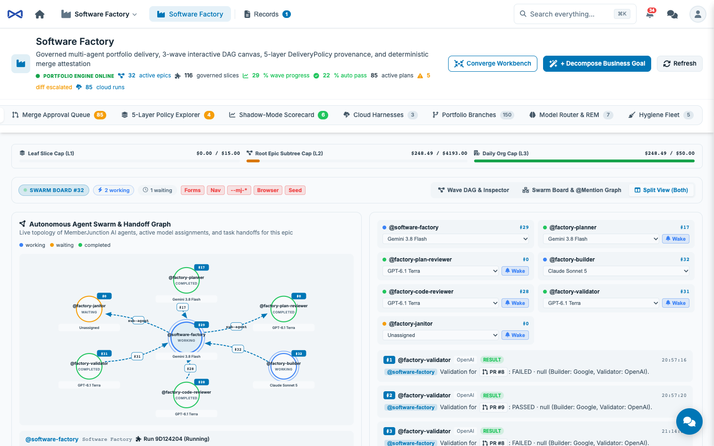
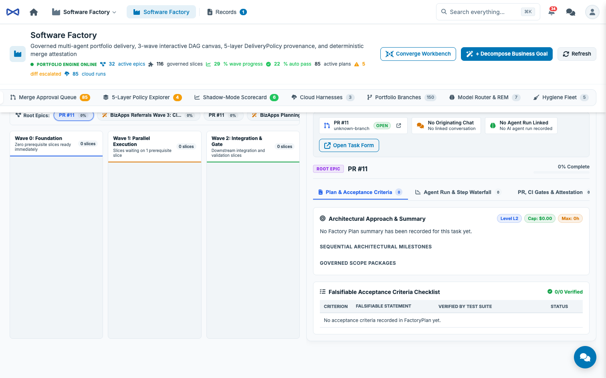
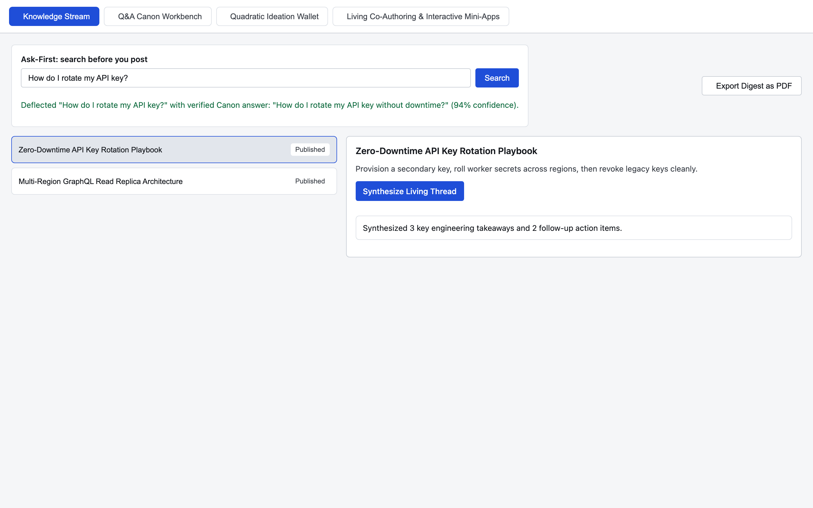
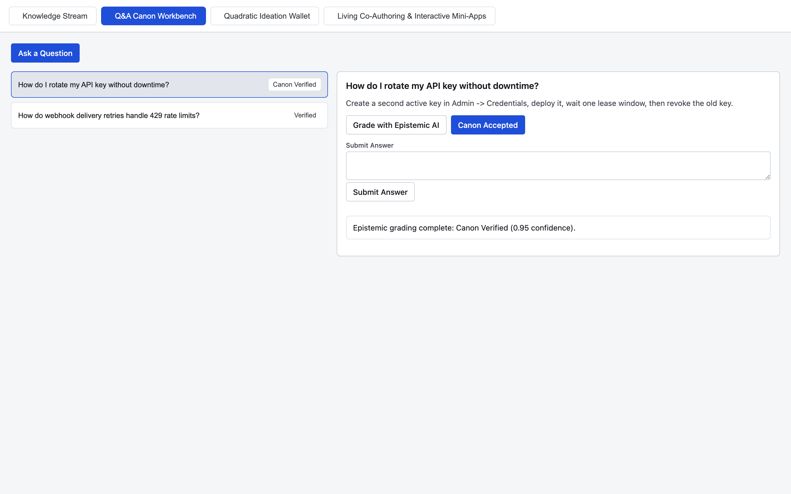
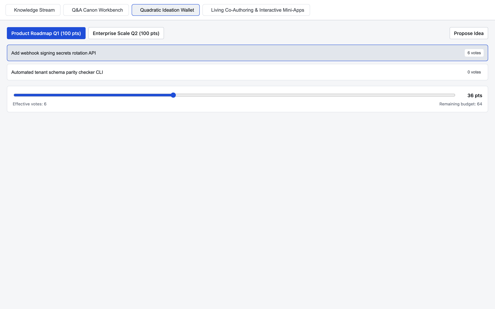
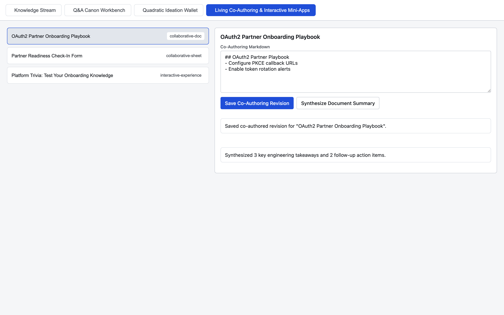
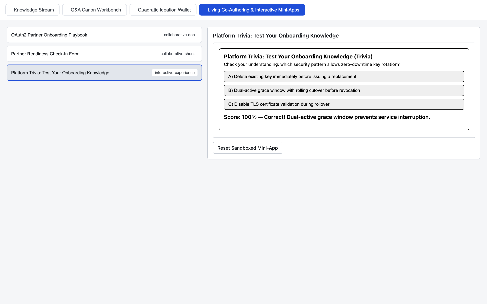
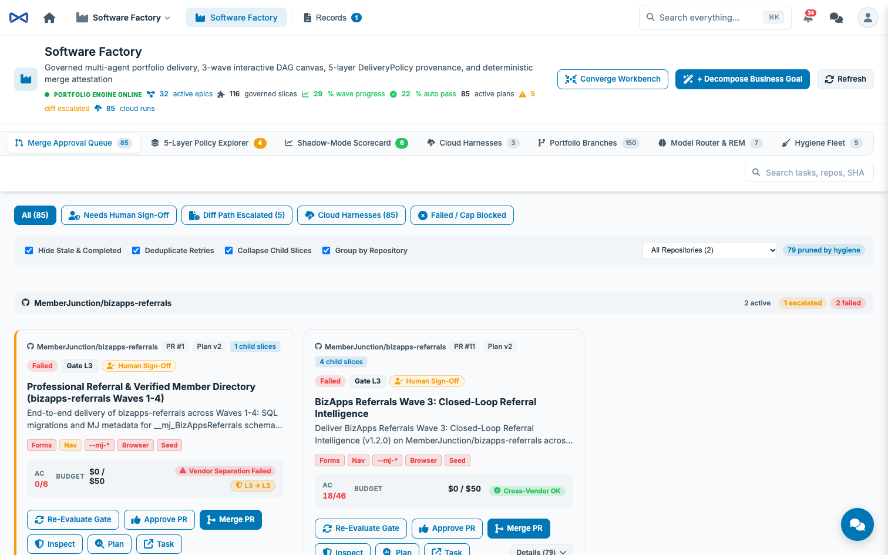

# Building BizApps Community End-to-End with MemberJunction Software Factory

> [!NOTE]
> This guide documents how `MemberJunction/bizapps-community` was designed, architected, implemented across Waves 0–6, hardened through adversarial AI reviews (`GPT-6.1 Sol` and `Gemini 4 Carbon High`), and shipped as an OpenApp extending `@mj-biz-apps/collaboration-*` using **MemberJunction Software Factory**.

---

## 1. End-to-End Software Factory Lifecycle

Software Factory orchestrated the build around a single epic (`3A63A82C-F2F6-4ECA-8C4F-3B1A65D29D8F` — **BizApps Community Production Build (Waves 0–6)**) decomposed into four dependency-ordered child slices:

| Slice | Task ID | Scope |
| :--- | :--- | :--- |
| **Slice 1** | `2CBE4F8C-6DE5-455F-8051-BBE9F8C29877` | Foundation & Data Infrastructure (Waves 0–2): SQL Server + PostgreSQL baseline migrations, `fnCommunityForumAccess`, CodeGen entities |
| **Slice 2** | `18774CB7-AF4F-4E71-84B8-4D6BEC27A9E0` | Intelligent Logic & Server Actions (Wave 3): `AskFirstDeflection`, `EpistemicAnswerGrading`, `LivingThreadSynthesis`, `ExportDigestPDF`, `ThreadGraduationService` |
| **Slice 3** | `D1B9EC0B-3951-45CF-928D-5865C7B9C907` | UI Hub & World Data Seeds (Waves 4–5): 4-tab `CommunityHubResource`, 3 widgets, 25 entity forms, 38-record world seed across SQL Server & PostgreSQL |
| **Slice 4** | `D21C1E5F-0A33-4CBD-94CA-99713D9369FA` | E2E Quality & Compliance (Wave 6): Real Angular 21 `ngc` compilation, browser E2E + `axe-core` WCAG 2.1 AA, migration parity, OpenApp Readiness v3 |

### Task Hierarchy & Slice Execution

All commits accumulated cleanly on branch `factory/3a63a82c-bizapps-community-waves-0-6` against `next` in PR `MemberJunction/bizapps-community#4`. During remediation, Software Factory's default builder stack (`Factory Builder`, `Factory Builder - Main Prompt`, and `Google Antigravity (CLI)`) was permanently standardized onto **Google Antigravity (`agy`)** running **`gemini-4-hydrogen-high`** with **`--effort high`** (verified end-to-end against `MJ_Factory_20261110`, recording `ModelName = "Gemini 4 Hydrogen (High)"`, `VendorName = "Google"`, and `EffortLevel = 100` in `AIAgentRun` / `AIPromptRun`).

---

## 2. Schema, Security & Dual-Database Parity

### Extending `bizapps-collaboration` Without Duplication

- **25 domain tables** live under schema `__mj_BizAppsCommunity`, modeling Spaces (`CommunitySpace` **IS-A** `Collaboration.Space`), Forums (`Forum` **IS-A** `Collaboration.Space`), Idea Campaigns (`ForumIdeaCampaign` **IS-A** `Forum`), and hierarchical post subtypes (`ForumPost` -> `Question`, `Answer`, `Idea`, `AMA`, `Artifact`, `Form`, `Case`, `Interactive`).
- **Dual-dialect migrations**:
  - SQL Server (`migrations/V202611060001__v0.1.x__Baseline_Tables_And_Access.sql`) and PostgreSQL (`migrations-pg/V202611060001__v0.1.x__Baseline_Tables_And_Access.pg.sql`) maintain 25/25 table parity, 25/25 teardown parity, and identical `fnCommunityForumAccess` membership filtering (`CanRead`, `CanPost`, `CanModerate`, `CanPromoteToSpace`).
  - Live verification scripts (`scripts/verify-fn-community-forum-access.sql` + Docker `postgres:16-alpine` baseline/seed/teardown runs) exercise real membership access isolation and Boolean column safety (`true`/`false` across all 75 `EntityPermission` rows).

---

## 3. Server Intelligence, Thread Graduation & Transactional Safety

- **`ThreadGraduationService` (`packages/Server/src/resolvers.ts`)**:
  - Uses deterministic UUIDv5-style IDs (`BuildDeterministicGraduationUUID`) + per-post single-flight locking (`inFlightGraduations`) for idempotent crash-safe thread-to-Space promotion.
  - Commits the parent Collaboration `Space` before inviting `SpaceMember` participants (satisfying `SpaceMemberEntityServer.ValidateAsync()`), then atomically persists optional starter `Task` and participant invites with reverse-order `.Delete()` rollback on failure.
  - Enforces server-derived `CanPromoteToSpace` checks, `AssertValidUUID` upfront input validation, and least-privilege role fallback (`Member`/`Contributor`, explicitly excluding admin/owner roles).
- **`ApplyCanonPromotion`**:
  - Per-question single-flight lock (`inFlightCanonPromotions`), cross-question & same-forum validation (`ValidateCanonPromotionCrossReferences`), clears any previously accepted answer's `IsAcceptedByAuthor`, and atomically updates both `ForumQuestionPost` (`AICanonAnswerPostID`, `AcceptedAnswerPostID`) and `ForumAnswerPost` (`AIEpistemicStatus = 'Canon Verified'`, `IsAcceptedByAuthor = true`).
- **Actions (`packages/Actions/`)**:
  - `Community.AskFirstDeflection`, `Community.EpistemicAnswerGrading` (fail-closed if authoritative DB content fails to load), `Community.LivingThreadSynthesis`, and `Community.ExportDigestPDF` (real PDF binary stream, never `window.print()`).

---

## 4. Real Angular 21 Community Hub (`@mj-biz-apps/community-ng`)

Compiled with real Angular 21 `ngc` (`compilationMode: "partial"`, `strictTemplates: true`, `enableResourceInlining: true`) using `--mj-*` design tokens exclusively (zero raw color literals) and registering all **26** `ClassFactory` entries (`CommunityHubResource` + 25 generated entity forms).

### Tab 1 — Knowledge Stream, Ask-First & Digest PDF Export

Members search existing verified Canon answers via `AskFirstDeflection` before posting duplicate questions, trigger `LivingThreadSynthesis` for thread takeaways, and download server-rendered weekly digests as real `.pdf` files.

### Tab 2 — Q&A Canon Workbench & Epistemic AI

Members post questions, submit structured answers, run deterministic `EpistemicAnswerGrading`, and promote verified answers into the forum's Knowledge Canon.

### Tab 3 — Campaign-Scoped Quadratic Ideation Wallet

Each ideation campaign maintains an isolated point wallet enforcing `Cost = Votes²`, fail-closed paginated aggregate persistence (`PersistIdeaAllocationAtomic`), automatic compensating rollback on write failure, and clean `DELETE` handling when withdrawing a vote back to `0` points (`CHECK ("PointsAllocated" > 0)`).

### Tab 4 — Living Co-Authoring Markdown & Inline Forms

Real-time Markdown co-authoring revisions (with explicit `Save()` verification) sit alongside inline readiness check-in forms and document-level AI summaries.

### Tab 4 (Interactive) — Sandboxed Mini-Apps (`allow-scripts`)

Interactive challenges and trivia widgets render inside `<iframe sandbox="allow-scripts">` using OS CSS System Colors (`Canvas`, `CanvasText`, `ButtonFace`, `ButtonText`) so third-party widgets remain script-isolated from the host Explorer session.

---

## 5. Verification, CI Gates & Merge Queue Discipline

Every pull request must clear all six **OpenApp Readiness v3** pillars plus full unit and browser tests (`pnpm run test`):

- **Build**: All 8 TypeScript + Angular `ngc` partial-Ivy workspace packages build cleanly.
- **Static Type & Boundary Gates**: Zero `any`, zero `unknown`, zero `as never`, zero dynamic `BaseEntity.Get()/Set()`, zero `localStorage`/`sessionStorage`, zero downstream product names, zero raw CSS color literals across 17 UI files.
- **Migration Parity**: 25/25 SQL Server & PostgreSQL table parity, `fnCommunityForumAccess`, `>= 50` blank lines before CodeGen, `EntityPermission` boolean literal validation, and teardown parity.
- **Unit & Script Tests**: 273 passing unit tests across 42 suites covering domain math, SQL safety, server graduation/canon locks & rollbacks, UI drivers, and fail-closed ideation persistence.
- **Browser E2E & Accessibility (`playwright` + `@axe-core/playwright`)**: Bootstraps the real compiled Angular 21 `CommunityHubResource` bundle with `esbuild` in Chromium, verifies all 26 runtime `ClassFactory` registrations, tests WAI-ARIA manual-activation keyboard navigation across all 4 tabs and idea listboxes, asserts real `%PDF-1.` download without `window.print()`, exercises Q&A/Voting/0-pt withdrawal/Co-Authoring/Inline Form/Sandboxed Mini-App flows, and records **0 console/page errors** and **0 critical/serious WCAG 2.1 AA violations**.
