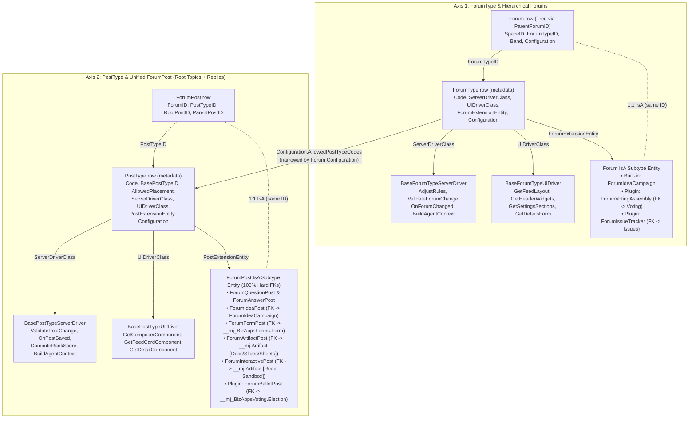
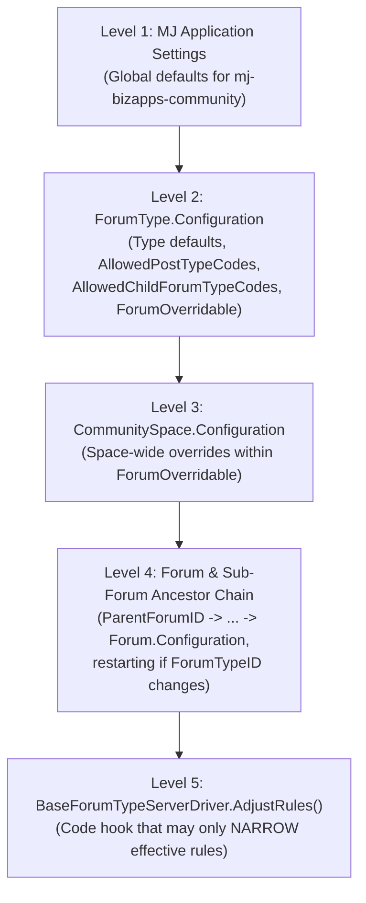

# Community Extensibility: `ForumType` & `PostType` as Plug-ins, 4-Level Configuration Cascade, MJ Docs/Slides/Sheets & Interactive AI Sandbox Posts

This document defines the multi-axis extensibility architecture for **BizApps Community** (`mj-bizapps-community`), modeled directly after [BizApps Collaboration's Extensibility Plan](https://github.com/MemberJunction/bizapps-collaboration/blob/next/docs/EXTENSIBILITY_PLAN.md) (`SpaceType` drivers, IsA subtypes, and hierarchical `Configuration` resolution).

---

## 1. Core Architectural Decisions

| # | Decision | Rationale |
|---|---|---|
| **D1** | **Zero Poly Soft Keys — 100% Enforced SQL Foreign Keys + IsA Subtypes.** | Untyped UUID columns without `FOREIGN KEY` constraints forfeit MJ CodeGen's automatic relationship discovery, base-view label joins, delete checks, GraphQL resolvers, and `IS-A` hydration. Every relationship in `__mj_BizAppsCommunity` uses a real SQL `FOREIGN KEY`. |
| **D2** | **Four Hard Dependencies (`Common`, `Tasks`, `Collaboration`, `Forms`).** | Polls, surveys, and structured intakes are core to every community, so `mj-bizapps-forms` is a hard dependency alongside `mj-bizapps-common`, `mj-bizapps-tasks`, and `mj-bizapps-collaboration`. This gives built-in `ForumFormPost` rows enforced SQL FKs to `__mj_BizAppsForms.Form(ID)` and `FormDistribution(ID)`. |
| **D3** | **Two Plug-In Type Axes: `ForumType` (Container Axis) and `PostType` (Content Axis).** | Just as `SpaceType` names `ServerDriverClass`, `UIDriverClass`, and `SpaceExtensionEntity` (IsA `Space`), **`ForumType`** extends `Forum` and **`PostType`** extends `ForumPost`. Downstream apps can declare new `ForumType`s, subclass existing `PostType`s (`BasePostTypeID`), and attach IsA tables with hard FKs. |
| **D4** | **Downstream Bridge Open Apps for Optional Domains (`Voting`, `Issues`, `Credentialing`, `Committees`).** | Community core stays blind to optional sibling BizApps (`scripts/check-downstream-names.mjs` enforces this in CI). Integration with `BizApps Voting` lives in `mj-bizapps-community-voting`, which depends on both apps and declares IsA subtype tables (`ForumVotingAssembly` IsA `Forum`, `ForumBallotPost` IsA `ForumPost`) with hard SQL FKs to `__mj_BizAppsVoting.Election(ID)`. |
| **D5** | **`BizApps Sonar` is Purely Downstream via Runtime Introspection.** | Sonar is an ingest/scoring engine that introspects MJ entity metadata dynamically (`EntityID`, `ModelRelatedEntity`, `Factor`). Community needs zero references to Sonar. |
| **D6** | **Native Integration with MJ Core Docs, Slides & Sheets (MJ PR #6215).** | MJ Docs, Slides, and Sheets are core `MJ: Artifacts` with live Yjs co-editing, passage-anchored `MJ: Conversations` comment threads, agent co-editor tools (`DocumentToolLibrary`, `SlidesToolLibrary`, `SheetsToolLibrary`), and `BaseDocumentBlock` embeds. Community wires directly into `MJ: Artifacts` via `ForumArtifactPost` (IsA `ForumPost`) and contributes custom Community Document Blocks. |
| **D7** | **AI-Generated Interactive Games, Simulations & Mini-Apps via Sandboxed Component Host (MJ PR #5257).** | `ForumInteractivePost` (IsA `ForumPost`) links via hard FK to an `MJ: Artifact` of type `Component` rendered inside MJ's opaque-origin `<mj-react-component>` sandbox (`BridgeDataProvider`), with player scores, turns, and benchmark inputs stored in `ForumInteractiveSession`. |
| **D8** | **4-Level Settings Cascade (`ResolveForumConfiguration`).** | Settings resolve deterministically from: **(1) MJ Generic `Application Settings`** → **(2) `ForumType.Configuration`** → **(3) `CommunitySpace.Configuration`** → **(4) `Forum.Configuration` (walking the `ParentForumID` ancestor chain)** → narrowed by `BaseForumTypeServerDriver.AdjustRules`. |
| **D9** | **Per-Forum Participant Roles (`ForumRoleType` & `ForumMemberRole`).** | Layered on top of `fnCollaborationAccess`, individual Forums and Sub-Forums grant scoped roles (`forum-admin`, `moderator`, `topic-host`, `expert-reviewer`, `contributor`, `observer`, `muted`) that optionally inherit to Sub-Forums (`InheritsToSubForums`). |

---

## 2. The Two-Axis Plug-In Model (`ForumType` & `PostType`)



### 2.1 Why `ForumPost` Unifies Root Threads and Replies
In a multi-type community, **both root thread starters and nested replies are `ForumPost` rows**:
* **Root Post (`ParentPostID IS NULL`, `RootPostID IS NULL`):** Starts a topic in a `Forum`. Its `PostTypeID` determines what kind of topic it is (`discussion`, `question`, `idea-proposal`, `poll-or-form`, `collaborative-doc`, `collaborative-sheet`, `collaborative-deck`, `live-ama`, `case-review`, `interactive-experience`, or a downstream plugin type like `formal-ballot-motion`).
* **Reply Post (`ParentPostID IS NOT NULL`, `RootPostID = <RootForumPost.ID>`):** Replies within the thread. Its `PostTypeID` must be in the root post type's `AllowedReplyPostTypeCodes` (intersected with the Forum's `AllowedPostTypeCodes`).
  * Example 1: A `question` root post (`ForumQuestionPost`) allows replies of type `answer` (`ForumAnswerPost`—which carries `+1/-1` votes, `IsAcceptedAnswer`, and the AI Epistemic Rubric Grade) and `comment` (lightweight clarification).
  * Example 2: A `discussion` root post allows standard `reply` posts, inline `poll-or-form` posts (`ForumFormPost`), co-editable `collaborative-doc` attachments (`ForumArtifactPost`), and even AI-generated `interactive-experience` mini-apps (`ForumInteractivePost`)!

### 2.2 Subclassing Existing `PostType`s (`PostType.BasePostTypeID`)
`PostType` includes a self-referencing `BasePostTypeID` foreign key (`FOREIGN KEY REFERENCES [__mj_BizAppsCommunity].[PostType]([ID])`):
* Just as `MJ: Artifact Types` walks `ParentID` in `ArtifactToolManager.ts` to inherit viewers and agent tools until overridden, a specialized `PostType` (for example, `'clinical-grand-rounds'` or `'friday-trivia-challenge'`) can point `BasePostTypeID` at `'case-review'` or `'interactive-experience'`.
* When `ServerDriverClass`, `UIDriverClass`, or `PostExtensionEntity` is `NULL` on the child `PostType`, the `PostTypeEngine` walks `BasePostTypeID` to inherit the parent's driver and IsA extension table while applying the child's specialized `Configuration` (custom prompt instructions, JSON schema, rubric weights, or template artifact).

---

## 3. Built-In `ForumType` & `PostType` Catalog

### 3.1 Shipped `ForumType`s

| `ForumType.Code` | `ForumExtensionEntity` (IsA `Forum`) | Default `AllowedPostTypeCodes` | Purpose |
|---|---|---|---|
| `general-discussion` | *(None — plain `Forum`)* | `["discussion", "question", "poll-or-form", "collaborative-doc", "interactive-experience", "reply"]` | Open member discourse with Living AI Synthesis and low-signal noise collapsing. |
| `qa-knowledge-base` | *(None — plain `Forum`)* | `["question", "answer", "comment", "collaborative-doc"]` | Stack Overflow + AI Rubric Graded Q&A with bounties and Canon verification. |
| `ideation-campaign` | `MJ: BizApps Community: Forum Idea Campaigns` (`ForumIdeaCampaign`) | `["idea-proposal", "reply", "poll-or-form"]` | 100-Point Wallet & Quadratic Voting ($\text{Cost} = \text{Votes}^2$) feature/topic prioritization. |
| `playbooks-and-docs` | *(None — plain `Forum`)* | `["collaborative-doc", "collaborative-sheet", "collaborative-deck", "reply"]` | Co-edited MJ Docs, Slides, Sheets & forkable community playbooks. |
| `peer-case-rounds` | *(None — plain `Forum`)* | `["case-review", "answer", "reply", "poll-or-form"]` | Structured peer review ("Grand Rounds", architecture teardowns, executive clinics). |
| `live-events-and-amas` | *(None — plain `Forum`)* | `["live-ama", "question", "answer", "interactive-experience"]` | Scheduled AMAs, office hours, and live interactive community challenges. |

### 3.2 Shipped `PostType`s & Their Hard-FK IsA Subtype Tables

| `PostType.Code` | `AllowedPlacement` | `PostExtensionEntity` (IsA `ForumPost`) | Hard SQL Foreign Keys on the IsA Table |
|---|---|---|---|
| `discussion` | `RootOnly` | *(None — base `ForumPost`)* | Base `ForumPost` FKs (`ForumID`, `SpaceID`, `PromotedSpaceID`, `PromotedTaskID`) |
| `reply` | `ReplyOnly` | *(None — base `ForumPost`)* | `RootPostID` -> `ForumPost(ID)`, `ParentPostID` -> `ForumPost(ID)` |
| `comment` | `ReplyOnly` | *(None — base `ForumPost`)* | Lightweight clarification under a `question` or `answer` |
| `question` | `RootOnly` | `ForumQuestionPost` | `AcceptedAnswerPostID` -> `ForumPost(ID)`, `AIVerifiedAnswerPostID` -> `ForumPost(ID)` |
| `answer` | `ReplyOnly` | `ForumAnswerPost` | `QuestionPostID` -> `ForumQuestionPost(ID)`, `SupersededByAnswerPostID` -> `ForumAnswerPost(ID)` |
| `idea-proposal` | `RootOnly` | `ForumIdeaPost` | `CampaignForumID` -> `ForumIdeaCampaign(ID)` |
| `poll-or-form` | `Both` | `ForumFormPost` | `FormID` -> `__mj_BizAppsForms.Form(ID)`, `FormDistributionID` -> `__mj_BizAppsForms.FormDistribution(ID)` |
| `collaborative-doc` | `Both` | `ForumArtifactPost` | `ArtifactID` -> `__mj.Artifact(ID)`, `PinnedArtifactVersionID` -> `__mj.ArtifactVersion(ID)`, `SpaceItemID` -> `__mj_BizAppsCollaboration.SpaceItem(ID)`, `ParentArtifactPostID` -> `ForumArtifactPost(ID)` |
| `collaborative-sheet` | `Both` | `ForumArtifactPost` (`DocumentKind='Sheet'`) | Same hard FKs to `__mj.Artifact`, `__mj.ArtifactVersion`, and `SpaceItem` |
| `collaborative-deck` | `Both` | `ForumArtifactPost` (`DocumentKind='SlideDeck'`) | Same hard FKs to `__mj.Artifact`, `__mj.ArtifactVersion`, and `SpaceItem` |
| `case-review` | `RootOnly` | `ForumCaseReviewPost` | Structured columns (`ContextMarkdown`, `ConstraintsMarkdown`, `AttemptedMarkdown`, `DecisionAskMarkdown`, `RubricTemplateFormID` -> `__mj_BizAppsForms.Form(ID)`) |
| `live-ama` | `RootOnly` | `ForumAMAPost` | `HostUserID` -> `__mj.User(ID)`, `StartsAt`, `EndsAt`, `RecordingSpaceItemID` -> `__mj_BizAppsCollaboration.SpaceItem(ID)` |
| `interactive-experience` | `Both` | `ForumInteractivePost` | `ComponentArtifactID` -> `__mj.Artifact(ID)`, `ComponentArtifactVersionID` -> `__mj.ArtifactVersion(ID)` |

---

## 4. Deep Integration with MJ Docs, Slides & Sheets (MJ PR #6215)

In MemberJunction (**[MJ PR #6215 — `plans/docs-slides-sheets.md`](https://github.com/MemberJunction/MJ/pull/6215)**), Docs, Slides, and Sheets are built into MJ Core on top of `MJ: Artifacts` and `MJ: Artifact Versions`:
* **Live Yjs Co-Editing + Saved Checkpoints:** `y-prosemirror` (TipTap MIT core) for Docs, 16:9 layout regions for Slides (`Presentation`), and multi-tab formula workbooks for Sheets (`Excel Spreadsheet`), with checkpoints saved back to `MJ: Artifact Versions`.
* **Agents as Co-Editors:** `DocumentToolLibrary`, `SlidesToolLibrary`, and `SheetsToolLibrary` allow MJ Agents to read outlines and edit specific paragraphs, slide regions, or sheet ranges by stable ID with revision checks and automatic before/after version checkpoints.
* **Live Reference Blocks (`@RegisterClass(BaseDocumentBlock, '<Kind>')`):** Docs, Slides, and Sheets embed live MJ Queries, Views, Records, Charts, and Interactive Components that evaluate under each reader's permissions (or freeze explicitly on publish).
* **Delegated Permissions (§ 3.3) & Passage Conversations (§ 3.5):** An artifact delegates read/edit permissions to its owning record (a Collaboration `SpaceItem` or Community `ForumArtifactPost`), and every inline passage/slide/cell comment thread is an `MJ: Conversations` row where `@-mentioning` an agent runs it in context.

### How `mj-bizapps-community` Extends MJ Docs, Slides & Sheets:
1. **`ForumArtifactPost` IsA Subtype (Replacing Static Notes & Disconnected Wiki Pages):**
   * Any post of type `collaborative-doc`, `collaborative-sheet`, or `collaborative-deck` creates or links an `MJ: Artifact` (and registers it as a `SpaceItem` in the parent Collaboration Space).
   * **`CoEditPermissionMode` on `ForumArtifactPost`:** Controls who can co-edit the live Yjs document right inside the community thread:
     * `'AuthorOnly'` (author + agents they invoke)
     * `'ForumModerators'` (author + users with `CanCoEditDocs = 1` in `ForumMemberRole`)
     * `'HighTrustMembers'` (members with `CommunityMemberProfile.TrustLevel >= 3`)
     * `'AllContributors'` (true community wiki / collaborative RFC mode—anyone with `CanContribute` in the Forum can co-edit live!)
2. **AI Consensus-to-Redline Loop ("Living RFCs"):**
   * When a committee or working group posts a draft policy or technical standard as a `collaborative-doc` root post, members debate in the replies below AND open anchored `MJ: Conversations` threads on specific paragraphs.
   * Clicking **"Ask Assistant to Propose Redlines from Consensus"** invokes `SynthesizeConsensusIntoDocAction`, which reads the Bridging Consensus clusters from the replies and uses `DocumentToolLibrary`'s **Suggest** tool (PR #6215 § 3.6) to insert tracked paragraph proposals directly into the live MJ Doc for the author/chair to accept or reject in 1 click!
3. **Forkable Playbooks with Version Lineage:**
   * When `ForumArtifactPost.IsForkablePlaybook = 1`, any member can click **"Fork Playbook to My Space"**. This clones the underlying MJ Doc, Slide Deck, or Sheet (including its live MJ Query/View blocks, which automatically re-scope to the cloner's own organization/chapter permissions!) into their target Collaboration `Space` and records `ParentArtifactPostID` lineage.
4. **Custom Community `BaseDocumentBlock` Registrations:**
   * `mj-bizapps-community` registers three custom blocks via `@RegisterClass(BaseDocumentBlock, ...)` so **any MJ Doc, Slide Deck, or Sheet across the entire platform** can embed live community intelligence:
     * `CommunityThreadSynthesisBlock`: Embeds a live-updating AI Synthesis & Consensus card from a `ForumPost` thread into a Board Slide Deck or Executive Brief Doc.
     * `CommunityCanonAnswerBlock`: Embeds a `CanonVerified` `ForumAnswerPost` into an SOP Doc (showing a live freshness badge if superseded).
     * `CommunityIdeaLeaderboardBlock`: Embeds a live 100-Point / Quadratic `ForumIdeaCampaign` table or chart into a strategy Doc or Sheet.

---

## 5. AI-Generated Interactive Games, Simulations & Mini-App Posts (`ForumInteractivePost`)

Building on **[MJ PR #5257 (`plans/sandboxed-component-host/proposal.md`)](https://github.com/MemberJunction/MJ/pull/5257)**, MJ runs agent-authored React components (`MJ: Artifacts` of type `Component`) inside an isolated, opaque-origin CSP iframe (`<mj-react-component>`) connected to the host via `BridgeDataProvider`.

In `mj-bizapps-community`, this powers **`PostType = 'interactive-experience'` (`ForumInteractivePost` IsA `ForumPost`)**:

### 5.1 How It Works End-to-End
1. **Prompting the Composer Assistant:**
   * In any Forum that allows `interactive-experience` (or a subclassed `PostType` like `weekly-trivia-game` or `roi-simulator`), a user or community steward clicks **"✨ Build Interactive Post with AI"** and describes what they want:
     * *"Create a 5-question timed clinical diagnostic challenge based on this month's Cardiology Guidelines PDF, with instant explanations and a peer leaderboard."*
     * *"Build an interactive 'Staffing & Dues Calculator' where members enter their FTE count and operating budget to see how their ratios compare against the community median."*
     * *"Create a 16-seed single-elimination bracket where members vote head-to-head on the most overrated software patterns."*
2. **AI Component Generation & Sandboxed Execution:**
   * The Community Builder Agent generates a React component artifact (`ComponentArtifactID` FK -> `__mj.Artifact(ID)`) using MJ's `Component_*` tools and linter, and saves a `ForumInteractivePost` row with `InteractiveKind` (`'TriviaQuiz' | 'SimulationCalculator' | 'BracketTournament' | 'ScenarioRoleplay' | 'FlashcardChallenge' | 'CustomMiniApp'`) and `GameConfigJSON`.
   * When members view the post in the feed or thread, `<mj-react-component>` mounts the interactive experience inside the sandboxed frame.
3. **Structured Persistence & Live Leaderboards (`ForumInteractiveSession`):**
   * When a member finishes a quiz round, submits a simulation run, or completes a scenario, the component calls the typed Remote Operation `Community.RecordInteractiveSession`, writing a row to `ForumInteractiveSession` (`InteractivePostID` FK -> `ForumInteractivePost(ID)`, `UserID` FK -> `__mj.User(ID)`, `Score`, `DurationMs`, `SessionStateJSON`).
   * The post card renders a live **Community Leaderboard & Peer Distribution Histogram** right below the interactive canvas, awards outcome reputation points (`CommunityReputationEvent`), and lets members discuss strategies in the thread replies below!
4. **1-Click "Promote to Reusable Post Type":**
   * If an AI-generated interactive post is a hit, a Forum Admin can click **"Save as Reusable Post Type"**, registering a new `PostType` row (`BasePostTypeID` -> `interactive-experience`) so anyone in the community can launch new rounds of that game or calculator from a template!

---

## 6. The 4-Level Hierarchical Settings Cascade (`ResolveForumConfiguration`)

Every setting in `mj-bizapps-community` follows the same rule established in `BizApps Collaboration`:
* **If SQL reads it** (row-level security, `fnCommunityAccess`, foreign keys), it is a typed table column (stamped from resolved settings when needed).
* **Everything else** lives in a typed JSONType `Configuration` bag (`ICommunitySettings`) shared across all four levels of the hierarchy and resolved by a single pure function in `@mj-biz-apps/community-core`:



### 6.1 Shared Configuration Interface (`packages/Core/src/configuration.ts`)

```ts
export interface ICommunitySettings {
  /** PostType codes allowed in this forum. A child level may narrow this list (or extend it only if 'PostTypes.AllowedCodes' is in ForumOverridable). */
  PostTypes?: {
    AllowedCodes?: string[];
    DefaultRootCode?: string;
    AllowAIInteractivePostCreation?: boolean;
  };
  /** Anonymous access policy for Shared-band content. */
  AnonymousAccess?: {
    Mode?: 'None' | 'TeaserOnly' | 'FullRead';
    AllowAnonymousAskFirstSearch?: boolean;
    TeaserReplyLimit?: number;
  };
  /** Moderation & trust-level gates. */
  Moderation?: {
    Policy?: 'PostFirst' | 'AIQuarantineLowTrust' | 'PreModerateAll';
    MinTrustLevelToCreateRootPost?: number;
    MinTrustLevelToCreateInteractivePost?: number;
    MinTrustLevelToCoEditDocs?: number;
    AutoCollapseLowSignalReplies?: boolean;
  };
  /** AI synthesis, epistemic grading, and Ask-First deflection switches. */
  AI?: {
    EnableAskFirstDeflection?: boolean;
    EnableLivingThreadSynthesis?: boolean;
    SynthesisReplyThreshold?: number;
    EnableAnswerRubricGrading?: boolean;
    EnableBridgingConsensus?: boolean;
  };
  /** Digest & inbound email defaults. */
  Digest?: {
    DefaultFrequency?: 'None' | 'Daily' | 'Weekly' | 'Realtime';
    AllowInboundEmailReply?: boolean;
  };
  /** Arbitrary plugin/driver settings keyed by owning Open App name. */
  Extensions?: Record<string, Record<string, unknown>>;
}

export interface IForumTypeConfiguration extends ICommunitySettings {
  /** Which ForumType codes may be created as sub-forums under a forum of this type. */
  SubForums?: {
    AllowedForumTypeCodes?: string[];
    MaxDepth?: number;
  };
  /** Dotted setting paths that a Space or Forum is permitted to override (e.g., 'Moderation.Policy', 'PostTypes.AllowedCodes', 'AnonymousAccess'). */
  ForumOverridable?: string[];
}
```

---

## 7. Per-Forum Participant Roles & Scoped Moderation (`ForumRoleType` & `ForumMemberRole`)

While `BizApps Collaboration` (`SpaceMember` + `fnCollaborationAccess`) governs who can reach the `Space` and whether they see the `Team` band, individual `Forum`s and Sub-Forums within a `CommunitySpace` often have their own volunteer leaders, moderators, or subject-matter reviewers:

| `ForumRoleType.Code` | `Level` | `CanConfigureForum` | `CanModeratePosts` | `CanPinAndLock` | `CanAcceptAnswers` | `CanEndorseCanon` | `CanCreateRootPost` | `CanReply` | `CanCoEditDocs` |
|---|---|---|---|---|---|---|---|---|---|
| `forum-admin` | 40 | `1` | `1` | `1` | `1` | `1` | `1` | `1` | `1` |
| `moderator` | 30 | `0` | `1` | `1` | `1` | `1` | `1` | `1` | `1` |
| `topic-host` | 25 | `0` | `0` | `1` | `1` | `0` | `1` | `1` | `1` |
| `expert-reviewer` | 20 | `0` | `0` | `0` | `0` | `1` | `1` | `1` | `1` |
| `contributor` | 10 | `0` | `0` | `0` | `0` | `0` | `1` | `1` | `0` |
| `observer` | 5 | `0` | `0` | `0` | `0` | `0` | `0` | `0` | `0` |
| `muted` | 0 | `0` | `0` | `0` | `0` | `0` | `0` | `0` | `0` |

* **Inheritance down `ParentForumID`:** When a user holds a `ForumMemberRole` on a parent `Forum` with `InheritsToSubForums = 1`, `fnCommunityForumAccess(@UserID)` automatically projects that role onto its descendant sub-forums (unless overridden by a more specific `ForumMemberRole` row on the child `Forum`).
* **Space Owners & Admins:** A user whose `SpaceRoleType.IsOwnerRole = 1` on the enclosing Collaboration `Space` automatically receives `forum-admin` capabilities across all Forums in that Space.

---

## 8. Downstream Plugin Open Apps (100% Hard SQL Foreign Keys)

Because `ForumType` and `PostType` are open metadata catalogs backed by ClassFactory drivers and IsA extension entities, any integration with optional sibling BizApps ships as a small, focused bridge Open App with **real SQL Foreign Keys**:

### 8.1 `mj-bizapps-community-voting` (Schema: `__mj_BizAppsCommunityVoting`)
* **Dependencies:** `mj-bizapps-community`, `mj-bizapps-voting`
* **Ships `ForumType`:** `deliberation-assembly` (`ForumExtensionEntity = 'MJ: BizApps Community Voting: Forum Voting Assemblies'`)
  * **IsA Table `ForumVotingAssembly`:**
    * `ID` (`UNIQUEIDENTIFIER PK`, `FOREIGN KEY REFERENCES [__mj_BizAppsCommunity].[Forum]([ID])`)
    * `DefaultElectionTypeID` (`UNIQUEIDENTIFIER NOT NULL`, `FOREIGN KEY REFERENCES [__mj_BizAppsVoting].[ElectionType]([ID])`)
    * `DefaultSecrecyMode` (`NVARCHAR(20) NOT NULL`)
* **Ships `PostType`:** `formal-ballot-motion` (`PostExtensionEntity = 'MJ: BizApps Community Voting: Forum Ballot Posts'`)
  * **IsA Table `ForumBallotPost`:**
    * `ID` (`UNIQUEIDENTIFIER PK`, `FOREIGN KEY REFERENCES [__mj_BizAppsCommunity].[ForumPost]([ID])`)
    * `ElectionID` (`UNIQUEIDENTIFIER NOT NULL`, `FOREIGN KEY REFERENCES [__mj_BizAppsVoting].[Election]([ID])`)
    * `PrimaryContestID` (`UNIQUEIDENTIFIER NULL`, `FOREIGN KEY REFERENCES [__mj_BizAppsVoting].[Contest]([ID])`)
    * `FrozenArtifactVersionID` (`UNIQUEIDENTIFIER NULL`, `FOREIGN KEY REFERENCES [__mj].[ArtifactVersion]([ID])` — pins the exact MJ Doc version being ratified!)
* **UI Driver (`BallotPostUIDriver`):** Renders `<mj-ballot>` inline inside the community thread and auto-posts an `OfficialStatusUpdate` reply when `OnResultsCertified` fires!

### 8.2 `mj-bizapps-community-issues` (Schema: `__mj_BizAppsCommunityIssues`)
* **Dependencies:** `mj-bizapps-community`, `mj-bizapps-issues`
* **Ships `ForumType`:** `issue-and-bug-tracker` (`ForumExtensionEntity = 'MJ: BizApps Community Issues: Forum Issue Trackers'`)
  * **IsA Table `ForumIssueTracker`:**
    * `ID` (`UNIQUEIDENTIFIER PK`, `FOREIGN KEY REFERENCES [__mj_BizAppsCommunity].[Forum]([ID])`)
    * `DefaultIssueTypeID` (`UNIQUEIDENTIFIER NOT NULL`, `FOREIGN KEY REFERENCES [__mj_BizAppsIssues].[IssueType]([ID])`)
* **Ships `PostType`:** `tracked-issue-post` (`PostExtensionEntity = 'MJ: BizApps Community Issues: Forum Issue Posts'`)
  * **IsA Table `ForumIssuePost`:**
    * `ID` (`UNIQUEIDENTIFIER PK`, `FOREIGN KEY REFERENCES [__mj_BizAppsCommunity].[ForumPost]([ID])`)
    * `IssueID` (`UNIQUEIDENTIFIER NOT NULL`, `FOREIGN KEY REFERENCES [__mj_BizAppsIssues].[Issue]([ID])`)
    * `SyncStatusToPost` (`BIT NOT NULL DEFAULT 1`)

### 8.3 `mj-bizapps-community-credentialing` (Schema: `__mj_BizAppsCommunityCredentialing`)
* **Dependencies:** `mj-bizapps-community`, `mj-bizapps-credentialing`
* **Ships Tables with Hard FKs:**
  * `ForumCredentialDomain` (`ForumID` FK -> `__mj_BizAppsCommunity.Forum(ID)`, `CredentialTypeID` FK -> `__mj_BizAppsCredentialing.CredentialType(ID)`, `VoteWeightMultiplier` `DECIMAL(5,2)`): automatically marks voters holding that active credential as `IsVerifiedDomainExpert = 1` on `ForumPostVote`!
  * `ForumCECreditAward` (`ID` PK, `AnswerPostID` FK -> `__mj_BizAppsCommunity.ForumAnswerPost(ID)`, `ReputationEventID` FK -> `__mj_BizAppsCommunity.CommunityReputationEvent(ID)`, `CredentialHolderID` FK -> `__mj_BizAppsCredentialing.CredentialHolder(ID)`, `CreditHours` `DECIMAL(5,2)`): awards verifiable Continuing Education micro-credits when an expert authors a Canon-Verified answer!
