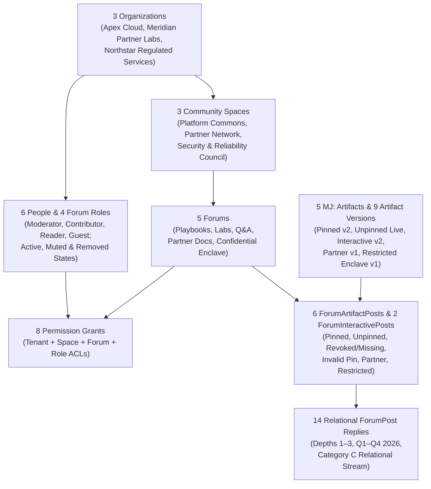

# BizApps Community Integration Tests (`@mj-biz-apps/community-integration-tests`)

Deterministic real-world seeded cross-stack integration tests, adversarial RLS & boundary checks, multi-viewport headless Chromium Playwright verification, and OpenApp v3 readiness certification for **BizApps Community** (`@mj-biz-apps/community-ng` and `@memberjunction/ng-artifacts`).

## World Seed Topology (`world/community-artifact-world.mjs`)

The integration world provisions **65 realistic, domain-neutral records across 11 entity groups** spanning 3 isolated tenant organizations, 6 personas (active, partner, isolated enclave, muted, and removed), 4 forum roles, 8 ACL permission grants, 5 forums, 5 `MJ: Artifacts`, 9 `MJ: Artifact Versions`, 6 `ForumArtifactPost` records, 2 `ForumInteractivePost` records, and 14 high-volume relational `ForumPost` replies spanning 5 statuses (`Published`, `Answered`, `Resolved`, `Draft`, `Archived`) and 4 quarterly periods (`2026-Q1`..`2026-Q4`).



### Seeded Entity Density Summary

| Entity Group | Seeded Count | Coverage Notes |
| --- | ---: | --- |
| **Organizations** | 3 | Standard enterprise, partner-federated, and strict-isolated regulated tenants |
| **Community Spaces** | 3 | One space per organization (`Full Read`, `Teaser Only`, `None`) |
| **People / Users** | 6 | Moderator, contributor, partner architect, enclave lead, muted member, removed guest |
| **Forum Roles** | 4 | `forum-moderator`, `forum-contributor`, `forum-reader`, `forum-guest` |
| **Permissions / ACLs** | 8 | Explicit org/space/forum grants exercising active, muted, removed, and cross-tenant rules |
| **Forums** | 5 | Playbooks, Interactive Labs, Q&A, Partner SDK Playbooks, Confidential Enclave Runbooks |
| **MJ: Artifacts** | 5 | Document, Spreadsheet, Interactive, Presentation, Restricted Enclave (`ART_REVOKED_MISSING` intentionally absent) |
| **MJ: Artifact Versions** | 9 | Multi-version histories (`v1`–`v3`) verifying pinned `v2` != latest `v3` |
| **ForumArtifactPosts** | 6 | Pinned `v2`, unpinned latest, revoked/missing artifact, invalid pinned version, partner pinned, restricted tenant |
| **ForumInteractivePosts** | 2 | Pinned `ComponentArtifactID` (`v2`) and archived missing component fallback |
| **Relational ForumPost Replies** | 14 | Nested depths 1–3 across Q1–Q4 2026, including 3 replies preserved on the revoked-artifact post |
| **Total** | **65** | Verified >= 20 multi-entity density with 0 SQLite FK violations (`PRAGMA foreign_keys = ON`) |

## Adversarial & Functional Check Matrix (`checks/`)

| Check Suite | File | Assertions Verified |
| --- | --- | --- |
| **Functional Viewer Checks** | [`checks/forum-artifact-post-viewer.check.mjs`](./checks/forum-artifact-post-viewer.check.mjs) | Batched `RunViews` (`ResultType: 'simple'`, validated `ID IN (...)`, 0 N+1 hydrations); `PinnedArtifactVersionID` -> `VersionNumber` pass-through (`v2` != latest `v3`); unpinned latest resolution; `ForumInteractivePost.ComponentArtifactID` + `PinnedArtifactVersionID` alignment & Escape-to-close; 14 relational `ForumPost` replies preserved across depths 1–3; rapid card-switch monotonic token cancellation |
| **Adversarial Boundary Checks** | [`checks/forum-artifact-adversarial-boundaries.check.mjs`](./checks/forum-artifact-adversarial-boundaries.check.mjs) | Cross-organization RLS denial (Apex & Meridian blocked from Northstar enclave artifacts while Northstar succeeds); muted write/co-edit denial & removed user total read denial; missing/revoked artifact graceful fallback with zero raw `###`/`**bold**`/code-fence leakage while preserving all 3 relational replies; invalid, pruned, and cross-artifact `PinnedArtifactVersionID` fail-closed handling; SQL injection rejected with 0 executed queries; empty ID short-circuit & bounded 50-ID chunking |
| **Seed Density Unit Tests** | [`src/__tests__/community-seed-density.spec.ts`](./src/__tests__/community-seed-density.spec.ts) | >= 20 multi-domain record density, UUID uniqueness, SQLite `PRAGMA foreign_keys = ON` integrity, adversarial fixture schemas, zero sample mockup brand names, and `sf-readiness/v3` `SeedDensityReport` validation |

## Multi-Viewport Playwright Verification (`../../test-harnesses/integration.mjs`)

`test-harnesses/integration.mjs` compiles and mounts the real `@mj-biz-apps/community-ng` Angular 21 bundle (`CommunityHubResource`, `CommunityArtifactViewerComponent`, `<mj-artifact-viewer-panel>`, and all 25 generated entity forms) in headless Chromium and verifies:

- **4 Viewports × 2 Themes (8 Matrix Combinations)**:
  - Desktop (`1440×900`) — Light & Dark `--mj-*` tokens
  - Tablet Landscape (`1024×768`) — Light & Dark `--mj-*` tokens
  - Tablet Portrait (`768×1024`) — Light & Dark `--mj-*` tokens
  - Mobile (`390×844`) — Light & Dark `--mj-*` tokens
- **UX Mockup & Runtime Fidelity**:
  - Local FontAwesome CSS + WOFF2 webfonts loaded (`width > 0`, `height > 0`)
  - Landmarks present (`header` sticky, `nav`, `main`, `aside`, `footer`), search bar, filter chips, multi-column stream
  - Interactive slide-over artifact viewer drawer for `ForumArtifactPost` (`Pinned v2`), `ForumInteractivePost` (`Pinned v2`), and revoked artifact fallback (`data-fallback-reason="artifact-not-found"`), plus `Escape` dismissal
  - Zero raw markdown syntax tokens (`###`, `**bold**`), zero broken images, zero horizontal overflow, zero `window.print()`, `pageErrors === 0`, `consoleErrors === 0`, and domain-neutral copy

## Related Architecture & Rubric Documentation

- **Docs vs. Notes Rubric**: [CLAUDE.md](../../CLAUDE.md) and [AGENTS.md](../../AGENTS.md) codify the `MJ Docs (MJ: Artifacts) vs. MJ: Comments vs. Quick Notes` classification (`ForumArtifactPost` and `ForumInteractivePost` = Category A; high-volume `ForumPost` replies = Category C relational).
- **Git-Canonical Specification**: [`.mj/specs/ng-artifacts-forum-viewer/spec.md`](../../.mj/specs/ng-artifacts-forum-viewer/spec.md) documents `CommunityArtifactViewerComponent`, batched `RunView` metadata loading, critical user journeys, and this verification matrix.
- **Angular Viewer API**: [`packages/Angular/README.md`](../Angular/README.md) documents `<mjc-community-artifact-viewer>` inputs, outputs, keyboard accessibility, and `--mj-*` design tokens.

## Running Commands

```bash
# Run deterministic seed-density unit tests
node --experimental-strip-types --test packages/IntegrationTests/src/__tests__/community-seed-density.spec.ts

# Run functional + adversarial cross-stack checks
node --test \
  packages/IntegrationTests/checks/forum-artifact-post-viewer.check.mjs \
  packages/IntegrationTests/checks/forum-artifact-adversarial-boundaries.check.mjs

# Run full cross-stack integration + 8-cell Playwright verification + OpenApp v3 readiness report
node test-harnesses/integration.mjs

# Run integration checks + readiness report without launching Chromium
node test-harnesses/integration.mjs --skip-playwright

# Run repository OpenApp v3 readiness certification script
pnpm run report:openapp-readiness
```
