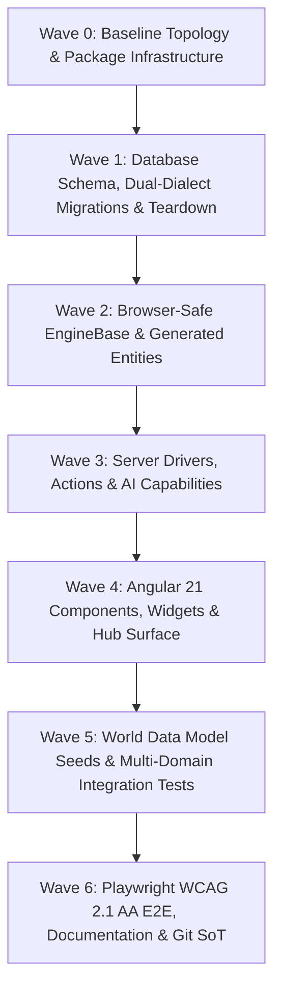

# BizApps Community (`mj-bizapps-community`) — Master Architecture, Schema & Software Factory Execution Plan

> **Companion Specifications:**
> - [`docs/EXTENSIBILITY_PLAN.md`](../docs/EXTENSIBILITY_PLAN.md) — Plug-in driver contracts, metadata directories, and peer `SpaceType` interoperability.
> - [`migrations/V202611060001__v0.1.x__Baseline_Tables_And_Access.sql`](../migrations/V202611060001__v0.1.x__Baseline_Tables_And_Access.sql) — Canonical SQL Server DDL and access TVF.
> - [`migrations-pg/V202611060001__v0.1.x__Baseline_Tables_And_Access.pg.sql`](../migrations-pg/V202611060001__v0.1.x__Baseline_Tables_And_Access.pg.sql) — Dual-dialect PostgreSQL baseline.
> - [`scripts/seed-world.mjs`](../scripts/seed-world.mjs) / [`scripts/seed-world.sql`](../scripts/seed-world.sql) — Multi-domain World Data Model seed dataset (>=25 records).

---

## 1. Executive Summary & Architectural Vision

**BizApps Community** (`__mj_BizAppsCommunity`) is an AI-native community, epistemic Q&A, participatory ideation, collaborative document co-authoring, and interactive knowledge-synthesis Open App for **MemberJunction (MJ v6.3+)** built directly on top of **BizApps Collaboration** (`__mj_BizAppsCollaboration`) and **BizApps Forms** (`__mj_BizAppsForms`).

### Core Design Principles

1. **100% Generic in the MemberJunction Way:**
   Zero tenant-specific or client-branded terms (such as `MoreCheese`) exist in schema tables, TypeScript classes, component selectors, or metadata catalogs. Tenant and demo personas belong strictly inside optional sample seed scripts and integration tests.
2. **Two-Axis Plug-In Extensibility (`ForumType` + `PostType`) with 100% Hard SQL Foreign Keys:**
   - **`ForumType`** governs channel containers (`Forum`), declaring optional `ServerDriverClass`, `UIDriverClass`, and 1:1 `ExtensionEntity` (`IsA` `Forum`, such as `ForumIdeaCampaign`).
   - **`PostType`** governs unified `ForumPost` records (both root threads and replies), declaring placement rules (`Root Only`, `Reply Only`, `Both`), optional `ServerDriverClass`, `UIDriverClass`, and 1:1 `ExtensionEntity` (`IsA` `ForumPost`).
   - **Polymorphic Entity Links**: Posts can link to any MemberJunction entity record via `LinkedEntityID` + `LinkedRecordID`, decorated in metadata via `EntityField.EntityIDFieldName`.
3. **Browser-Safe Shared Engine (`@mj-biz-apps/community-engine-base`):**
   Modeled after `CollaborationEngineBase`, process-wide metadata caching (`ForumType`, `PostType`, `ForumRoleType`), O(1) lookups by ID and Code, and 4-tier configuration resolution live in a browser-safe library (`packages/EngineBase`) shared by Angular, AngularWidgets, and Server without pulling in Node/server-only dependencies.
4. **4-Tier Hierarchical Configuration Cascade:**
   Settings cascade deterministically across four tiers:
   $$\text{Application Settings} \longrightarrow \text{ForumType.Configuration} \longrightarrow \text{CommunitySpace.Configuration} \longrightarrow \text{Forum.Configuration}$$
   Overrides at forum level are strictly validated against `ForumType.Configuration.ForumOverridable`.
5. **Living Document Co-Authoring & Interactive Component Artifacts:**
   - Embeds live Yjs co-edited MJ Documents (`.doc.md`), Presentations (`.slides.json`), and Spreadsheets (`.sheet.json`) backed by hard FKs to `__mj.Artifact` and `__mj.ArtifactVersion`.
   - Embeds sandboxed **MemberJunction Interactive Component Artifacts** (`@memberjunction/interactive-component-types`) for AI-generated quizzes, trivia games, calculators, and simulations with persistent score leaderboards.
6. **Dual Human + AI Epistemic Answer Grading & Participatory Ideation:**
   - Stack Overflow-style Q&A with weighted voting and asynchronous MJ Agent Epistemic Rubric (*Canon Verified*, *Novel Insight*, *Partially Outdated*, *Conflicts With Canon*).
   - Ideation campaigns featuring 100-Point Wallets or Quadratic Voting ($\text{Cost} = \text{Votes}^2$) with demographic/tier slicing.
7. **Security & Anonymous Public Access:**
   Granular access evaluated via `fnCommunityForumAccess(@UserID)` combining Collaboration Space membership, Space open status, and forum overrides, supporting configurable anonymous reading (`None`, `Teaser Only`, `Full Read`) while shielding `Team`-band discussions unconditionally.

---

## 2. Upstream Dependencies & Sibling Integrations

`mj-bizapps-community` declares **four** hard dependencies in `mj-app.json`:

| Upstream Dependency | Schema | Integration Points |
|---|---|---|
| **BizApps Collaboration** (`mj-bizapps-collaboration`) | `__mj_BizAppsCollaboration` | `CommunitySpace(ID)` IsA `Space(ID)`; `Forum.SpaceID` and `ForumPost.PromotedToSpaceID` reference `Space(ID)`; attachments and artifacts reference `SpaceItem(ID)`; reachability uses `fnCollaborationAccess(@UserID)` and `fnCollaborationSpaceStatuses()`. |
| **BizApps Forms** (`mj-bizapps-forms`) | `__mj_BizAppsForms` | `ForumFormPost(ID)` (IsA `ForumPost`) references `Form(ID)` and `FormDistribution(ID)` with real SQL FKs for inline polls, pulse surveys, and structured questionnaire intakes. |
| **BizApps Tasks** (`mj-bizapps-tasks`) | `__mj_BizAppsTasks` | Action items extracted from discussions or created during Space graduation link directly to `Task(ID)` via `ForumPost.LinkedTaskID`. |
| **BizApps Common** (`__mj_BizAppsCommon`) | `__mj_BizAppsCommon` | Author attribution and member profiles reference `Person(ID)` via `ForumPost.AuthorPersonID` and `CommunityMemberProfile.PersonID`. |
| **MemberJunction Core** (`v6.3+`) | `__mj` | User accounts (`User`), AI agents (`AIAgent`), tags (`Tag`), artifacts (`Artifact`, `ArtifactVersion`), anchored conversations (`Conversation`), and polymorphic entity records (`Entity`). |

### Downstream Isolation Boundary

To prevent circular dependencies and retain generic purity, **zero downstream or sibling app names** (`voting`, `issues`, `credentialing`, `sonar`, `accounting`) are permitted inside `packages/`, `metadata/`, or `migrations/` (enforced in CI by `scripts/check-downstream-names.mjs`). External domain integrations occur through dedicated downstream bridge apps (`mj-bizapps-community-voting`, `mj-bizapps-community-issues`) or runtime discovery.

---

## 3. Entity Architecture & ERD

```mermaid
erDiagram
    %% Upstream Entities
    COLLAB_Space["__mj_BizAppsCollaboration.Space"]
    COLLAB_SpaceItem["__mj_BizAppsCollaboration.SpaceItem"]
    FORMS_Form["__mj_BizAppsForms.Form"]
    FORMS_Dist["__mj_BizAppsForms.FormDistribution"]
    MJ_Artifact["__mj.Artifact"]
    MJ_ArtifactVersion["__mj.ArtifactVersion"]
    MJ_Conversation["__mj.Conversation"]
    MJ_Entity["__mj.Entity"]

    %% Community Core Entities
    CommunitySpace["CommunitySpace (IsA Space)"]
    ForumType["ForumType"]
    Forum["Forum"]
    ForumIdeaCampaign["ForumIdeaCampaign (IsA Forum)"]
    ForumRoleType["ForumRoleType"]
    ForumMember["ForumMember"]
    ForumTopicTag["ForumTopicTag"]

    %% Unified Post & Subtypes
    PostType["PostType"]
    ForumPost["ForumPost (Unified Base)"]
    ForumQuestionPost["ForumQuestionPost (IsA Post)"]
    ForumAnswerPost["ForumAnswerPost (IsA Post)"]
    ForumIdeaPost["ForumIdeaPost (IsA Post)"]
    ForumFormPost["ForumFormPost (IsA Post)"]
    ForumArtifactPost["ForumArtifactPost (IsA Post)"]
    ForumCasePost["ForumCasePost (IsA Post)"]
    ForumAMAPost["ForumAMAPost (IsA Post)"]
    ForumInteractivePost["ForumInteractivePost (IsA Post)"]
    ForumInteractiveSession["ForumInteractiveSession"]

    %% Supporting
    ForumPostTag["ForumPostTag"]
    ForumPostReaction["ForumPostReaction"]
    ForumPostAttachment["ForumPostAttachment"]
    ForumIdeaAllocation["ForumIdeaAllocation"]
    CommunityMemberProfile["CommunityMemberProfile"]
    ForumSubscription["ForumSubscription"]
    ForumPostFlag["ForumPostFlag"]

    %% Relationships
    COLLAB_Space ||--|| CommunitySpace : "PK/FK ID"
    CommunitySpace ||--o{ Forum : "SpaceID"
    ForumType ||--o{ Forum : "ForumTypeID"
    Forum ||--o{ Forum : "ParentForumID"
    Forum ||--|| ForumIdeaCampaign : "PK/FK ID"
    Forum ||--o{ ForumMember : "ForumID"
    ForumRoleType ||--o{ ForumMember : "ForumRoleTypeID"
    CommunitySpace ||--o{ ForumTopicTag : "SpaceID"

    Forum ||--o{ ForumPost : "ForumID"
    PostType ||--o{ ForumPost : "PostTypeID"
    ForumPost ||--o{ ForumPost : "RootPostID / ParentPostID"
    ForumPost }o--o| MJ_Entity : "LinkedEntityID"
    ForumPost }o--o| MJ_Conversation : "ConversationID"

    ForumPost ||--|| ForumQuestionPost : "PK/FK ID"
    ForumPost ||--|| ForumAnswerPost : "PK/FK ID"
    ForumPost ||--|| ForumIdeaPost : "PK/FK ID"
    ForumPost ||--|| ForumFormPost : "PK/FK ID"
    ForumPost ||--|| ForumArtifactPost : "PK/FK ID"
    ForumPost ||--|| ForumCasePost : "PK/FK ID"
    ForumPost ||--|| ForumAMAPost : "PK/FK ID"
    ForumPost ||--|| ForumInteractivePost : "PK/FK ID"

    FORMS_Form ||--o{ ForumFormPost : "FormID"
    FORMS_Dist ||--o{ ForumFormPost : "FormDistributionID"
    MJ_Artifact ||--o{ ForumArtifactPost : "ArtifactID"
    MJ_ArtifactVersion ||--o{ ForumArtifactPost : "PinnedArtifactVersionID"
    COLLAB_SpaceItem ||--o{ ForumArtifactPost : "SpaceItemID"

    MJ_Artifact ||--o{ ForumInteractivePost : "ComponentArtifactID"
    MJ_ArtifactVersion ||--o{ ForumInteractivePost : "PinnedArtifactVersionID"
    ForumInteractivePost ||--o{ ForumInteractiveSession : "InteractivePostID"

    ForumPost ||--o{ ForumPostTag : "PostID"
    ForumPost ||--o{ ForumPostReaction : "PostID"
    ForumPost ||--o{ ForumPostAttachment : "PostID"
    ForumIdeaPost ||--o{ ForumIdeaAllocation : "IdeaPostID"
    ForumPost ||--o{ ForumPostFlag : "PostID"
```



---

## 4. Physical Schema Specification

### System Columns & Collation Standard
Every physical table defines:
- `COLLATE SQL_Latin1_General_CP1_CI_AS` on all character columns (`NVARCHAR`, `VARCHAR`).
- `[__mj_CreatedAt] DATETIMEOFFSET NOT NULL CONSTRAINT [DF_<table>___mj_CreatedAt] DEFAULT (SYSDATETIMEOFFSET())`
- `[__mj_UpdatedAt] DATETIMEOFFSET NOT NULL CONSTRAINT [DF_<table>___mj_UpdatedAt] DEFAULT (SYSDATETIMEOFFSET())`

### Canonical Entity Table Inventory

1. **`CommunitySpace`**: 1:1 `IsA` subtype of `__mj_BizAppsCollaboration.Space`. Declares `Slug`, `CommunityKind` (`Association Wide`, `Special Interest Group`, `Product Community`, `Working Group`, `Other`), `AnonymousReadMode` (`None`, `Teaser Only`, `Full Read`), `AskFirstEnabled`, `DefaultDigestCadence`, and default forum link.
2. **`ForumType`**: Metadata container archetype registry (`Code`, `Name`, `ServerDriverClass`, `UIDriverClass`, `ExtensionEntity`, `Configuration`, `Sequence`, `IsActive`).
3. **`PostType`**: Metadata post archetype registry (`Code`, `Name`, `PlacementRule` (`Root Only`, `Reply Only`, `Both`), `AllowsNestedReplies`, `TriggersThreadSynthesis`, `IndexedInCorpus`, `ServerDriverClass`, `UIDriverClass`, `ExtensionEntity`).
4. **`ForumRoleType`**: Role capability matrix (`Code`, `Name`, `Level`, `CanConfigureForum`, `CanModerateQueue`, `CanPinOrLock`, `CanAcceptAnswers`, `CanVerifyCanon`, `CanPromoteToSpace`, `CanCreateRootPost`, `CanReply`, `CanCoEditDocs`, `VoteWeightMultiplier`).
5. **`Forum`**: Channel entity scoped to `CommunitySpace`. Declares `VisibilityBand` (`Shared`, `Team`, `PrivateForum`), `PostingPolicy` (`Open`, `Moderated`, `ReadOnly`), `InheritsSpaceMembers`, `AnonymousReadMode`, and sub-forum hierarchy (`ParentForumID`).
6. **`ForumIdeaCampaign`**: 1:1 `IsA` subtype of `Forum` configuring participatory budget allocations (`DefaultBudgetPoints`, `AllocationMode` (`Point Allocation`, `Quadratic`), `MaxPointsPerIdea`, `SubmissionsCloseAt`, `VotingClosesAt`).
7. **`ForumMember`**: Explicit forum membership overrides for private/moderated channels (`ForumID`, `UserID`, `ForumRoleTypeID`, `Status`).
8. **`ForumTopicTag`**: Space-scoped taxonomy tags optionally linked to core `__mj.Tag` (`SpaceID`, `Slug`, `Name`, `IsOfficial`, `PostCount`).
9. **`ForumPost`**: Unified root thread and nested reply entity (`ForumID`, `PostTypeID`, `RootPostID`, `ParentPostID`, `ReplyDepth`, `AuthorUserID`, `AuthorPersonID`, `AuthorAgentID`, `Title`, `Slug`, `BodyMarkdown`, `SummaryMarkdown`, `VisibilityBand`, `Status`, `IsPinned`, `IsLocked`, `IsFeatured`, `ReplyCount`, `ReactionScore`, `ViewCount`, `LastActivityAt`, `PromotedToSpaceID`, `LinkedTaskID`, `LinkedEntityID`, `LinkedRecordID`, `ConversationID`).
10. **`ForumQuestionPost`**: 1:1 `IsA` subtype of `ForumPost` (`AcceptedAnswerPostID`, `AICanonAnswerPostID`, `BountyPoints`, `ResolvedAt`, `DeflectionCount`).
11. **`ForumAnswerPost`**: 1:1 `IsA` subtype of `ForumPost` (`QuestionPostID`, `IsAcceptedByAuthor`, `IsVerifiedByModerator`, `VerifiedByUserID`, `AIEpistemicStatus`, `AIConfidenceScore`, `AIRationaleMarkdown`, `FreshnessReviewDueAt`).
12. **`ForumIdeaPost`**: 1:1 `IsA` subtype of `ForumPost` (`IdeaStatus` (`Under Consideration`, `Planned`, `In Progress`, `Shipped`, `Declined`), `TotalPointsAllocated`, `EffectiveQuadraticVotes`, `UniqueBackerCount`, `TargetReleaseOrQuarter`, `StatusRationaleMarkdown`).
13. **`ForumFormPost`**: 1:1 `IsA` subtype of `ForumPost` linking to `__mj_BizAppsForms.Form` and `FormDistribution` (`FormID`, `FormDistributionID`, `ShowLiveResultsInline`, `RequirePostReplyOnSubmit`, `ClosesAt`).
14. **`ForumArtifactPost`**: 1:1 `IsA` subtype of `ForumPost` for collaborative docs/sheets/slides (`ArtifactID`, `PinnedArtifactVersionID`, `SpaceItemID`, `ArtifactModality`, `CollaborationMode`, `ShowInlinePreview`).
15. **`ForumCasePost`**: 1:1 `IsA` subtype of `ForumPost` for peer case reviews (`SituationMarkdown`, `ActionTakenMarkdown`, `OutcomeMarkdown`, `IsAnonymized`, `AnonymizedAuthorAlias`, `RedactionConfirmedByUserID`).
16. **`ForumAMAPost`**: 1:1 `IsA` subtype of `ForumPost` for scheduled live events (`HostUserID`, `ScheduledStartAt`, `ScheduledEndAt`, `QuestionsOpenAt`, `IsLiveNow`, `RecordingURL`, `RecapMarkdown`).
17. **`ForumInteractivePost`**: 1:1 `IsA` subtype of `ForumPost` backed by MJ Component Artifacts (`ComponentArtifactID`, `PinnedArtifactVersionID`, `SpaceItemID`, `ExperienceKind`, `ExperienceKindDetails`, `PromptUsed`, `ScoringMode`, `ShowLeaderboard`, `MaxAttemptsPerMember`, `PlayCount`, `ExpiresAt`).
18. **`ForumInteractiveSession`**: Per-member interactive scores and state snapshots (`InteractivePostID`, `ArtifactVersionID`, `UserID`, `AttemptNumber`, `Score`, `DurationSeconds`, `Completed`, `OutcomeSummary`, `SessionStateJSON`).
19. **`ForumPostTag`**, **`ForumPostReaction`**, **`ForumPostAttachment`**, **`ForumIdeaAllocation`**, **`CommunityMemberProfile`**, **`ForumSubscription`**, **`ForumPostFlag`**: High-performance supporting ledger and index tables.

---

## 5. Security & Composable Access TVF (`fnCommunityForumAccess`)

Security is evaluated in SQL through an inline Table-Valued Function that combines Collaboration Space membership, Space status, and forum overrides without referencing non-existent properties:

```sql
CREATE FUNCTION [${flyway:defaultSchema}].[fnCommunityForumAccess](@UserID UNIQUEIDENTIFIER)
RETURNS TABLE
AS
RETURN (
    SELECT
        f.ID AS ForumID,
        f.SpaceID,
        sa.CanSeeTeam,
        CAST(
            CASE
                WHEN f.Status = N'Locked' THEN 0
                WHEN ss.ReadOnly = 1 THEN 0
                WHEN sa.CanContribute = 0 THEN 0
                WHEN fm.Status = N'Muted' THEN 0
                WHEN fr.CanCreateRootPost = 0 AND fr.CanReply = 0 THEN 0
                WHEN f.PostingPolicy = N'ReadOnly' AND ISNULL(fr.CanConfigureForum, 0) = 0 THEN 0
                ELSE 1
            END AS BIT
        ) AS CanPost,
        CAST(ISNULL(fr.CanModerateQueue, 0) AS BIT) AS CanModerate
    FROM [${flyway:defaultSchema}].[Forum] AS f
    INNER JOIN [__mj_BizAppsCollaboration].[fnCollaborationAccess](@UserID) AS sa
        ON sa.SpaceID = f.SpaceID
    INNER JOIN [__mj_BizAppsCollaboration].[fnCollaborationSpaceStatuses]() AS ss
        ON ss.SpaceID = f.SpaceID AND ss.Visible = 1
    LEFT JOIN [${flyway:defaultSchema}].[ForumMember] AS fm
        ON fm.ForumID = f.ID AND fm.UserID = @UserID
    LEFT JOIN [${flyway:defaultSchema}].[ForumRoleType] AS fr
        ON fr.ID = fm.ForumRoleTypeID
    WHERE
        (
            f.InheritsSpaceMembers = 1
            AND (
                f.VisibilityBand = N'Shared'
                OR (f.VisibilityBand = N'Team' AND sa.CanSeeTeam = 1)
            )
            AND (fm.ID IS NULL OR fm.Status IN (N'Active', N'Muted'))
        )
        OR (
            fm.Status = N'Active'
        )
);
GO
```

---

## 6. Generic MemberJunction Community Hub UX Architecture

Extracted from UX prototyping into a 100% generic MemberJunction specification:

1. **Knowledge Stream (Unified Community Feed):**
   Fluid multi-channel activity feed with unread indicators, topic filter chips, sort order (`Latest Activity`, `Top Reactions`, `Unanswered Q&A`), and AI Living Thread Synthesis badges that collapse long conversations into concise takeaway cards.
2. **Q&A Canon Workbench:**
   Structured question view with author acceptance markers, bounty tracking, and dual verification badges:
   - **Human Expert Verification**: Verified by Subject Matter Expert or Moderator.
   - **AI Epistemic Status**: `Canon Verified`, `Novel Insight`, `Partially Outdated`, or `Conflicts With Canon`.
3. **Ideation Wallets & Quadratic Allocation Board:**
   Participatory roadmap board where members allocate points from their 100-point wallet or quadratic votes. Visualizes vote totals, unique backer counts, and lifecycle stages (`Under Consideration` $\to$ `Planned` $\to$ `In Progress` $\to$ `Shipped`).
4. **Living Document Co-Authoring & Playbooks:**
   Deep integration with MJ Artifacts (`@memberjunction/ng-artifacts`) allowing members to collaborate on living guides, spreadsheets, and slide decks directly inside forum posts with passage comments and redline suggestions.
5. **Interactive Sandboxed Mini-Apps:**
   Inline rendering of MJ Component Artifacts (`<mj-artifact-type-plugin-viewer>`) enabling AI-generated calculators, trivia games, compliance quizzes, and simulations with persistent attempt scoring and competitive leaderboards.
6. **Digest & Notification Engine:**
   Per-member subscription preferences (`Every Post`, `Daily Digest`, `Weekly Digest`, `Highlights Only`, `Muted`) respecting user settings stored in `MJ: User Settings` via `UserInfoEngine.Instance`.
7. **Admin Policy Cascade Editor:**
   Visual configuration panel for community owners to manage allowed post types, reply depth limits, AI deflection thresholds, and forum role permissions.

---

## 7. Software Factory Phased Execution Blueprint

This 7-Wave blueprint governs execution by **BizApps Software Factory** to deliver a complete, production-grade build from `next`.



### Wave 0: Baseline Topology & Package Infrastructure
- **Objective:** Establish repo configurations, package boundaries, standards, and build order.
- **Required Packages:**
  - `@mj-biz-apps/community-core` (`packages/Core`)
  - `@mj-biz-apps/community-entities` (`packages/Entities`)
  - `@mj-biz-apps/community-engine-base` (`packages/EngineBase`)
  - `@mj-biz-apps/community-core-entities-server` (`packages/CoreEntitiesServer`)
  - `@mj-biz-apps/community-actions` (`packages/Actions`)
  - `@mj-biz-apps/community-server` (`packages/Server`)
  - `@mj-biz-apps/community-ng-widgets` (`packages/AngularWidgets`)
  - `@mj-biz-apps/community-ng` (`packages/Angular`)
- **Key Artifacts:** `mj-app.json`, root `package.json`, `.mj-standards.json`, `pnpm-workspace.yaml`.
- **Exit Gate:** `pnpm run test` executes TypeScript builds and base test suites with zero errors; `node scripts/check-downstream-names.mjs` passes with zero violations.

### Wave 1: Database Schema, Dual-Dialect Migrations & Teardown
- **Objective:** Finalize physical database schema, constraints, TVF, PostgreSQL parity, and teardowns.
- **Key Artifacts:**
  - `migrations/B202611060000__v0.1.x__Schema.sql`
  - `migrations/V202611060001__v0.1.x__Baseline_Tables_And_Access.sql` (with 50 blank lines before future CodeGen block)
  - `migrations-pg/B202611060000__v0.1.x__Schema.pg.sql`
  - `migrations-pg/V202611060001__v0.1.x__Baseline_Tables_And_Access.pg.sql`
  - `teardown/V1__Remove_Community_Schema.sql`
  - `teardown-pg/V1__Remove_Community_Schema.pg.sql`
- **Exit Gate:** Schema applies cleanly on blank SQL Server and PostgreSQL databases; all 25 tables carry `__mj_CreatedAt`, `__mj_UpdatedAt`, and string collations; `fnCommunityForumAccess` passes integration verification.

### Wave 2: Browser-Safe EngineBase & Generated Entities
- **Objective:** Run CodeGen to emit typed entity classes; wire `CommunityEngineBase` and subtype directories.
- **Key Artifacts:**
  - Generated entities in `@mj-biz-apps/community-entities`.
  - `CommunityEngineBase` in `@mj-biz-apps/community-engine-base` providing O(1) lookups by ID/Code for `ForumType`, `PostType`, and `ForumRoleType`, plus `ResolveForumConfiguration()`.
  - `ForumSubtypeDirectory` & `PostSubtypeDirectory` registering dynamic `IsA` entity resolution.
  - Polymorphic foreign-key metadata in `metadata/entities/.polymorphic-fk-entity-fields.json`.
- **Exit Gate:** Zero `any`, zero lazy `unknown`, zero `.Get()`/`.Set()` bypasses; all field unions derived from entity types (`SomeEntity['FieldName']`).

### Wave 3: Server Drivers, Actions & AI Capabilities
- **Objective:** Implement server-side driver registries, Ask-First deflection, epistemic answer grading, thread synthesis, and PDF exports.
- **Key Artifacts:**
  - `BaseForumServerDriver` and `BasePostServerDriver` hierarchies in `@mj-biz-apps/community-core-entities-server`.
  - Actions in `@mj-biz-apps/community-actions`:
    - `AskFirstDeflectionAction`: Vector search across posts and knowledge base before composing questions.
    - `EpistemicAnswerGradingAction`: LLM rubric evaluator scoring answers for canon verification and freshness.
    - `LivingThreadSynthesisAction`: Generates incremental executive summaries when reply count reaches watermark thresholds.
    - `ExportCommunityDigestPDFAction`: Server-side PDF generation using `pdfkit` (strictly zero browser `window.print()`).
  - `ThreadGraduationService` in `@mj-biz-apps/community-server`: Promotes high-momentum threads into child Collaboration Spaces.
- **Exit Gate:** Server unit tests pass with >=80% branch coverage; actions registered via `@RegisterClass(BaseAction, ...)`.

### Wave 4: Angular 21 Components, Widgets & Hub Surface
- **Objective:** Build the complete interactive UI suite following modern Angular 21 standards.
- **Key Requirements:**
  - `ChangeDetectionStrategy.OnPush` on every component.
  - Zero raw `#hex`, `rgb()`, `rgba()`, `hsl()` color literals; 100% `--mj-*` design tokens.
  - Modern control flow (`@if`, `@for`, `@switch`) and `inject()` DI.
  - `<mj-page-layout>` chrome on all dashboards and resource views.
  - `CommunityHubResource` extending `BaseResourceComponent` with `@RegisterClass(BaseResourceComponent, 'CommunityHubResource')`, `NotifyLoadComplete()`, and `DefaultNavItems` entry.
  - Dual Form Registration Parity: every entity in `metadata/entities/` retains an active `@RegisterClass(BaseFormComponent, ...)` class reachable from `mj-app.json` `startupExport`.
  - User preferences persisted exclusively via `UserInfoEngine.Instance`.
  - Inline forms rendered via `<mj-form>` from `BizApps Forms`.
  - Sandboxed interactive mini-apps rendered via `<mj-artifact-type-plugin-viewer>` from `@memberjunction/ng-artifacts`.
- **Exit Gate:** Component tests verify design tokens, dual form registration, and lifecycle hygiene (`pageErrors === 0`, `consoleErrors === 0`).

### Wave 5: World Data Model Seeds & Multi-Domain Integration Tests
- **Objective:** Provide rich multi-domain seed data and end-to-end integration test suites.
- **Key Artifacts:**
  - `scripts/seed-world.sql` & `scripts/seed-world.mjs` & `scripts/seed-world.pg.sql` (>=25 realistic records across 3 spaces, 7 forums, 4 tags, 11 posts, ideation allocations, and Q&A canon).
  - Integration test suite (`packages/IntegrationTests/` or package integration suites) testing:
    - User access filtering via `fnCommunityForumAccess`.
    - Ask-First deflection flow.
    - Question submission, answer verification, and epistemic status grading.
    - Quadratic ideation point allocation math.
    - Collaborative document embedding and redline suggestion capture.
    - Thread-to-Space graduation.
- **Exit Gate:** All integration workflows pass against real database instances in dual dialects.

### Wave 6: Playwright WCAG 2.1 AA E2E Verification, Repository Documentation & Git SoT
- **Objective:** Verify accessibility, browser runtime safety, and documentation parity.
- **Key Artifacts:**
  - Playwright test specs covering keyboard navigation, focus management, screen reader labels, and contrast audits.
  - Zero WCAG 2.1 AA violations on all community views.
  - Git repository documentation: `README.md`, developer guide, and `.mj/specs/community-hub/` specifications.
  - Linked MemberJunction Artifacts for rich documentation presentation.
- **Exit Gate:** Playwright test run reports 100% pass with `pageErrors === 0` and `consoleErrors === 0`; documentation verified against MemberJunction open-app standards.

---

## 8. Standards Compliance Matrix

| Rule | Requirement | Implementation in `bizapps-community` |
|---|---|---|
| **1. No `any` Types** | Zero `any`, lazy `unknown`, or `.Get()`/`.Set()` bypasses | Strict typing across all packages; entity fields accessed via generated typed properties. |
| **2. Derived Unions** | Derive field unions from generated types | All DTOs, parameters, and view models derive types using `Entity['Field']`. |
| **3. Migration DDL & Separation** | Plain DDL, 50 blank lines, CodeGen banner, dual dialect | Hand-written DDL separated from CodeGen blocks by 50 blank lines; full PG counterparts in `migrations-pg/`. |
| **4. Dual Form Registration** | `@RegisterClass(BaseFormComponent, ...)` active | Every community entity registers a `BaseFormComponent` subclass in `startupExport`. |
| **5. Navigation & Resource Parity** | `BaseResourceComponent` + `<mj-page-layout>` | `CommunityHubResource` registered, implements `NotifyLoadComplete()`, and wired in `DefaultNavItems`. |
| **6. Strict `--mj-*` Tokens** | Zero raw color literals; server PDF actions | All component CSS uses `--mj-*` tokens; digest PDF generated via server action. |
| **7. Runtime Safety** | Prototype safety & zero browser errors | Safe property access; Playwright verified with `pageErrors === 0`. |
| **8. Rich Seed Data** | Multi-domain demo data >=20 records | `scripts/seed-world.mjs` provides 25 realistic multi-space, multi-forum records. |
| **9. Angular `OnPush`** | `ChangeDetectionStrategy.OnPush` + `UserInfoEngine` | All Angular components use `OnPush`; preferences persisted to server-side user settings. |
| **10. Documentation & Git SoT** | Canonical `README.md` and `.mj/specs/` | Full repository documentation aligned with MJ conventions. |
| **11. Unit & Integration Tests** | High test coverage in dual dialects | Vitest unit tests + multi-domain integration test suite. |
