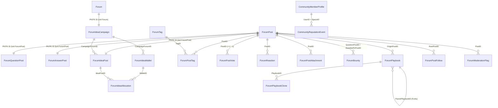
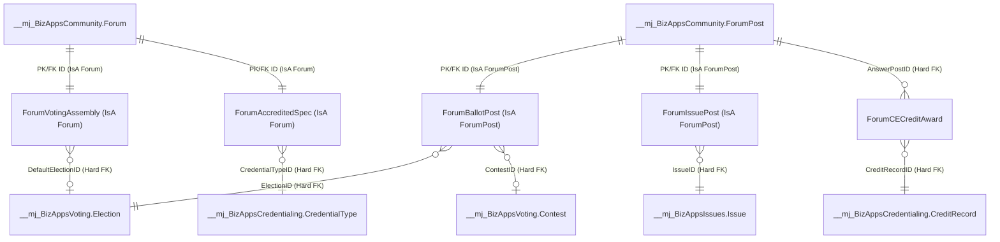

# BizApps Community (`mj-bizapps-community`) — Master Architecture, Full IsA Schema & Engineering Work Plan

> **Companion Deep-Dive Specification:** See [`docs/EXTENSIBILITY_PLAN.md`](../docs/EXTENSIBILITY_PLAN.md) for the complete `ForumType` & `PostType` plug-in driver contracts (`BaseForumServerDriver`, `BaseForumUIDriver`, `BasePostServerDriver`, `BasePostUIDriver`), MJ Core Docs/Slides/Sheets (`MJ PR #6215`) integration, AI-generated interactive games (`MJ PR #5257`), and downstream bridge Open App blueprints (`mj-bizapps-community-voting`, `mj-bizapps-community-issues`, `mj-bizapps-community-credentialing`).

---

## 1. Architectural Vision

**BizApps Community** (`__mj_BizAppsCommunity`) is an AI-native community, epistemic Q&A, participatory ideation, collaborative document co-authoring, and interactive knowledge-synthesis Open App for **MemberJunction (MJ)** built directly on top of **BizApps Collaboration** (`__mj_BizAppsCollaboration`) and **BizApps Forms** (`__mj_BizAppsForms`).

Rather than isolating member discussions in a disconnected forum silo—or polluting core tables with untyped polymorphic soft keys—`mj-bizapps-community` applies the **MemberJunction `IsA` entity inheritance and plug-in driver architecture** across two orthogonal axes:

1. **Two-Axis Plug-In Extensibility (`ForumType` + `PostType`) with 100% Hard SQL Foreign Keys:**
   - **`ForumType`** governs forum/channel containers (`Forum` and hierarchical `ParentForumID` sub-forums), declaring a `ServerDriverClass`, `UIDriverClass`, optional `BaseForumTypeID` parent, and optional 1:1 `ForumExtensionEntity` (`IsA` `Forum`, such as `ForumIdeaCampaign`).
   - **`PostType`** governs unified `ForumPost` records (both root posts where `ParentPostID IS NULL` and replies where `ParentPostID IS NOT NULL`), declaring `AllowedPlacement` (`'RootOnly' | 'ReplyOnly' | 'Both'`), `ServerDriverClass`, `UIDriverClass`, optional `BasePostTypeID` parent, and optional 1:1 `PostExtensionEntity` (`IsA` `ForumPost`).
   - **Zero Polymorphic Soft Keys:** Every cross-table and cross-app reference uses a **real SQL `FOREIGN KEY` constraint**, unlocking automatic MJ CodeGen typed properties, entity relationship graphs, cascading validation, and GraphQL joins.
2. **4-Level Hierarchical Configuration Cascade & Per-Forum Participant Roles:**
   - Settings cascade deterministically across four levels:
     1. **Global `MJ: Application Settings`** (`bizapps.community.defaults`)
     2. **`ForumType.Configuration`** (inheriting along `BaseForumTypeID`)
     3. **`CommunitySpace.Configuration`** (Space-level overrides)
     4. **`Forum.Configuration`** (inheriting down `ParentForumID` sub-forums)
   - Controls which `PostType`s are allowed at root vs. reply level and toggles feature switches (`qaGrading`, `ideation`, `formsAndPolls`, `collaborativeDocs`, `interactiveMiniApps`, `moderation`, `anonymousAccess`, `workingSpacePromotion`).
   - **`ForumRoleType` & `ForumMemberRole`** grant granular per-forum participant roles (`forum-admin`, `moderator`, `topic-host`, `expert-reviewer`, `guest-speaker`) with sub-forum inheritance and domain-expert vote weight multipliers.
3. **MJ Core Collaborative Docs, Slides & Sheets (`MJ PR #6215`):**
   - `ForumArtifactPost` (`IsA` `ForumPost`) embeds live Yjs co-edited **MJ Documents (`.doc.md`), Presentations (`.slides.json`), and Spreadsheets (`.sheet.json`)** backed by hard FKs to `__mj.Artifact(ID)` and `__mj.ArtifactVersion(ID)`.
   - Supports delegated co-editing permissions (`AuthorOnly`, `ForumModerators`, `HighTrustMembers`, `AllContributors`), passage-anchored `MJ: Conversations` comment threads, AI agent co-authoring with `Suggest` redlines (`DocumentToolLibrary` / `SlidesToolLibrary` / `SheetsToolLibrary`), and three custom Community `BaseDocumentBlock` plugins (`CommunityThreadSynthesisBlock`, `CommunityCanonAnswerBlock`, `CommunityIdeaLeaderboardBlock`).
4. **Native Polls & Structured Intakes via `BizApps Forms` + AI-Generated Interactive Component Artifacts:**
   - `mj-bizapps-forms` is a **hard dependency** of `mj-bizapps-community`: `ForumFormPost` (`IsA` `ForumPost`) links directly to `__mj_BizAppsForms.Form(ID)` and `FormDistribution(ID)` with real SQL Foreign Keys for inline polls, multi-question surveys, and structured case intakes.
   - `ForumInteractivePost` (`IsA` `ForumPost`) + `ForumInteractiveSession` use **MemberJunction Interactive Component Artifacts** (`MJ: Artifacts` & `MJ: Artifact Versions` with `ArtifactType = 'Component'`, `ComponentSpec` from `@memberjunction/interactive-component-types`, and `@memberjunction/ng-artifacts` `ComponentArtifactViewerComponent` / `<mj-artifact-type-plugin-viewer>`), giving AI-generated trivia games, "Spot the Compliance Flaw" simulations, ROI calculators, and bracket challenges full database storage, immutable version history (`<mj-artifact-version-history>`), client-side permission evaluation (`EvaluateComponentPermissions`), and sandboxed execution (`MJ PR #5257`).
5. **Dual Human + AI Epistemic Answer Grading & Participatory Point-Allocation Ideation:**
   - `ForumQuestionPost` and `ForumAnswerPost` (`IsA` `ForumPost`) combine Stack Overflow-style `+1 / -1` voting (weighted by `ForumRoleType.VoteWeightMultiplier`) with an asynchronous MJ Agent Epistemic Rubric (**Canon Alignment**, **Completeness**, and **Temporal Freshness / Supersession detection**).
   - `ForumIdeaCampaign` (`IsA` `Forum`) and `ForumIdeaPost` (`IsA` `ForumPost`) give members `100-point` wallets (`ForumIdeaWallet`) or Quadratic Voting ($\text{Cost} = \text{Votes}^2$) with demographic/tier slicing via `BizApps Common`.
6. **Configurable Anonymous Public Access (`None` | `TeaserOnly` | `FullRead`):**
   - Enforced at the SQL layer (`fnCommunityForumAccess(@UserID)`) and via the pre-auth public edge (`CommunityPublicEdge` at `/community`), stripping `Team`-band posts unconditionally and preserving visitor intent across login redirects.

---

## 2. Dependency Boundaries: Hard Core vs. Downstream Bridge Open Apps vs. Sonar

### 2.1 Four Hard Upstream Dependencies in [`mj-app.json`](../mj-app.json)

`mj-bizapps-community` declares **four** hard dependencies, enabling enforced SQL `FOREIGN KEY` constraints across all core community workflows:

| Hard Upstream Dependency | SQL Schema | Enforced SQL Foreign Keys & Capabilities in `mj-bizapps-community` |
|---|---|---|
| **BizApps Collaboration** (`mj-bizapps-collaboration`) | `__mj_BizAppsCollaboration` | `CommunitySpace(ID)` IsA `Space(ID)`; `Forum.SpaceID` and `ForumPost.PromotedSpaceID` reference `Space(ID)`; `ForumPostAttachment.SpaceItemID`, `ForumArtifactPost.SpaceItemID`, `ForumInteractivePost.SpaceItemID`, and `ForumPlaybook.SpaceItemID` reference `SpaceItem(ID)`; inherits `fnCollaborationAccess(@UserID)` (`Shared` vs `Team` bands). |
| **BizApps Common** (`mj-bizapps-common`) | `__mj_BizAppsCommon` | `ForumPost.AuthorPersonID`, `ForumPostVote.VoterPersonID`, `ForumIdeaWallet.PersonID`, and `CommunityMemberProfile.PersonID` reference `Person(ID)`; `ForumIdeaWallet.OrganizationID` references `Organization(ID)` for demographic & tier slicing. |
| **BizApps Tasks** (`mj-bizapps-tasks`) | `__mj_BizAppsTasks` | Action items extracted from discussions or created inside promoted Working Spaces land directly in `__mj_BizAppsTasks.Task(ID)`. |
| **BizApps Forms** (`mj-bizapps-forms`) | `__mj_BizAppsForms` | `ForumFormPost(ID)` (IsA `ForumPost`) holds enforced SQL Foreign Keys to `__mj_BizAppsForms.Form(ID)` and `__mj_BizAppsForms.FormDistribution(ID)` for inline polls, pulse checks, and structured intake forms. |

### 2.2 Optional Sibling Domains via Downstream Bridge Open Apps (`mj-bizapps-community-*`)

Optional enterprise domains are **never** referenced via untyped soft UUID columns in `__mj_BizAppsCommunity` (enforced in CI by [`scripts/check-downstream-names.mjs`](../scripts/check-downstream-names.mjs)). Instead, when an organization installs both Community and another BizApp, a lightweight **bridge Open App** provides the `IsA` subtype tables with **100% hard SQL Foreign Keys**:

| Downstream Bridge Open App | Depends On | `IsA` Extension Tables & Hard SQL Foreign Keys |
|---|---|---|
| **`mj-bizapps-community-voting`** | `mj-bizapps-community` + `mj-bizapps-voting` | `ForumVotingAssembly` (`IsA` `Forum`) & `ForumBallotPost` (`IsA` `ForumPost`) with hard FKs to `__mj_BizAppsVoting.Election(ID)` and `BallotItem(ID)` (`<mj-ballot>`). |
| **`mj-bizapps-community-issues`** | `mj-bizapps-community` + `mj-bizapps-issues` | `ForumIssuePost` (`IsA` `ForumPost`) with a hard FK to `__mj_BizAppsIssues.Issue(ID)` and two-way status/resolution webhooks. |
| **`mj-bizapps-community-credentialing`** | `mj-bizapps-community` + `mj-bizapps-credentialing` | `ForumAccreditedSpec` (`IsA` `Forum`) & `ForumCECreditAward` with hard FKs to `__mj_BizAppsCredentialing.CredentialType(ID)` and `CreditRecord(ID)` for verified domain-expert vote weighting and CE micro-credits. |

### 2.3 Why `BizApps Sonar` (`mj-bizapps-sonar`) Needs Zero Bridge Tables in Community

* **`BizApps Sonar`** is an ingest and engagement-scoring engine that sits **strictly downstream** of `mj-bizapps-community`.
* Sonar discovers `__mj_BizAppsCommunity` tables (`ForumPost`, `ForumAnswerPost`, `ForumPostVote`, `ForumIdeaAllocation`, `ForumPlaybookClone`, `ForumInteractiveSession`) dynamically at runtime through MemberJunction's core metadata (`__mj.Entity`, `ModelRelatedEntity`, `Factor`).
* Therefore, `mj-bizapps-community` has **zero compile-time or schema references** to Sonar.

---

## 3. Mermaid Entity-Relationship Diagrams (ERD)

### 3.1 Core `IsA` Hierarchy & Upstream Hard-FK ERD (`__mj_BizAppsCommunity`)

```mermaid
erDiagram
    %% Upstream Hard Dependencies
    COLLAB_Space["__mj_BizAppsCollaboration.Space"]
    COLLAB_SpaceItem["__mj_BizAppsCollaboration.SpaceItem"]
    COMMON_Person["__mj_BizAppsCommon.Person"]
    COMMON_Org["__mj_BizAppsCommon.Organization"]
    FORMS_Form["__mj_BizAppsForms.Form"]
    FORMS_Dist["__mj_BizAppsForms.FormDistribution"]
    MJ_Artifact["__mj.Artifact (Docs/Slides/Sheets & Interactive Components)"]
    MJ_ArtifactVer["__mj.ArtifactVersion"]

    %% Community Container Axis
    COMM_Space["CommunitySpace (IsA Space)"]
    COMM_ForumType["ForumType (Container Plugin Registry)"]
    COMM_Forum["Forum (Hierarchical ParentForumID)"]
    COMM_RoleType["ForumRoleType"]
    COMM_MemberRole["ForumMemberRole"]
    COMM_IdeaCampaign["ForumIdeaCampaign (IsA Forum)"]

    %% Unified Post Axis & IsA Subtype Tables
    COMM_PostType["PostType (Post Plugin Registry)"]
    COMM_Post["ForumPost (Unified Root & Reply Base)"]
    COMM_QuestionPost["ForumQuestionPost (IsA ForumPost)"]
    COMM_AnswerPost["ForumAnswerPost (IsA ForumPost)"]
    COMM_IdeaPost["ForumIdeaPost (IsA ForumPost)"]
    COMM_FormPost["ForumFormPost (IsA ForumPost)"]
    COMM_ArtifactPost["ForumArtifactPost (IsA ForumPost)"]
    COMM_CasePost["ForumCaseReviewPost (IsA ForumPost)"]
    COMM_AMAPost["ForumAMAPost (IsA ForumPost)"]
    COMM_InteractivePost["ForumInteractivePost (IsA ForumPost)"]
    COMM_InteractiveSession["ForumInteractiveSession"]

    COLLAB_Space ||--|| COMM_Space : "PK/FK ID (IsA Space)"
    COMM_Space ||--o{ COMM_Forum : "SpaceID"
    COMM_ForumType ||--o{ COMM_Forum : "ForumTypeID"
    COMM_ForumType ||--o{ COMM_ForumType : "BaseForumTypeID"
    COMM_Forum ||--o{ COMM_Forum : "ParentForumID (Sub-Forums)"
    COMM_Forum ||--|| COMM_IdeaCampaign : "PK/FK ID (IsA Forum)"

    COMM_Forum ||--o{ COMM_MemberRole : "ForumID"
    COMM_RoleType ||--o{ COMM_MemberRole : "ForumRoleTypeID"

    COMM_Forum ||--o{ COMM_Post : "ForumID"
    COMM_PostType ||--o{ COMM_Post : "PostTypeID"
    COMM_PostType ||--o{ COMM_PostType : "BasePostTypeID"
    COMM_Post ||--o{ COMM_Post : "ParentPostID / RootPostID"
    COMM_Post }o--o| COLLAB_Space : "PromotedSpaceID (Hard FK)"
    COMMON_Person ||--o{ COMM_Post : "AuthorPersonID (Hard FK)"

    COMM_Post ||--|| COMM_QuestionPost : "PK/FK ID (IsA ForumPost)"
    COMM_Post ||--|| COMM_AnswerPost : "PK/FK ID (IsA ForumPost)"
    COMM_Post ||--|| COMM_IdeaPost : "PK/FK ID (IsA ForumPost)"
    COMM_Post ||--|| COMM_FormPost : "PK/FK ID (IsA ForumPost)"
    COMM_Post ||--|| COMM_ArtifactPost : "PK/FK ID (IsA ForumPost)"
    COMM_Post ||--|| COMM_CasePost : "PK/FK ID (IsA ForumPost)"
    COMM_Post ||--|| COMM_AMAPost : "PK/FK ID (IsA ForumPost)"
    COMM_Post ||--|| COMM_InteractivePost : "PK/FK ID (IsA ForumPost)"
    COMM_InteractivePost ||--o{ COMM_InteractiveSession : "InteractivePostID"

    FORMS_Form ||--o{ COMM_FormPost : "FormID (Hard FK)"
    FORMS_Dist ||--o{ COMM_FormPost : "FormDistributionID (Hard FK)"
    MJ_Artifact ||--o{ COMM_ArtifactPost : "ArtifactID (Hard FK)"
    MJ_ArtifactVer ||--o{ COMM_ArtifactPost : "PinnedArtifactVersionID (Hard FK)"
    COLLAB_SpaceItem ||--o{ COMM_ArtifactPost : "SpaceItemID (Hard FK)"
    MJ_Artifact ||--o{ COMM_InteractivePost : "ComponentArtifactID (Hard FK)"
    MJ_ArtifactVer ||--o{ COMM_InteractivePost : "PinnedArtifactVersionID (Hard FK)"
    COLLAB_SpaceItem ||--o{ COMM_InteractivePost : "SpaceItemID (Hard FK)"
    MJ_ArtifactVer ||--o{ COMM_InteractiveSession : "ArtifactVersionID (Hard FK)"
    COMMON_Org ||--o{ COMMON_Person : "Affiliates"
```



### 3.2 Complete Internal `__mj_BizAppsCommunity` Supporting Entities ERD



### 3.3 Downstream Bridge Open Apps ERD (100% Hard SQL Foreign Keys)



---

## 4. Full Production SQL Schema Specification (`migrations/B202611060000__v0.1.x__Baseline.sql`)

Below is the complete baseline DDL for schema `__mj_BizAppsCommunity` (29 tables total: 19 core & governance tables + 10 `IsA` subtype & interactive session tables). Every relationship uses a **hard SQL `FOREIGN KEY` constraint**—zero untyped polymorphic soft keys.

```sql
IF NOT EXISTS (SELECT 1 FROM sys.schemas WHERE name = N'${flyway:defaultSchema}')
    EXEC('CREATE SCHEMA [${flyway:defaultSchema}]');
GO

-- ============================================================================
-- 1. CommunitySpace (1:1 IsA Extension of __mj_BizAppsCollaboration.Space)
-- ============================================================================
CREATE TABLE [${flyway:defaultSchema}].[CommunitySpace] (
    [ID] UNIQUEIDENTIFIER NOT NULL,
    [Slug] NVARCHAR(120) NOT NULL,
    [CommunityKind] NVARCHAR(30) NOT NULL CONSTRAINT [DF_CommunitySpace_Kind] DEFAULT (N'AssociationWide'),
    [AnonymousAccessMode] NVARCHAR(20) NOT NULL CONSTRAINT [DF_CommunitySpace_AnonMode] DEFAULT (N'None'),
    [AllowAnonymousSearch] BIT NOT NULL CONSTRAINT [DF_CommunitySpace_AnonSearch] DEFAULT (0),
    [RequireLoginPromptAfterPosts] INT NOT NULL CONSTRAINT [DF_CommunitySpace_TeaserCount] DEFAULT (3),
    [DefaultDigestFrequency] NVARCHAR(20) NOT NULL CONSTRAINT [DF_CommunitySpace_Digest] DEFAULT (N'Daily'),
    [InboundEmailDomain] NVARCHAR(255) NULL,
    [Configuration] NVARCHAR(MAX) NULL, -- Level 3 JSON overrides in 4-level settings cascade
    CONSTRAINT [PK_CommunitySpace] PRIMARY KEY CLUSTERED ([ID]),
    CONSTRAINT [UQ_CommunitySpace_Slug] UNIQUE NONCLUSTERED ([Slug]),
    CONSTRAINT [FK_CommunitySpace_Space] FOREIGN KEY ([ID]) REFERENCES [__mj_BizAppsCollaboration].[Space]([ID]),
    CONSTRAINT [CK_CommunitySpace_Kind] CHECK ([CommunityKind] IN (
        N'AssociationWide', N'Chapter', N'SpecialInterestGroup', N'Cohort', N'ProductCommunity', N'WorkingGroup'
    )),
    CONSTRAINT [CK_CommunitySpace_AnonMode] CHECK ([AnonymousAccessMode] IN (N'None', N'TeaserOnly', N'FullRead')),
    CONSTRAINT [CK_CommunitySpace_Digest] CHECK ([DefaultDigestFrequency] IN (N'None', N'Daily', N'Weekly', N'Realtime'))
);
GO

-- ============================================================================
-- 2. ForumType (Extensible Forum Container Plug-In Registry)
-- ============================================================================
CREATE TABLE [${flyway:defaultSchema}].[ForumType] (
    [ID] UNIQUEIDENTIFIER NOT NULL CONSTRAINT [DF_ForumType_ID] DEFAULT (NEWSEQUENTIALID()),
    [Code] NVARCHAR(100) NOT NULL,
    [Name] NVARCHAR(100) NOT NULL,
    [Description] NVARCHAR(MAX) NULL,
    [Icon] NVARCHAR(100) NULL,
    [ExtensionEntity] NVARCHAR(255) NULL,      -- MJ Entity name of 1:1 IsA child table off Forum
    [ServerDriverClass] NVARCHAR(200) NULL,    -- @RegisterClass(BaseForumServerDriver, '<Key>')
    [UIDriverClass] NVARCHAR(200) NULL,        -- @RegisterClass(BaseForumUIDriver, '<Key>')
    [Configuration] NVARCHAR(MAX) NULL,        -- Level 2 JSON defaults (allowed PostTypes & feature switches)
    [Sequence] INT NOT NULL CONSTRAINT [DF_ForumType_Sequence] DEFAULT (0),
    [IsActive] BIT NOT NULL CONSTRAINT [DF_ForumType_IsActive] DEFAULT (1),
    CONSTRAINT [PK_ForumType] PRIMARY KEY CLUSTERED ([ID]),
    CONSTRAINT [UQ_ForumType_Code] UNIQUE NONCLUSTERED ([Code]),
    CONSTRAINT [UQ_ForumType_Name] UNIQUE NONCLUSTERED ([Name])
);
GO

-- ============================================================================
-- 3. Forum (Hierarchical Forum / Sub-Forum Containers)
-- ============================================================================
CREATE TABLE [${flyway:defaultSchema}].[Forum] (
    [ID] UNIQUEIDENTIFIER NOT NULL CONSTRAINT [DF_Forum_ID] DEFAULT (NEWSEQUENTIALID()),
    [SpaceID] UNIQUEIDENTIFIER NOT NULL,
    [ParentForumID] UNIQUEIDENTIFIER NULL,
    [ForumTypeID] UNIQUEIDENTIFIER NOT NULL,
    [Name] NVARCHAR(200) NOT NULL,
    [Slug] NVARCHAR(120) NOT NULL,
    [Description] NVARCHAR(MAX) NULL,
    [Icon] NVARCHAR(100) NULL,
    [ColorHex] NVARCHAR(20) NULL,
    [VisibilityBand] NVARCHAR(20) NOT NULL CONSTRAINT [DF_Forum_Band] DEFAULT (N'Shared'),
    [AnonymousReadMode] NVARCHAR(30) NULL,
    [InheritsSpaceMembers] BIT NOT NULL CONSTRAINT [DF_Forum_Inherits] DEFAULT (1),
    [PostingPolicy] NVARCHAR(30) NOT NULL CONSTRAINT [DF_Forum_Policy] DEFAULT (N'Open'),
    [Configuration] NVARCHAR(MAX) NULL, -- Level 4 JSON overrides (filtered through ForumOverridable)
    [Sequence] INT NOT NULL CONSTRAINT [DF_Forum_Sequence] DEFAULT (0),
    [Status] NVARCHAR(30) NOT NULL CONSTRAINT [DF_Forum_Status] DEFAULT (N'Active'),
    CONSTRAINT [PK_Forum] PRIMARY KEY CLUSTERED ([ID]),
    CONSTRAINT [UQ_Forum_Space_Slug] UNIQUE NONCLUSTERED ([SpaceID], [Slug]),
    CONSTRAINT [FK_Forum_Space] FOREIGN KEY ([SpaceID]) REFERENCES [${flyway:defaultSchema}].[CommunitySpace]([ID]),
    CONSTRAINT [FK_Forum_ParentForum] FOREIGN KEY ([ParentForumID]) REFERENCES [${flyway:defaultSchema}].[Forum]([ID]),
    CONSTRAINT [FK_Forum_ForumType] FOREIGN KEY ([ForumTypeID]) REFERENCES [${flyway:defaultSchema}].[ForumType]([ID]),
    CONSTRAINT [CK_Forum_Band] CHECK ([VisibilityBand] IN (N'Shared', N'Team', N'PrivateForum')),
    CONSTRAINT [CK_Forum_AnonOverride] CHECK ([AnonymousReadMode] IS NULL OR [AnonymousReadMode] IN (N'None', N'Teaser Only', N'Full Read'))
);
GO

-- ============================================================================
-- 4. ForumIdeaCampaign (1:1 IsA Extension of Forum for Ideation & Roadmaps)
-- ============================================================================
CREATE TABLE [${flyway:defaultSchema}].[ForumIdeaCampaign] (
    [ID] UNIQUEIDENTIFIER NOT NULL,
    [VotingMechanism] NVARCHAR(30) NOT NULL CONSTRAINT [DF_ForumIdeaCampaign_Mech] DEFAULT (N'PointAllocation'),
    [PointsBudgetPerUser] INT NOT NULL CONSTRAINT [DF_ForumIdeaCampaign_Budget] DEFAULT (100),
    [MaxPointsPerIdea] INT NULL,
    [RefundPointsOnShipped] BIT NOT NULL CONSTRAINT [DF_ForumIdeaCampaign_Refund] DEFAULT (1),
    [WeightBySegmentMode] NVARCHAR(30) NOT NULL CONSTRAINT [DF_ForumIdeaCampaign_Weight] DEFAULT (N'EqualOnePersonOneBudget'),
    [CampaignStatus] NVARCHAR(30) NOT NULL CONSTRAINT [DF_ForumIdeaCampaign_Status] DEFAULT (N'VotingOpen'),
    [OpensAt] DATETIMEOFFSET(7) NULL,
    [ClosesAt] DATETIMEOFFSET(7) NULL,
    CONSTRAINT [PK_ForumIdeaCampaign] PRIMARY KEY CLUSTERED ([ID]),
    CONSTRAINT [FK_ForumIdeaCampaign_Forum] FOREIGN KEY ([ID]) REFERENCES [${flyway:defaultSchema}].[Forum]([ID]),
    CONSTRAINT [CK_ForumIdeaCampaign_Mech] CHECK ([VotingMechanism] IN (N'PointAllocation', N'Quadratic', N'Approval')),
    CONSTRAINT [CK_ForumIdeaCampaign_Weight] CHECK ([WeightBySegmentMode] IN (N'EqualOnePersonOneBudget', N'TierWeighted', N'CredentialWeighted')),
    CONSTRAINT [CK_ForumIdeaCampaign_Status] CHECK ([CampaignStatus] IN (N'Draft', N'OpenForSubmissions', N'VotingOpen', N'Closed', N'Archived')),
    CONSTRAINT [CK_ForumIdeaCampaign_BudgetPositive] CHECK ([PointsBudgetPerUser] > 0)
);
GO

-- ============================================================================
-- 5. ForumRoleType & 6. ForumMemberRole (Per-Forum Participant Roles)
-- ============================================================================
CREATE TABLE [${flyway:defaultSchema}].[ForumRoleType] (
    [ID] UNIQUEIDENTIFIER NOT NULL CONSTRAINT [DF_ForumRoleType_ID] DEFAULT (NEWSEQUENTIALID()),
    [Name] NVARCHAR(100) NOT NULL,
    [DisplayName] NVARCHAR(100) NOT NULL,
    [Description] NVARCHAR(500) NULL,
    [CanPinOrLock] BIT NOT NULL CONSTRAINT [DF_ForumRoleType_Pin] DEFAULT (0),
    [CanModerateQueue] BIT NOT NULL CONSTRAINT [DF_ForumRoleType_Mod] DEFAULT (0),
    [CanVerifyCanon] BIT NOT NULL CONSTRAINT [DF_ForumRoleType_Canon] DEFAULT (0),
    [CanPromoteToSpace] BIT NOT NULL CONSTRAINT [DF_ForumRoleType_Promote] DEFAULT (0),
    [CanConfigureForum] BIT NOT NULL CONSTRAINT [DF_ForumRoleType_Config] DEFAULT (0),
    [VoteWeightMultiplier] DECIMAL(5,2) NOT NULL CONSTRAINT [DF_ForumRoleType_Weight] DEFAULT (1.00),
    CONSTRAINT [PK_ForumRoleType] PRIMARY KEY CLUSTERED ([ID]),
    CONSTRAINT [UQ_ForumRoleType_Name] UNIQUE NONCLUSTERED ([Name])
);
GO

CREATE TABLE [${flyway:defaultSchema}].[ForumMemberRole] (
    [ID] UNIQUEIDENTIFIER NOT NULL CONSTRAINT [DF_ForumMemberRole_ID] DEFAULT (NEWSEQUENTIALID()),
    [ForumID] UNIQUEIDENTIFIER NOT NULL,
    [UserID] UNIQUEIDENTIFIER NOT NULL,
    [PersonID] UNIQUEIDENTIFIER NULL,
    [ForumRoleTypeID] UNIQUEIDENTIFIER NOT NULL,
    [InheritsToSubForums] BIT NOT NULL CONSTRAINT [DF_ForumMemberRole_Inherit] DEFAULT (1),
    [GrantedByUserID] UNIQUEIDENTIFIER NULL,
    [ExpiresAt] DATETIMEOFFSET(7) NULL,
    CONSTRAINT [PK_ForumMemberRole] PRIMARY KEY CLUSTERED ([ID]),
    CONSTRAINT [UQ_ForumMemberRole_Forum_User_Role] UNIQUE NONCLUSTERED ([ForumID], [UserID], [ForumRoleTypeID]),
    CONSTRAINT [FK_ForumMemberRole_Forum] FOREIGN KEY ([ForumID]) REFERENCES [${flyway:defaultSchema}].[Forum]([ID]),
    CONSTRAINT [FK_ForumMemberRole_User] FOREIGN KEY ([UserID]) REFERENCES [__mj].[User]([ID]),
    CONSTRAINT [FK_ForumMemberRole_Person] FOREIGN KEY ([PersonID]) REFERENCES [__mj_BizAppsCommon].[Person]([ID]),
    CONSTRAINT [FK_ForumMemberRole_RoleType] FOREIGN KEY ([ForumRoleTypeID]) REFERENCES [${flyway:defaultSchema}].[ForumRoleType]([ID]),
    CONSTRAINT [FK_ForumMemberRole_GrantedBy] FOREIGN KEY ([GrantedByUserID]) REFERENCES [__mj].[User]([ID])
);
GO

-- ============================================================================
-- 7. PostType (Extensible Post Plug-In Registry — Root, Reply, or Both)
-- ============================================================================
CREATE TABLE [${flyway:defaultSchema}].[PostType] (
    [ID] UNIQUEIDENTIFIER NOT NULL CONSTRAINT [DF_PostType_ID] DEFAULT (NEWSEQUENTIALID()),
    [Name] NVARCHAR(100) NOT NULL,
    [DisplayName] NVARCHAR(100) NOT NULL,
    [Description] NVARCHAR(MAX) NULL,
    [IconClass] NVARCHAR(100) NULL,
    [BasePostTypeID] UNIQUEIDENTIFIER NULL,
    [AllowedPlacement] NVARCHAR(20) NOT NULL CONSTRAINT [DF_PostType_Placement] DEFAULT (N'Both'),
    [PostExtensionEntity] NVARCHAR(255) NULL, -- MJ Entity name of 1:1 IsA child table off ForumPost
    [ServerDriverClass] NVARCHAR(255) NULL,   -- @RegisterClass(BasePostServerDriver, '<Key>')
    [UIDriverClass] NVARCHAR(255) NULL,       -- @RegisterClass(BasePostUIDriver, '<Key>')
    [DefaultReplyPostTypeID] UNIQUEIDENTIFIER NULL,
    [Configuration] NVARCHAR(MAX) NULL,
    [IsSystem] BIT NOT NULL CONSTRAINT [DF_PostType_IsSystem] DEFAULT (0),
    [IsActive] BIT NOT NULL CONSTRAINT [DF_PostType_IsActive] DEFAULT (1),
    CONSTRAINT [PK_PostType] PRIMARY KEY CLUSTERED ([ID]),
    CONSTRAINT [UQ_PostType_Name] UNIQUE NONCLUSTERED ([Name]),
    CONSTRAINT [FK_PostType_BasePostType] FOREIGN KEY ([BasePostTypeID]) REFERENCES [${flyway:defaultSchema}].[PostType]([ID]),
    CONSTRAINT [FK_PostType_DefaultReplyPostType] FOREIGN KEY ([DefaultReplyPostTypeID]) REFERENCES [${flyway:defaultSchema}].[PostType]([ID]),
    CONSTRAINT [CK_PostType_Placement] CHECK ([AllowedPlacement] IN (N'RootOnly', N'ReplyOnly', N'Both'))
);
GO

-- ============================================================================
-- 8. ForumPost (Unified Root & Reply Base Entity — Root of Post IsA Hierarchy)
-- ============================================================================
CREATE TABLE [${flyway:defaultSchema}].[ForumPost] (
    [ID] UNIQUEIDENTIFIER NOT NULL CONSTRAINT [DF_ForumPost_ID] DEFAULT (NEWSEQUENTIALID()),
    [SpaceID] UNIQUEIDENTIFIER NOT NULL,
    [ForumID] UNIQUEIDENTIFIER NOT NULL,
    [PostTypeID] UNIQUEIDENTIFIER NOT NULL,
    [RootPostID] UNIQUEIDENTIFIER NULL,   -- NULL when this post is a root thread post
    [ParentPostID] UNIQUEIDENTIFIER NULL, -- NULL when this post is a root thread post
    [AuthorUserID] UNIQUEIDENTIFIER NOT NULL,
    [AuthorPersonID] UNIQUEIDENTIFIER NULL,
    [Title] NVARCHAR(300) NULL,           -- Populated for root posts and titled artifacts/forms
    [Slug] NVARCHAR(220) NULL,
    [BodyMarkdown] NVARCHAR(MAX) NOT NULL,
    [BodyPlainText] NVARCHAR(MAX) NULL,
    [Band] NVARCHAR(20) NOT NULL CONSTRAINT [DF_ForumPost_Band] DEFAULT (N'Shared'),
    [Status] NVARCHAR(30) NOT NULL CONSTRAINT [DF_ForumPost_Status] DEFAULT (N'Open'),
    [PostedVia] NVARCHAR(20) NOT NULL CONSTRAINT [DF_ForumPost_Via] DEFAULT (N'Web'),
    [IsPinned] BIT NOT NULL CONSTRAINT [DF_ForumPost_Pinned] DEFAULT (0),
    [PinScope] NVARCHAR(20) NOT NULL CONSTRAINT [DF_ForumPost_PinScope] DEFAULT (N'None'),
    [PinnedUntil] DATETIMEOFFSET(7) NULL,
    [IsLowSignalNoise] BIT NOT NULL CONSTRAINT [DF_ForumPost_LowSignal] DEFAULT (0),
    [ReplyCount] INT NOT NULL CONSTRAINT [DF_ForumPost_ReplyCount] DEFAULT (0),
    [ParticipantCount] INT NOT NULL CONSTRAINT [DF_ForumPost_PartCount] DEFAULT (1),
    [ViewCount] INT NOT NULL CONSTRAINT [DF_ForumPost_ViewCount] DEFAULT (0),
    [AnonymousViewCount] INT NOT NULL CONSTRAINT [DF_ForumPost_AnonViews] DEFAULT (0),
    [UpvoteCount] INT NOT NULL CONSTRAINT [DF_ForumPost_Upvotes] DEFAULT (0),
    [DownvoteCount] INT NOT NULL CONSTRAINT [DF_ForumPost_Downvotes] DEFAULT (0),
    [NetVoteScore] INT NOT NULL CONSTRAINT [DF_ForumPost_NetVotes] DEFAULT (0),
    [ExpertWeightedScore] DECIMAL(12,2) NOT NULL CONSTRAINT [DF_ForumPost_ExpScore] DEFAULT (0),
    [BridgingConsensusScore] DECIMAL(8,4) NULL,
    [HotnessScore] DECIMAL(18,6) NOT NULL CONSTRAINT [DF_ForumPost_Hotness] DEFAULT (0),
    [AISummary] NVARCHAR(MAX) NULL,
    [AIConsensusJSON] NVARCHAR(MAX) NULL,
    [AISummaryUpdatedAt] DATETIMEOFFSET(7) NULL,
    [AISummaryReplyWatermark] INT NOT NULL CONSTRAINT [DF_ForumPost_Watermark] DEFAULT (0),
    [PromotedSpaceID] UNIQUEIDENTIFIER NULL,
    [ModerationStatus] NVARCHAR(30) NOT NULL CONSTRAINT [DF_ForumPost_ModStatus] DEFAULT (N'Visible'),
    [LastActivityAt] DATETIMEOFFSET(7) NOT NULL CONSTRAINT [DF_ForumPost_LastAct] DEFAULT (SYSDATETIMEOFFSET()),
    [EditedAt] DATETIMEOFFSET(7) NULL,
    [EditedByUserID] UNIQUEIDENTIFIER NULL,
    [EditReason] NVARCHAR(300) NULL,
    CONSTRAINT [PK_ForumPost] PRIMARY KEY CLUSTERED ([ID]),
    CONSTRAINT [FK_ForumPost_Space] FOREIGN KEY ([SpaceID]) REFERENCES [__mj_BizAppsCollaboration].[Space]([ID]),
    CONSTRAINT [FK_ForumPost_Forum] FOREIGN KEY ([ForumID]) REFERENCES [${flyway:defaultSchema}].[Forum]([ID]),
    CONSTRAINT [FK_ForumPost_PostType] FOREIGN KEY ([PostTypeID]) REFERENCES [${flyway:defaultSchema}].[PostType]([ID]),
    CONSTRAINT [FK_ForumPost_RootPost] FOREIGN KEY ([RootPostID]) REFERENCES [${flyway:defaultSchema}].[ForumPost]([ID]),
    CONSTRAINT [FK_ForumPost_ParentPost] FOREIGN KEY ([ParentPostID]) REFERENCES [${flyway:defaultSchema}].[ForumPost]([ID]),
    CONSTRAINT [FK_ForumPost_AuthorUser] FOREIGN KEY ([AuthorUserID]) REFERENCES [__mj].[User]([ID]),
    CONSTRAINT [FK_ForumPost_AuthorPerson] FOREIGN KEY ([AuthorPersonID]) REFERENCES [__mj_BizAppsCommon].[Person]([ID]),
    CONSTRAINT [FK_ForumPost_PromotedSpace] FOREIGN KEY ([PromotedSpaceID]) REFERENCES [__mj_BizAppsCollaboration].[Space]([ID]),
    CONSTRAINT [FK_ForumPost_EditedBy] FOREIGN KEY ([EditedByUserID]) REFERENCES [__mj].[User]([ID]),
    CONSTRAINT [CK_ForumPost_Band] CHECK ([Band] IN (N'Shared', N'Team')),
    CONSTRAINT [CK_ForumPost_Status] CHECK ([Status] IN (
        N'Open', N'Answered', N'UnderReview', N'Planned', N'InWorkingSpace', N'Shipped', N'Resolved', N'Archived', N'Locked'
    )),
    CONSTRAINT [CK_ForumPost_PinScope] CHECK ([PinScope] IN (N'None', N'Forum', N'Space')),
    CONSTRAINT [CK_ForumPost_Via] CHECK ([PostedVia] IN (N'Web', N'Mobile', N'EmailReply', N'Agent', N'MigratedImport')),
    CONSTRAINT [CK_ForumPost_ModStatus] CHECK ([ModerationStatus] IN (
        N'Visible', N'CollapsedByCommunity', N'PendingModeration', N'QuarantinedByAI', N'RemovedByModerator'
    ))
);
GO

-- ============================================================================
-- 9. ForumQuestionPost (1:1 IsA ForumPost — Root Q&A Question Extension)
-- ============================================================================
CREATE TABLE [${flyway:defaultSchema}].[ForumQuestionPost] (
    [ID] UNIQUEIDENTIFIER NOT NULL,
    [AcceptedAnswerPostID] UNIQUEIDENTIFIER NULL,
    [AIVerifiedAnswerPostID] UNIQUEIDENTIFIER NULL,
    [QuestionUrgency] NVARCHAR(20) NOT NULL CONSTRAINT [DF_ForumQuestionPost_Urgency] DEFAULT (N'Normal'),
    [RequiredDomainTag] NVARCHAR(100) NULL,
    [HasActiveBounty] BIT NOT NULL CONSTRAINT [DF_ForumQuestionPost_Bounty] DEFAULT (0),
    CONSTRAINT [PK_ForumQuestionPost] PRIMARY KEY CLUSTERED ([ID]),
    CONSTRAINT [FK_ForumQuestionPost_Post] FOREIGN KEY ([ID]) REFERENCES [${flyway:defaultSchema}].[ForumPost]([ID]),
    CONSTRAINT [FK_ForumQuestionPost_AcceptedAnswer] FOREIGN KEY ([AcceptedAnswerPostID]) REFERENCES [${flyway:defaultSchema}].[ForumPost]([ID]),
    CONSTRAINT [FK_ForumQuestionPost_AIVerifiedAnswer] FOREIGN KEY ([AIVerifiedAnswerPostID]) REFERENCES [${flyway:defaultSchema}].[ForumPost]([ID]),
    CONSTRAINT [CK_ForumQuestionPost_Urgency] CHECK ([QuestionUrgency] IN (N'Normal', N'TimeSensitive', N'ComplianceCritical'))
);
GO

-- ============================================================================
-- 10. ForumAnswerPost (1:1 IsA ForumPost — Graded Q&A Answer Extension)
-- ============================================================================
CREATE TABLE [${flyway:defaultSchema}].[ForumAnswerPost] (
    [ID] UNIQUEIDENTIFIER NOT NULL,
    [QuestionPostID] UNIQUEIDENTIFIER NOT NULL,
    [IsAcceptedByAuthor] BIT NOT NULL CONSTRAINT [DF_ForumAnswerPost_Accepted] DEFAULT (0),
    [IsVerifiedByModerator] BIT NOT NULL CONSTRAINT [DF_ForumAnswerPost_Verified] DEFAULT (0),
    [VerifiedByUserID] UNIQUEIDENTIFIER NULL,
    [VerifiedAt] DATETIMEOFFSET(7) NULL,
    [AIEpistemicStatus] NVARCHAR(40) NULL,
    [AIConfidenceScore] DECIMAL(4,3) NULL,
    [AIRationaleMarkdown] NVARCHAR(MAX) NULL,
    [FreshnessReviewDueAt] DATETIMEOFFSET(7) NULL,
    CONSTRAINT [PK_ForumAnswerPost] PRIMARY KEY CLUSTERED ([ID]),
    CONSTRAINT [FK_ForumAnswerPost_Post] FOREIGN KEY ([ID]) REFERENCES [${flyway:defaultSchema}].[ForumPost]([ID]),
    CONSTRAINT [FK_ForumAnswerPost_QuestionPost] FOREIGN KEY ([QuestionPostID]) REFERENCES [${flyway:defaultSchema}].[ForumQuestionPost]([ID]),
    CONSTRAINT [FK_ForumAnswerPost_VerifiedByUser] FOREIGN KEY ([VerifiedByUserID]) REFERENCES [${mjSchema}].[User]([ID]),
    CONSTRAINT [CK_ForumAnswerPost_EpistemicStatus] CHECK ([AIEpistemicStatus] IS NULL OR [AIEpistemicStatus] IN (
        N'Canon Verified', N'Novel Insight', N'Partially Outdated', N'Conflicts With Canon'
    ))
);
GO

-- ============================================================================
-- 11. ForumIdeaPost (1:1 IsA ForumPost — Ideation & Feature Proposal Extension)
-- ============================================================================
CREATE TABLE [${flyway:defaultSchema}].[ForumIdeaPost] (
    [ID] UNIQUEIDENTIFIER NOT NULL,
    [CampaignForumID] UNIQUEIDENTIFIER NOT NULL,
    [IdeaStatus] NVARCHAR(30) NOT NULL CONSTRAINT [DF_ForumIdeaPost_Status] DEFAULT (N'UnderConsideration'),
    [TotalPointsAllocated] INT NOT NULL CONSTRAINT [DF_ForumIdeaPost_Points] DEFAULT (0),
    [UniqueAllocatorCount] INT NOT NULL CONSTRAINT [DF_ForumIdeaPost_Allocators] DEFAULT (0),
    [QuadraticEffectiveScore] DECIMAL(12,4) NOT NULL CONSTRAINT [DF_ForumIdeaPost_QuadScore] DEFAULT (0),
    [TargetReleaseLabel] NVARCHAR(80) NULL,
    [OfficialResponseMarkdown] NVARCHAR(MAX) NULL,
    CONSTRAINT [PK_ForumIdeaPost] PRIMARY KEY CLUSTERED ([ID]),
    CONSTRAINT [FK_ForumIdeaPost_Post] FOREIGN KEY ([ID]) REFERENCES [${flyway:defaultSchema}].[ForumPost]([ID]),
    CONSTRAINT [FK_ForumIdeaPost_Campaign] FOREIGN KEY ([CampaignForumID]) REFERENCES [${flyway:defaultSchema}].[ForumIdeaCampaign]([ID]),
    CONSTRAINT [CK_ForumIdeaPost_Status] CHECK ([IdeaStatus] IN (
        N'UnderConsideration', N'NeedsMoreDetail', N'Planned', N'InDevelopment', N'Shipped', N'Declined'
    ))
);
GO

-- ============================================================================
-- 12. ForumFormPost (1:1 IsA ForumPost — Hard FK to BizApps Forms)
-- ============================================================================
CREATE TABLE [${flyway:defaultSchema}].[ForumFormPost] (
    [ID] UNIQUEIDENTIFIER NOT NULL,
    [FormID] UNIQUEIDENTIFIER NOT NULL,
    [FormDistributionID] UNIQUEIDENTIFIER NULL,
    [PresentationMode] NVARCHAR(30) NOT NULL CONSTRAINT [DF_ForumFormPost_Mode] DEFAULT (N'InlinePollCard'),
    [ResultVisibility] NVARCHAR(30) NOT NULL CONSTRAINT [DF_ForumFormPost_Vis] DEFAULT (N'AfterSubmission'),
    [AllowMultipleSubmissions] BIT NOT NULL CONSTRAINT [DF_ForumFormPost_Multi] DEFAULT (0),
    [ClosesAt] DATETIMEOFFSET(7) NULL,
    CONSTRAINT [PK_ForumFormPost] PRIMARY KEY CLUSTERED ([ID]),
    CONSTRAINT [FK_ForumFormPost_Post] FOREIGN KEY ([ID]) REFERENCES [${flyway:defaultSchema}].[ForumPost]([ID]),
    CONSTRAINT [FK_ForumFormPost_Form] FOREIGN KEY ([FormID]) REFERENCES [__mj_BizAppsForms].[Form]([ID]),
    CONSTRAINT [FK_ForumFormPost_Distribution] FOREIGN KEY ([FormDistributionID]) REFERENCES [__mj_BizAppsForms].[FormDistribution]([ID]),
    CONSTRAINT [CK_ForumFormPost_Mode] CHECK ([PresentationMode] IN (N'InlinePollCard', N'FullWizard', N'ModalIntake')),
    CONSTRAINT [CK_ForumFormPost_Vis] CHECK ([ResultVisibility] IN (N'AlwaysLive', N'AfterSubmission', N'AfterClose', N'ModeratorsOnly'))
);
GO

-- ============================================================================
-- 13. ForumArtifactPost (1:1 IsA ForumPost — MJ Core Docs, Slides & Sheets PR #6215)
-- ============================================================================
CREATE TABLE [${flyway:defaultSchema}].[ForumArtifactPost] (
    [ID] UNIQUEIDENTIFIER NOT NULL,
    [ArtifactID] UNIQUEIDENTIFIER NOT NULL,
    [PinnedArtifactVersionID] UNIQUEIDENTIFIER NULL,
    [SpaceItemID] UNIQUEIDENTIFIER NULL,
    [ArtifactKind] NVARCHAR(30) NOT NULL CONSTRAINT [DF_ForumArtifactPost_Kind] DEFAULT (N'Document'),
    [CoEditPermissionMode] NVARCHAR(30) NOT NULL CONSTRAINT [DF_ForumArtifactPost_CoEdit] DEFAULT (N'HighTrustMembers'),
    [EnableInlinePassageThreads] BIT NOT NULL CONSTRAINT [DF_ForumArtifactPost_Inline] DEFAULT (1),
    [IsForkableTemplate] BIT NOT NULL CONSTRAINT [DF_ForumArtifactPost_Fork] DEFAULT (1),
    [CloneCount] INT NOT NULL CONSTRAINT [DF_ForumArtifactPost_Clones] DEFAULT (0),
    CONSTRAINT [PK_ForumArtifactPost] PRIMARY KEY CLUSTERED ([ID]),
    CONSTRAINT [FK_ForumArtifactPost_Post] FOREIGN KEY ([ID]) REFERENCES [${flyway:defaultSchema}].[ForumPost]([ID]),
    CONSTRAINT [FK_ForumArtifactPost_Artifact] FOREIGN KEY ([ArtifactID]) REFERENCES [__mj].[Artifact]([ID]),
    CONSTRAINT [FK_ForumArtifactPost_Version] FOREIGN KEY ([PinnedArtifactVersionID]) REFERENCES [__mj].[ArtifactVersion]([ID]),
    CONSTRAINT [FK_ForumArtifactPost_SpaceItem] FOREIGN KEY ([SpaceItemID]) REFERENCES [__mj_BizAppsCollaboration].[SpaceItem]([ID]),
    CONSTRAINT [CK_ForumArtifactPost_Kind] CHECK ([ArtifactKind] IN (N'Document', N'Presentation', N'Spreadsheet')),
    CONSTRAINT [CK_ForumArtifactPost_CoEdit] CHECK ([CoEditPermissionMode] IN (
        N'AuthorOnly', N'ForumModerators', N'HighTrustMembers', N'AllContributors'
    ))
);
GO

-- ============================================================================
-- 14. ForumCaseReviewPost (1:1 IsA ForumPost — Structured Case / Grand Rounds)
-- ============================================================================
CREATE TABLE [${flyway:defaultSchema}].[ForumCaseReviewPost] (
    [ID] UNIQUEIDENTIFIER NOT NULL,
    [IntakeFormID] UNIQUEIDENTIFIER NULL,
    [ContextSummaryMarkdown] NVARCHAR(MAX) NOT NULL,
    [ConstraintsMarkdown] NVARCHAR(MAX) NULL,
    [AttemptedApproachesMarkdown] NVARCHAR(MAX) NULL,
    [DesiredOutcomeMarkdown] NVARCHAR(MAX) NULL,
    [IsDeIdentifiedVerified] BIT NOT NULL CONSTRAINT [DF_ForumCaseReviewPost_DeId] DEFAULT (1),
    [IsAnonymousAuthorMask] BIT NOT NULL CONSTRAINT [DF_ForumCaseReviewPost_AnonMask] DEFAULT (0),
    CONSTRAINT [PK_ForumCaseReviewPost] PRIMARY KEY CLUSTERED ([ID]),
    CONSTRAINT [FK_ForumCaseReviewPost_Post] FOREIGN KEY ([ID]) REFERENCES [${flyway:defaultSchema}].[ForumPost]([ID]),
    CONSTRAINT [FK_ForumCaseReviewPost_IntakeForm] FOREIGN KEY ([IntakeFormID]) REFERENCES [__mj_BizAppsForms].[Form]([ID])
);
GO

-- ============================================================================
-- 15. ForumAMAPost (1:1 IsA ForumPost — Live Ask-Me-Anything & Office Hours)
-- ============================================================================
CREATE TABLE [${flyway:defaultSchema}].[ForumAMAPost] (
    [ID] UNIQUEIDENTIFIER NOT NULL,
    [HostUserID] UNIQUEIDENTIFIER NOT NULL,
    [HostPersonID] UNIQUEIDENTIFIER NULL,
    [ScheduledStartAt] DATETIMEOFFSET(7) NOT NULL,
    [ScheduledEndAt] DATETIMEOFFSET(7) NOT NULL,
    [AMAStatus] NVARCHAR(20) NOT NULL CONSTRAINT [DF_ForumAMAPost_Status] DEFAULT (N'CollectingQuestions'),
    [TranscriptArtifactID] UNIQUEIDENTIFIER NULL,
    CONSTRAINT [PK_ForumAMAPost] PRIMARY KEY CLUSTERED ([ID]),
    CONSTRAINT [FK_ForumAMAPost_Post] FOREIGN KEY ([ID]) REFERENCES [${flyway:defaultSchema}].[ForumPost]([ID]),
    CONSTRAINT [FK_ForumAMAPost_HostUser] FOREIGN KEY ([HostUserID]) REFERENCES [__mj].[User]([ID]),
    CONSTRAINT [FK_ForumAMAPost_HostPerson] FOREIGN KEY ([HostPersonID]) REFERENCES [__mj_BizAppsCommon].[Person]([ID]),
    CONSTRAINT [FK_ForumAMAPost_Transcript] FOREIGN KEY ([TranscriptArtifactID]) REFERENCES [__mj].[Artifact]([ID]),
    CONSTRAINT [CK_ForumAMAPost_Status] CHECK ([AMAStatus] IN (N'CollectingQuestions', N'LiveNow', N'Completed'))
);
GO

-- ============================================================================
-- 16. ForumInteractivePost & 17. ForumInteractiveSession (AI Games & Mini-Apps PR #5257)
-- ============================================================================
CREATE TABLE [${flyway:defaultSchema}].[ForumInteractivePost] (
    [ID] UNIQUEIDENTIFIER NOT NULL,
    [ComponentArtifactID] UNIQUEIDENTIFIER NOT NULL,
    [PinnedArtifactVersionID] UNIQUEIDENTIFIER NULL,
    [SpaceItemID] UNIQUEIDENTIFIER NULL,
    [ExperienceKind] NVARCHAR(40) NOT NULL CONSTRAINT [DF_ForumInteractivePost_Kind] DEFAULT (N'Quiz'),
    [ExperienceKindDetails] NVARCHAR(200) NULL,
    [PromptUsed] NVARCHAR(MAX) NULL,
    [ScoringMode] NVARCHAR(30) NOT NULL CONSTRAINT [DF_ForumInteractivePost_Scoring] DEFAULT (N'Best Score'),
    [ShowLeaderboard] BIT NOT NULL CONSTRAINT [DF_ForumInteractivePost_Leaderboard] DEFAULT (1),
    [MaxAttemptsPerMember] INT NULL,
    [PlayCount] INT NOT NULL CONSTRAINT [DF_ForumInteractivePost_PlayCount] DEFAULT (0),
    [ExpiresAt] DATETIMEOFFSET(7) NULL,
    CONSTRAINT [PK_ForumInteractivePost] PRIMARY KEY CLUSTERED ([ID]),
    CONSTRAINT [FK_ForumInteractivePost_Post] FOREIGN KEY ([ID]) REFERENCES [${flyway:defaultSchema}].[ForumPost]([ID]),
    CONSTRAINT [FK_ForumInteractivePost_Artifact] FOREIGN KEY ([ComponentArtifactID]) REFERENCES [${mjSchema}].[Artifact]([ID]),
    CONSTRAINT [FK_ForumInteractivePost_ArtifactVersion] FOREIGN KEY ([PinnedArtifactVersionID]) REFERENCES [${mjSchema}].[ArtifactVersion]([ID]),
    CONSTRAINT [FK_ForumInteractivePost_SpaceItem] FOREIGN KEY ([SpaceItemID]) REFERENCES [__mj_BizAppsCollaboration].[SpaceItem]([ID]),
    CONSTRAINT [CK_ForumInteractivePost_Kind] CHECK ([ExperienceKind] IN (
        N'Quiz', N'Trivia', N'Calculator', N'Simulation', N'Flashcards', N'Poll Game', N'Other'
    )),
    CONSTRAINT [CK_ForumInteractivePost_Scoring] CHECK ([ScoringMode] IN (
        N'Best Score', N'Fastest Time', N'Streak', N'Completion', N'None'
    ))
);
GO

CREATE TABLE [${flyway:defaultSchema}].[ForumInteractiveSession] (
    [ID] UNIQUEIDENTIFIER NOT NULL CONSTRAINT [DF_ForumInteractiveSession_ID] DEFAULT (NEWSEQUENTIALID()),
    [InteractivePostID] UNIQUEIDENTIFIER NOT NULL,
    [ArtifactVersionID] UNIQUEIDENTIFIER NOT NULL,
    [UserID] UNIQUEIDENTIFIER NOT NULL,
    [AttemptNumber] INT NOT NULL CONSTRAINT [DF_ForumInteractiveSession_Attempt] DEFAULT (1),
    [Score] DECIMAL(12,2) NULL,
    [DurationSeconds] INT NULL,
    [Completed] BIT NOT NULL CONSTRAINT [DF_ForumInteractiveSession_Completed] DEFAULT (0),
    [OutcomeSummary] NVARCHAR(300) NULL,
    [SessionStateJSON] NVARCHAR(MAX) NULL,
    CONSTRAINT [PK_ForumInteractiveSession] PRIMARY KEY CLUSTERED ([ID]),
    CONSTRAINT [FK_ForumInteractiveSession_Post] FOREIGN KEY ([InteractivePostID]) REFERENCES [${flyway:defaultSchema}].[ForumInteractivePost]([ID]),
    CONSTRAINT [FK_ForumInteractiveSession_ArtifactVersion] FOREIGN KEY ([ArtifactVersionID]) REFERENCES [${mjSchema}].[ArtifactVersion]([ID]),
    CONSTRAINT [FK_ForumInteractiveSession_User] FOREIGN KEY ([UserID]) REFERENCES [${mjSchema}].[User]([ID]),
    CONSTRAINT [UQ_ForumInteractiveSession_Post_User_Attempt] UNIQUE NONCLUSTERED ([InteractivePostID], [UserID], [AttemptNumber]),
    CONSTRAINT [CK_ForumInteractiveSession_State_JSON] CHECK ([SessionStateJSON] IS NULL OR ISJSON([SessionStateJSON]) = 1)
);
GO

-- ============================================================================
-- 18. ForumTag & 19. ForumPostTag (Taxonomy & Canon Concept Mapping)
-- ============================================================================
CREATE TABLE [${flyway:defaultSchema}].[ForumTag] (
    [ID] UNIQUEIDENTIFIER NOT NULL CONSTRAINT [DF_ForumTag_ID] DEFAULT (NEWSEQUENTIALID()),
    [SpaceID] UNIQUEIDENTIFIER NOT NULL,
    [Name] NVARCHAR(100) NOT NULL,
    [Slug] NVARCHAR(100) NOT NULL,
    [Description] NVARCHAR(500) NULL,
    [Color] NVARCHAR(50) NULL,
    [SynonymOfTagID] UNIQUEIDENTIFIER NULL,
    [MinTrustLevelToUse] INT NOT NULL CONSTRAINT [DF_ForumTag_MinTL] DEFAULT (0),
    [IsOfficialCanonTag] BIT NOT NULL CONSTRAINT [DF_ForumTag_Canon] DEFAULT (0),
    [UsageCount] INT NOT NULL CONSTRAINT [DF_ForumTag_Usage] DEFAULT (0),
    CONSTRAINT [PK_ForumTag] PRIMARY KEY CLUSTERED ([ID]),
    CONSTRAINT [UQ_ForumTag_Space_Slug] UNIQUE NONCLUSTERED ([SpaceID], [Slug]),
    CONSTRAINT [FK_ForumTag_Space] FOREIGN KEY ([SpaceID]) REFERENCES [__mj_BizAppsCollaboration].[Space]([ID]),
    CONSTRAINT [FK_ForumTag_Synonym] FOREIGN KEY ([SynonymOfTagID]) REFERENCES [${flyway:defaultSchema}].[ForumTag]([ID])
);
GO

CREATE TABLE [${flyway:defaultSchema}].[ForumPostTag] (
    [ID] UNIQUEIDENTIFIER NOT NULL CONSTRAINT [DF_ForumPostTag_ID] DEFAULT (NEWSEQUENTIALID()),
    [PostID] UNIQUEIDENTIFIER NOT NULL,
    [TagID] UNIQUEIDENTIFIER NOT NULL,
    [TaggedByKind] NVARCHAR(20) NOT NULL CONSTRAINT [DF_ForumPostTag_Kind] DEFAULT (N'Author'),
    [ConfidenceScore] DECIMAL(5,4) NULL,
    CONSTRAINT [PK_ForumPostTag] PRIMARY KEY CLUSTERED ([ID]),
    CONSTRAINT [UQ_ForumPostTag_Post_Tag] UNIQUE NONCLUSTERED ([PostID], [TagID]),
    CONSTRAINT [FK_ForumPostTag_Post] FOREIGN KEY ([PostID]) REFERENCES [${flyway:defaultSchema}].[ForumPost]([ID]),
    CONSTRAINT [FK_ForumPostTag_Tag] FOREIGN KEY ([TagID]) REFERENCES [${flyway:defaultSchema}].[ForumTag]([ID]),
    CONSTRAINT [CK_ForumPostTag_Kind] CHECK ([TaggedByKind] IN (N'Author', N'Moderator', N'AIClassifier'))
);
GO

-- ============================================================================
-- 20. ForumPostVote (Stack Overflow Upvote/Downvote + Expert Role Weighting)
-- ============================================================================
CREATE TABLE [${flyway:defaultSchema}].[ForumPostVote] (
    [ID] UNIQUEIDENTIFIER NOT NULL CONSTRAINT [DF_ForumPostVote_ID] DEFAULT (NEWSEQUENTIALID()),
    [PostID] UNIQUEIDENTIFIER NOT NULL,
    [VoterUserID] UNIQUEIDENTIFIER NOT NULL,
    [VoterPersonID] UNIQUEIDENTIFIER NULL,
    [Direction] SMALLINT NOT NULL,
    [VoterTrustLevel] INT NOT NULL CONSTRAINT [DF_ForumPostVote_TL] DEFAULT (1),
    [IsVerifiedDomainExpert] BIT NOT NULL CONSTRAINT [DF_ForumPostVote_Expert] DEFAULT (0),
    [EffectiveWeight] DECIMAL(6,2) NOT NULL CONSTRAINT [DF_ForumPostVote_Weight] DEFAULT (1.00),
    [ReasonCode] NVARCHAR(40) NULL,
    CONSTRAINT [PK_ForumPostVote] PRIMARY KEY CLUSTERED ([ID]),
    CONSTRAINT [UQ_ForumPostVote_Post_Voter] UNIQUE NONCLUSTERED ([PostID], [VoterUserID]),
    CONSTRAINT [FK_ForumPostVote_Post] FOREIGN KEY ([PostID]) REFERENCES [${flyway:defaultSchema}].[ForumPost]([ID]),
    CONSTRAINT [FK_ForumPostVote_VoterUser] FOREIGN KEY ([VoterUserID]) REFERENCES [__mj].[User]([ID]),
    CONSTRAINT [FK_ForumPostVote_VoterPerson] FOREIGN KEY ([VoterPersonID]) REFERENCES [__mj_BizAppsCommon].[Person]([ID]),
    CONSTRAINT [CK_ForumPostVote_Direction] CHECK ([Direction] IN (1, -1)),
    CONSTRAINT [CK_ForumPostVote_Reason] CHECK ([ReasonCode] IS NULL OR [ReasonCode] IN (
        N'AccurateAndComplete', N'VerifiedInPractice', N'Outdated', N'Incomplete', N'IncorrectPerPolicy', N'OffTopic'
    ))
);
GO

-- ============================================================================
-- 21. ForumReaction & 22. ForumPostAttachment
-- ============================================================================
CREATE TABLE [${flyway:defaultSchema}].[ForumReaction] (
    [ID] UNIQUEIDENTIFIER NOT NULL CONSTRAINT [DF_ForumReaction_ID] DEFAULT (NEWSEQUENTIALID()),
    [PostID] UNIQUEIDENTIFIER NOT NULL,
    [UserID] UNIQUEIDENTIFIER NOT NULL,
    [ReactionType] NVARCHAR(30) NOT NULL,
    CONSTRAINT [PK_ForumReaction] PRIMARY KEY CLUSTERED ([ID]),
    CONSTRAINT [UQ_ForumReaction_Post_User_Type] UNIQUE NONCLUSTERED ([PostID], [UserID], [ReactionType]),
    CONSTRAINT [FK_ForumReaction_Post] FOREIGN KEY ([PostID]) REFERENCES [${flyway:defaultSchema}].[ForumPost]([ID]),
    CONSTRAINT [FK_ForumReaction_User] FOREIGN KEY ([UserID]) REFERENCES [__mj].[User]([ID]),
    CONSTRAINT [CK_ForumReaction_Type] CHECK ([ReactionType] IN (
        N'Helpful', N'Insightful', N'Agree', N'Celebrate', N'Curious', N'EndorseForCanon'
    ))
);
GO

CREATE TABLE [${flyway:defaultSchema}].[ForumPostAttachment] (
    [ID] UNIQUEIDENTIFIER NOT NULL CONSTRAINT [DF_ForumPostAttachment_ID] DEFAULT (NEWSEQUENTIALID()),
    [PostID] UNIQUEIDENTIFIER NOT NULL,
    [SpaceItemID] UNIQUEIDENTIFIER NOT NULL,
    [Caption] NVARCHAR(300) NULL,
    [Sequence] INT NOT NULL CONSTRAINT [DF_ForumPostAttachment_Sequence] DEFAULT (0),
    CONSTRAINT [PK_ForumPostAttachment] PRIMARY KEY CLUSTERED ([ID]),
    CONSTRAINT [UQ_ForumPostAttachment_Post_Item] UNIQUE NONCLUSTERED ([PostID], [SpaceItemID]),
    CONSTRAINT [FK_ForumPostAttachment_Post] FOREIGN KEY ([PostID]) REFERENCES [${flyway:defaultSchema}].[ForumPost]([ID]),
    CONSTRAINT [FK_ForumPostAttachment_SpaceItem] FOREIGN KEY ([SpaceItemID]) REFERENCES [__mj_BizAppsCollaboration].[SpaceItem]([ID])
);
GO

-- ============================================================================
-- 23. ForumIdeaWallet & 24. ForumIdeaAllocation (Point & Quadratic Voting)
-- ============================================================================
CREATE TABLE [${flyway:defaultSchema}].[ForumIdeaWallet] (
    [ID] UNIQUEIDENTIFIER NOT NULL CONSTRAINT [DF_ForumIdeaWallet_ID] DEFAULT (NEWSEQUENTIALID()),
    [CampaignForumID] UNIQUEIDENTIFIER NOT NULL,
    [UserID] UNIQUEIDENTIFIER NOT NULL,
    [PersonID] UNIQUEIDENTIFIER NULL,
    [OrganizationID] UNIQUEIDENTIFIER NULL,
    [InitialBudget] INT NOT NULL,
    [PointsAllocated] INT NOT NULL CONSTRAINT [DF_ForumIdeaWallet_Allocated] DEFAULT (0),
    [PointsRefunded] INT NOT NULL CONSTRAINT [DF_ForumIdeaWallet_Refunded] DEFAULT (0),
    [SegmentTag] NVARCHAR(100) NULL,
    CONSTRAINT [PK_ForumIdeaWallet] PRIMARY KEY CLUSTERED ([ID]),
    CONSTRAINT [UQ_ForumIdeaWallet_Campaign_User] UNIQUE NONCLUSTERED ([CampaignForumID], [UserID]),
    CONSTRAINT [FK_ForumIdeaWallet_Campaign] FOREIGN KEY ([CampaignForumID]) REFERENCES [${flyway:defaultSchema}].[ForumIdeaCampaign]([ID]),
    CONSTRAINT [FK_ForumIdeaWallet_User] FOREIGN KEY ([UserID]) REFERENCES [__mj].[User]([ID]),
    CONSTRAINT [FK_ForumIdeaWallet_Person] FOREIGN KEY ([PersonID]) REFERENCES [__mj_BizAppsCommon].[Person]([ID]),
    CONSTRAINT [FK_ForumIdeaWallet_Org] FOREIGN KEY ([OrganizationID]) REFERENCES [__mj_BizAppsCommon].[Organization]([ID]),
    CONSTRAINT [CK_ForumIdeaWallet_Balance] CHECK ([PointsAllocated] <= [InitialBudget] + [PointsRefunded])
);
GO

CREATE TABLE [${flyway:defaultSchema}].[ForumIdeaAllocation] (
    [ID] UNIQUEIDENTIFIER NOT NULL CONSTRAINT [DF_ForumIdeaAllocation_ID] DEFAULT (NEWSEQUENTIALID()),
    [CampaignForumID] UNIQUEIDENTIFIER NOT NULL,
    [WalletID] UNIQUEIDENTIFIER NOT NULL,
    [IdeaPostID] UNIQUEIDENTIFIER NOT NULL,
    [UserID] UNIQUEIDENTIFIER NOT NULL,
    [PointsSpent] INT NOT NULL,
    [EffectiveVotes] DECIMAL(12,4) NOT NULL,
    [RationaleComment] NVARCHAR(500) NULL,
    [IsRefunded] BIT NOT NULL CONSTRAINT [DF_ForumIdeaAllocation_Refunded] DEFAULT (0),
    CONSTRAINT [PK_ForumIdeaAllocation] PRIMARY KEY CLUSTERED ([ID]),
    CONSTRAINT [UQ_ForumIdeaAllocation_Campaign_Idea_User] UNIQUE NONCLUSTERED ([CampaignForumID], [IdeaPostID], [UserID]),
    CONSTRAINT [FK_ForumIdeaAllocation_Campaign] FOREIGN KEY ([CampaignForumID]) REFERENCES [${flyway:defaultSchema}].[ForumIdeaCampaign]([ID]),
    CONSTRAINT [FK_ForumIdeaAllocation_Wallet] FOREIGN KEY ([WalletID]) REFERENCES [${flyway:defaultSchema}].[ForumIdeaWallet]([ID]),
    CONSTRAINT [FK_ForumIdeaAllocation_IdeaPost] FOREIGN KEY ([IdeaPostID]) REFERENCES [${flyway:defaultSchema}].[ForumIdeaPost]([ID]),
    CONSTRAINT [FK_ForumIdeaAllocation_User] FOREIGN KEY ([UserID]) REFERENCES [__mj].[User]([ID]),
    CONSTRAINT [CK_ForumIdeaAllocation_PointsPositive] CHECK ([PointsSpent] > 0)
);
GO

-- ============================================================================
-- 25. ForumBounty, 26. ForumPlaybook & 27. ForumPlaybookClone
-- ============================================================================
CREATE TABLE [${flyway:defaultSchema}].[ForumBounty] (
    [ID] UNIQUEIDENTIFIER NOT NULL CONSTRAINT [DF_ForumBounty_ID] DEFAULT (NEWSEQUENTIALID()),
    [QuestionPostID] UNIQUEIDENTIFIER NOT NULL,
    [SponsoredByUserID] UNIQUEIDENTIFIER NOT NULL,
    [BountyKind] NVARCHAR(30) NOT NULL CONSTRAINT [DF_ForumBounty_Kind] DEFAULT (N'ReputationPoints'),
    [BountyPoints] INT NOT NULL CONSTRAINT [DF_ForumBounty_Points] DEFAULT (50),
    [RewardDescription] NVARCHAR(500) NULL,
    [Status] NVARCHAR(20) NOT NULL CONSTRAINT [DF_ForumBounty_Status] DEFAULT (N'Active'),
    [ExpiresAt] DATETIMEOFFSET(7) NOT NULL,
    [AwardedToPostID] UNIQUEIDENTIFIER NULL,
    [AwardedToUserID] UNIQUEIDENTIFIER NULL,
    [AwardedAt] DATETIMEOFFSET(7) NULL,
    CONSTRAINT [PK_ForumBounty] PRIMARY KEY CLUSTERED ([ID]),
    CONSTRAINT [FK_ForumBounty_QuestionPost] FOREIGN KEY ([QuestionPostID]) REFERENCES [${flyway:defaultSchema}].[ForumQuestionPost]([ID]),
    CONSTRAINT [FK_ForumBounty_Sponsor] FOREIGN KEY ([SponsoredByUserID]) REFERENCES [__mj].[User]([ID]),
    CONSTRAINT [FK_ForumBounty_AwardedPost] FOREIGN KEY ([AwardedToPostID]) REFERENCES [${flyway:defaultSchema}].[ForumPost]([ID]),
    CONSTRAINT [FK_ForumBounty_Winner] FOREIGN KEY ([AwardedToUserID]) REFERENCES [__mj].[User]([ID]),
    CONSTRAINT [CK_ForumBounty_Kind] CHECK ([BountyKind] IN (N'ReputationPoints', N'RecognitionBadge', N'SponsorPrize')),
    CONSTRAINT [CK_ForumBounty_Status] CHECK ([Status] IN (N'Active', N'Awarded', N'Expired', N'Cancelled'))
);
GO

CREATE TABLE [${flyway:defaultSchema}].[ForumPlaybook] (
    [ID] UNIQUEIDENTIFIER NOT NULL CONSTRAINT [DF_ForumPlaybook_ID] DEFAULT (NEWSEQUENTIALID()),
    [SpaceID] UNIQUEIDENTIFIER NOT NULL,
    [ForumID] UNIQUEIDENTIFIER NULL,
    [OriginPostID] UNIQUEIDENTIFIER NULL,
    [SpaceItemID] UNIQUEIDENTIFIER NOT NULL,
    [ArtifactID] UNIQUEIDENTIFIER NULL,
    [AuthorUserID] UNIQUEIDENTIFIER NOT NULL,
    [ParentPlaybookID] UNIQUEIDENTIFIER NULL,
    [Title] NVARCHAR(250) NOT NULL,
    [Slug] NVARCHAR(150) NOT NULL,
    [Summary] NVARCHAR(MAX) NULL,
    [VersionLabel] NVARCHAR(40) NOT NULL CONSTRAINT [DF_ForumPlaybook_Ver] DEFAULT (N'1.0.0'),
    [CloneCount] INT NOT NULL CONSTRAINT [DF_ForumPlaybook_Clones] DEFAULT (0),
    [UpvoteCount] INT NOT NULL CONSTRAINT [DF_ForumPlaybook_Upvotes] DEFAULT (0),
    [IsCanonEndorsed] BIT NOT NULL CONSTRAINT [DF_ForumPlaybook_Canon] DEFAULT (0),
    CONSTRAINT [PK_ForumPlaybook] PRIMARY KEY CLUSTERED ([ID]),
    CONSTRAINT [UQ_ForumPlaybook_Space_Slug] UNIQUE NONCLUSTERED ([SpaceID], [Slug]),
    CONSTRAINT [FK_ForumPlaybook_Space] FOREIGN KEY ([SpaceID]) REFERENCES [__mj_BizAppsCollaboration].[Space]([ID]),
    CONSTRAINT [FK_ForumPlaybook_Forum] FOREIGN KEY ([ForumID]) REFERENCES [${flyway:defaultSchema}].[Forum]([ID]),
    CONSTRAINT [FK_ForumPlaybook_Post] FOREIGN KEY ([OriginPostID]) REFERENCES [${flyway:defaultSchema}].[ForumPost]([ID]),
    CONSTRAINT [FK_ForumPlaybook_SpaceItem] FOREIGN KEY ([SpaceItemID]) REFERENCES [__mj_BizAppsCollaboration].[SpaceItem]([ID]),
    CONSTRAINT [FK_ForumPlaybook_Artifact] FOREIGN KEY ([ArtifactID]) REFERENCES [__mj].[Artifact]([ID]),
    CONSTRAINT [FK_ForumPlaybook_Author] FOREIGN KEY ([AuthorUserID]) REFERENCES [__mj].[User]([ID]),
    CONSTRAINT [FK_ForumPlaybook_Parent] FOREIGN KEY ([ParentPlaybookID]) REFERENCES [${flyway:defaultSchema}].[ForumPlaybook]([ID])
);
GO

CREATE TABLE [${flyway:defaultSchema}].[ForumPlaybookClone] (
    [ID] UNIQUEIDENTIFIER NOT NULL CONSTRAINT [DF_ForumPlaybookClone_ID] DEFAULT (NEWSEQUENTIALID()),
    [PlaybookID] UNIQUEIDENTIFIER NOT NULL,
    [ClonedByUserID] UNIQUEIDENTIFIER NOT NULL,
    [DestinationSpaceID] UNIQUEIDENTIFIER NULL,
    [DestinationSpaceItemID] UNIQUEIDENTIFIER NULL,
    [DestinationArtifactID] UNIQUEIDENTIFIER NULL,
    [ClonedAt] DATETIMEOFFSET(7) NOT NULL CONSTRAINT [DF_ForumPlaybookClone_At] DEFAULT (SYSDATETIMEOFFSET()),
    CONSTRAINT [PK_ForumPlaybookClone] PRIMARY KEY CLUSTERED ([ID]),
    CONSTRAINT [FK_ForumPlaybookClone_Playbook] FOREIGN KEY ([PlaybookID]) REFERENCES [${flyway:defaultSchema}].[ForumPlaybook]([ID]),
    CONSTRAINT [FK_ForumPlaybookClone_User] FOREIGN KEY ([ClonedByUserID]) REFERENCES [__mj].[User]([ID]),
    CONSTRAINT [FK_ForumPlaybookClone_DestSpace] FOREIGN KEY ([DestinationSpaceID]) REFERENCES [__mj_BizAppsCollaboration].[Space]([ID]),
    CONSTRAINT [FK_ForumPlaybookClone_DestItem] FOREIGN KEY ([DestinationSpaceItemID]) REFERENCES [__mj_BizAppsCollaboration].[SpaceItem]([ID]),
    CONSTRAINT [FK_ForumPlaybookClone_DestArtifact] FOREIGN KEY ([DestinationArtifactID]) REFERENCES [__mj].[Artifact]([ID])
);
GO

-- ============================================================================
-- 28. CommunityMemberProfile, 29. CommunityReputationEvent,
-- 30. ForumSubscription, 31. ForumPostFollow, 32. ForumModerationFlag,
-- 33. ForumDeflectionLog
-- ============================================================================
CREATE TABLE [${flyway:defaultSchema}].[CommunityMemberProfile] (
    [ID] UNIQUEIDENTIFIER NOT NULL CONSTRAINT [DF_CommunityMemberProfile_ID] DEFAULT (NEWSEQUENTIALID()),
    [SpaceID] UNIQUEIDENTIFIER NOT NULL,
    [UserID] UNIQUEIDENTIFIER NOT NULL,
    [PersonID] UNIQUEIDENTIFIER NULL,
    [TrustLevel] INT NOT NULL CONSTRAINT [DF_CommunityMemberProfile_TL] DEFAULT (0),
    [ReputationScore] INT NOT NULL CONSTRAINT [DF_CommunityMemberProfile_Rep] DEFAULT (0),
    [AcceptedAnswersCount] INT NOT NULL CONSTRAINT [DF_CommunityMemberProfile_Acc] DEFAULT (0),
    [CanonVerifiedPostsCount] INT NOT NULL CONSTRAINT [DF_CommunityMemberProfile_Canon] DEFAULT (0),
    [PlaybooksClonedCount] INT NOT NULL CONSTRAINT [DF_CommunityMemberProfile_Clones] DEFAULT (0),
    [BountiesWonCount] INT NOT NULL CONSTRAINT [DF_CommunityMemberProfile_Bounties] DEFAULT (0),
    [OptInPeerMatching] BIT NOT NULL CONSTRAINT [DF_CommunityMemberProfile_Peer] DEFAULT (0),
    [ExpertiseTagsJSON] NVARCHAR(MAX) NULL,
    CONSTRAINT [PK_CommunityMemberProfile] PRIMARY KEY CLUSTERED ([ID]),
    CONSTRAINT [UQ_CommunityMemberProfile_Space_User] UNIQUE NONCLUSTERED ([SpaceID], [UserID]),
    CONSTRAINT [FK_CommunityMemberProfile_Space] FOREIGN KEY ([SpaceID]) REFERENCES [__mj_BizAppsCollaboration].[Space]([ID]),
    CONSTRAINT [FK_CommunityMemberProfile_User] FOREIGN KEY ([UserID]) REFERENCES [__mj].[User]([ID]),
    CONSTRAINT [FK_CommunityMemberProfile_Person] FOREIGN KEY ([PersonID]) REFERENCES [__mj_BizAppsCommon].[Person]([ID]),
    CONSTRAINT [CK_CommunityMemberProfile_TL] CHECK ([TrustLevel] BETWEEN 0 AND 4)
);
GO

CREATE TABLE [${flyway:defaultSchema}].[CommunityReputationEvent] (
    [ID] UNIQUEIDENTIFIER NOT NULL CONSTRAINT [DF_CommunityReputationEvent_ID] DEFAULT (NEWSEQUENTIALID()),
    [SpaceID] UNIQUEIDENTIFIER NOT NULL,
    [UserID] UNIQUEIDENTIFIER NOT NULL,
    [EventKind] NVARCHAR(40) NOT NULL,
    [PointsDelta] INT NOT NULL,
    [SourcePostID] UNIQUEIDENTIFIER NULL,
    CONSTRAINT [PK_CommunityReputationEvent] PRIMARY KEY CLUSTERED ([ID]),
    CONSTRAINT [FK_CommunityReputationEvent_Space] FOREIGN KEY ([SpaceID]) REFERENCES [__mj_BizAppsCollaboration].[Space]([ID]),
    CONSTRAINT [FK_CommunityReputationEvent_User] FOREIGN KEY ([UserID]) REFERENCES [__mj].[User]([ID]),
    CONSTRAINT [FK_CommunityReputationEvent_Post] FOREIGN KEY ([SourcePostID]) REFERENCES [${flyway:defaultSchema}].[ForumPost]([ID]),
    CONSTRAINT [CK_CommunityReputationEvent_Kind] CHECK ([EventKind] IN (
        N'AnswerUpvoted', N'AnswerDownvoted', N'AnswerAccepted', N'AICanonVerified',
        N'BountySponsored', N'BountyAwarded', N'PostPromotedToSpace', N'PlaybookCloned', N'ModeratorAdjustment'
    ))
);
GO

CREATE TABLE [${flyway:defaultSchema}].[ForumSubscription] (
    [ID] UNIQUEIDENTIFIER NOT NULL CONSTRAINT [DF_ForumSubscription_ID] DEFAULT (NEWSEQUENTIALID()),
    [UserID] UNIQUEIDENTIFIER NOT NULL,
    [SpaceID] UNIQUEIDENTIFIER NOT NULL,
    [ForumID] UNIQUEIDENTIFIER NULL,
    [DeliveryChannel] NVARCHAR(20) NOT NULL CONSTRAINT [DF_ForumSubscription_Chan] DEFAULT (N'EmailDigest'),
    [DigestFrequency] NVARCHAR(20) NOT NULL CONSTRAINT [DF_ForumSubscription_Freq] DEFAULT (N'Daily'),
    [IncludeAISynthesis] BIT NOT NULL CONSTRAINT [DF_ForumSubscription_AI] DEFAULT (1),
    [TopicsFilterJSON] NVARCHAR(MAX) NULL,
    CONSTRAINT [PK_ForumSubscription] PRIMARY KEY CLUSTERED ([ID]),
    CONSTRAINT [FK_ForumSubscription_User] FOREIGN KEY ([UserID]) REFERENCES [__mj].[User]([ID]),
    CONSTRAINT [FK_ForumSubscription_Space] FOREIGN KEY ([SpaceID]) REFERENCES [__mj_BizAppsCollaboration].[Space]([ID]),
    CONSTRAINT [FK_ForumSubscription_Forum] FOREIGN KEY ([ForumID]) REFERENCES [${flyway:defaultSchema}].[Forum]([ID]),
    CONSTRAINT [CK_ForumSubscription_Chan] CHECK ([DeliveryChannel] IN (N'InApp', N'EmailDigest', N'RealtimeEmail')),
    CONSTRAINT [CK_ForumSubscription_Freq] CHECK ([DigestFrequency] IN (N'None', N'Daily', N'Weekly', N'Realtime'))
);
GO

CREATE TABLE [${flyway:defaultSchema}].[ForumPostFollow] (
    [ID] UNIQUEIDENTIFIER NOT NULL CONSTRAINT [DF_ForumPostFollow_ID] DEFAULT (NEWSEQUENTIALID()),
    [RootPostID] UNIQUEIDENTIFIER NOT NULL,
    [UserID] UNIQUEIDENTIFIER NOT NULL,
    [FollowReason] NVARCHAR(30) NOT NULL CONSTRAINT [DF_ForumPostFollow_Reason] DEFAULT (N'Manual'),
    [IsMuted] BIT NOT NULL CONSTRAINT [DF_ForumPostFollow_Muted] DEFAULT (0),
    [LastReadPostID] UNIQUEIDENTIFIER NULL,
    [LastReadAt] DATETIMEOFFSET(7) NULL,
    CONSTRAINT [PK_ForumPostFollow] PRIMARY KEY CLUSTERED ([ID]),
    CONSTRAINT [UQ_ForumPostFollow_RootPost_User] UNIQUE NONCLUSTERED ([RootPostID], [UserID]),
    CONSTRAINT [FK_ForumPostFollow_RootPost] FOREIGN KEY ([RootPostID]) REFERENCES [${flyway:defaultSchema}].[ForumPost]([ID]),
    CONSTRAINT [FK_ForumPostFollow_User] FOREIGN KEY ([UserID]) REFERENCES [__mj].[User]([ID]),
    CONSTRAINT [FK_ForumPostFollow_LastPost] FOREIGN KEY ([LastReadPostID]) REFERENCES [${flyway:defaultSchema}].[ForumPost]([ID]),
    CONSTRAINT [CK_ForumPostFollow_Reason] CHECK ([FollowReason] IN (N'Author', N'Replied', N'AllocatedPoints', N'UpvotedQuestion', N'Manual'))
);
GO

CREATE TABLE [${flyway:defaultSchema}].[ForumModerationFlag] (
    [ID] UNIQUEIDENTIFIER NOT NULL CONSTRAINT [DF_ForumModerationFlag_ID] DEFAULT (NEWSEQUENTIALID()),
    [SpaceID] UNIQUEIDENTIFIER NOT NULL,
    [ForumID] UNIQUEIDENTIFIER NOT NULL,
    [PostID] UNIQUEIDENTIFIER NOT NULL,
    [ReportedByUserID] UNIQUEIDENTIFIER NULL,
    [FlagKind] NVARCHAR(30) NOT NULL,
    [AIConfidence] DECIMAL(5,4) NULL,
    [Notes] NVARCHAR(1000) NULL,
    [Status] NVARCHAR(20) NOT NULL CONSTRAINT [DF_ForumModerationFlag_Status] DEFAULT (N'Open'),
    [ResolvedByUserID] UNIQUEIDENTIFIER NULL,
    [ResolutionAction] NVARCHAR(50) NULL,
    [ResolvedAt] DATETIMEOFFSET(7) NULL,
    CONSTRAINT [PK_ForumModerationFlag] PRIMARY KEY CLUSTERED ([ID]),
    CONSTRAINT [FK_ForumModerationFlag_Space] FOREIGN KEY ([SpaceID]) REFERENCES [__mj_BizAppsCollaboration].[Space]([ID]),
    CONSTRAINT [FK_ForumModerationFlag_Forum] FOREIGN KEY ([ForumID]) REFERENCES [${flyway:defaultSchema}].[Forum]([ID]),
    CONSTRAINT [FK_ForumModerationFlag_Post] FOREIGN KEY ([PostID]) REFERENCES [${flyway:defaultSchema}].[ForumPost]([ID]),
    CONSTRAINT [FK_ForumModerationFlag_Reporter] FOREIGN KEY ([ReportedByUserID]) REFERENCES [__mj].[User]([ID]),
    CONSTRAINT [FK_ForumModerationFlag_Resolver] FOREIGN KEY ([ResolvedByUserID]) REFERENCES [__mj].[User]([ID]),
    CONSTRAINT [CK_ForumModerationFlag_Kind] CHECK ([FlagKind] IN (
        N'Spam', N'Uncivil', N'DuplicateQuestion', N'OutdatedInfo', N'ConfidentialLeak', N'NeedsSplitOrMerge'
    )),
    CONSTRAINT [CK_ForumModerationFlag_Status] CHECK ([Status] IN (N'Open', N'Resolved', N'Dismissed'))
);
GO

CREATE TABLE [${flyway:defaultSchema}].[ForumDeflectionLog] (
    [ID] UNIQUEIDENTIFIER NOT NULL CONSTRAINT [DF_ForumDeflectionLog_ID] DEFAULT (NEWSEQUENTIALID()),
    [SpaceID] UNIQUEIDENTIFIER NOT NULL,
    [ForumID] UNIQUEIDENTIFIER NULL,
    [UserID] UNIQUEIDENTIFIER NULL,
    [QueryText] NVARCHAR(1000) NOT NULL,
    [DeflectedOutcome] NVARCHAR(40) NOT NULL,
    [MatchedPostIDsJSON] NVARCHAR(MAX) NULL,
    [CreatedRootPostID] UNIQUEIDENTIFIER NULL,
    CONSTRAINT [PK_ForumDeflectionLog] PRIMARY KEY CLUSTERED ([ID]),
    CONSTRAINT [FK_ForumDeflectionLog_Space] FOREIGN KEY ([SpaceID]) REFERENCES [__mj_BizAppsCollaboration].[Space]([ID]),
    CONSTRAINT [FK_ForumDeflectionLog_Forum] FOREIGN KEY ([ForumID]) REFERENCES [${flyway:defaultSchema}].[Forum]([ID]),
    CONSTRAINT [FK_ForumDeflectionLog_User] FOREIGN KEY ([UserID]) REFERENCES [__mj].[User]([ID]),
    CONSTRAINT [FK_ForumDeflectionLog_CreatedPost] FOREIGN KEY ([CreatedRootPostID]) REFERENCES [${flyway:defaultSchema}].[ForumPost]([ID]),
    CONSTRAINT [CK_ForumDeflectionLog_Outcome] CHECK ([DeflectedOutcome] IN (
        N'SolvedBeforePost', N'PostedAnywayWithNuance', N'ConvertedToExistingPostUpvote'
    ))
);
GO
```

---

## 5. Anonymous Read & Authenticated Write Architecture (`fnCommunityForumAccess`)

Organizations can configure anonymous read access at the Space level (`CommunitySpace.AnonymousAccessMode`) and override it per `ForumType` or `Forum` (`Forum.AnonymousAccessOverride`), while requiring authentication for all writes, votes, point allocations, interactive game leaderboard submissions, and `Team`-band access:

```sql
CREATE FUNCTION [${flyway:defaultSchema}].[fnCommunityForumAccess](@UserID UNIQUEIDENTIFIER)
RETURNS TABLE
AS
RETURN (
    WITH SpaceOpenWindow AS (
        SELECT
            s.ID AS SpaceID,
            CAST(
                CASE
                    WHEN s.ClosedAt IS NULL THEN 1
                    WHEN COALESCE(s.PostCloseAccess, st.PostCloseAccess, N'None') = N'ReadOnly' THEN 1
                    WHEN COALESCE(s.PostCloseAccess, st.PostCloseAccess, N'None') = N'ReadOnlyWindow'
                         AND COALESCE(s.PostCloseAccessDays, st.PostCloseAccessDays) IS NOT NULL
                         AND DATEDIFF(DAY, s.ClosedAt, SYSDATETIMEOFFSET()) <= COALESCE(s.PostCloseAccessDays, st.PostCloseAccessDays) THEN 1
                    ELSE 0
                END AS BIT
            ) AS IsReadable,
            CAST(CASE WHEN s.ClosedAt IS NULL THEN 1 ELSE 0 END AS BIT) AS IsOpenForWrites
        FROM [__mj_BizAppsCollaboration].[Space] AS s
        INNER JOIN [__mj_BizAppsCollaboration].[SpaceType] AS st ON st.ID = s.SpaceTypeID
    )
    SELECT
        f.ID AS ForumID,
        f.SpaceID,
        sa.CanSeeTeam,
        CAST(
            CASE
                WHEN f.Status = N'Locked' THEN 0
                WHEN sow.IsOpenForWrites = 0 THEN 0
                WHEN fm.Status = N'Muted' THEN 0
                WHEN fr.CanCreateRootPost = 0 AND fr.CanReply = 0 THEN 0
                WHEN f.PostingPolicy = N'ReadOnly' AND ISNULL(fr.CanConfigureForum, 0) = 0 THEN 0
                ELSE 1
            END AS BIT
        ) AS CanPost,
        CAST(ISNULL(fr.CanModerateQueue, 0) AS BIT) AS CanModerate
    FROM [${flyway:defaultSchema}].[Forum] AS f
    INNER JOIN [__mj_BizAppsCollaboration].[fnCollaborationAccess](@UserID) AS sa
        ON sa.SpaceID = f.SpaceID
    INNER JOIN SpaceOpenWindow AS sow
        ON sow.SpaceID = f.SpaceID AND sow.IsReadable = 1
    LEFT JOIN [${flyway:defaultSchema}].[ForumMember] AS fm
        ON fm.ForumID = f.ID AND fm.UserID = @UserID
    LEFT JOIN [${flyway:defaultSchema}].[ForumRoleType] AS fr
        ON fr.ID = fm.ForumRoleTypeID
    WHERE
        (
            f.InheritsSpaceMembers = 1
            AND (
                f.VisibilityBand = N'Shared'
                OR (f.VisibilityBand = N'Team' AND sa.CanSeeTeam = 1)
            )
            AND (fm.ID IS NULL OR fm.Status IN (N'Active', N'Muted'))
        )
        OR (
            fm.Status = N'Active'
        )
);
GO
```

---

## 6. Multi-Phase Engineering Work Plan

### Phase 1: Foundation — SQL Migrations, `ForumType`/`PostType` Metadata, RLS & `@mj-biz-apps/community-entities`
1. Author `migrations/B202611060000__v0.1.x__Baseline.sql` (SQL Server) and `migrations-pg/B202611060000__v0.1.x__Baseline.sql` (PostgreSQL) with all `IsA` subtype tables, hard SQL Foreign Keys, and `fnCommunityForumAccess`.
2. Seed `metadata/forum-types/`, `metadata/post-types/`, `metadata/forum-role-types/`, and `metadata/space-types/.community-space-type.json`.
3. Run MJ CodeGen to generate typed `BaseEntity` subclasses in `@mj-biz-apps/community-entities` with automatic `IsA` parent/child coordination (`Forum` ↔ `ForumIdeaCampaign`, `ForumPost` ↔ `ForumQuestionPost` / `ForumAnswerPost` / `ForumIdeaPost` / `ForumFormPost` / `ForumArtifactPost` / `ForumCaseReviewPost` / `ForumAMAPost` / `ForumInteractivePost`).

### Phase 2: Server Engine, 4-Level Configuration Cascade & Plug-In Drivers (`@mj-biz-apps/community-server`)
1. Implement `BaseForumServerDriver` and `BasePostServerDriver` hierarchies with `MJGlobal.Instance.ClassFactory` resolution and `BaseForumTypeID` / `BasePostTypeID` fallback chains.
2. Wire `resolveForumConfiguration` (4-level cascade: `MJ: Application Settings` → `ForumType` → `CommunitySpace` → `Forum`/`ParentForumID`) and `resolveEffectiveForumPermissions` (`ForumRoleType` / `ForumMemberRole`) into server hooks.
3. Implement `CommunityPublicEdge` (`/community`) for anonymous `TeaserOnly` / `FullRead` access, SEO `QAPage` / `DiscussionForumPosting` JSON-LD, and intent-preserving login redirects.

### Phase 3: AI Epistemic Answer Grading, Pre-Post Synthesis & Interactive Game Builder
1. Build **Pre-Post Ask-First Deflection Action** querying `ForumPost`, `ForumPlaybook`, and `MJ: Knowledge Hub`.
2. Build **AI Epistemic Answer Rubric Agent** (`ForumAnswerPost.AICanonStatus`, `AIGradeScore`, `AIRubricGradeJSON`, supersession detection).
3. Build **AI Interactive Post Builder Agent** that compiles natural-language prompts into a `ComponentSpec` (`@memberjunction/interactive-component-types`) persisted as an **`MJ: Artifact` (`ArtifactType = 'Component'`) & `MJ: Artifact Version`**, linked via `ForumInteractivePost.ComponentArtifactID` and rendered through `@memberjunction/ng-artifacts` (`ComponentArtifactViewerComponent` / `<mj-artifact-type-plugin-viewer>`).

### Phase 4: MJ Core Docs/Slides/Sheets Co-Editing (`MJ PR #6215`) & `BizApps Forms` Integration
1. Implement `ArtifactPostServerDriver` and `ArtifactPostUIDriver` (`ForumArtifactPost`) with delegated Yjs co-editing permissions, passage-anchored `MJ: Conversations` threads, and `Suggest` redlines.
2. Register Community's three custom `BaseDocumentBlock` plugins (`CommunityThreadSynthesisBlock`, `CommunityCanonAnswerBlock`, `CommunityIdeaLeaderboardBlock`).
3. Implement `FormPostServerDriver` and `FormPostUIDriver` (`ForumFormPost`) embedding `<mj-form>` inline polls and structured questionnaires.

### Phase 5: Angular UI (`@mj-biz-apps/community-ng`) & Downstream Bridge Open Apps
1. Build `<mj-community-space>`, `<mj-forum-shell>`, `<mj-post-composer>` (with Ask-First deflection and AI Interactive Game generator), `<mj-qa-answer-card>`, `<mj-idea-budget-allocator>`, and `<mj-forum-settings-cascade-editor>`.
2. Scaffold downstream bridge Open Apps (`mj-bizapps-community-voting`, `mj-bizapps-community-issues`, `mj-bizapps-community-credentialing`) with their `IsA` extension tables and hard SQL Foreign Keys.
