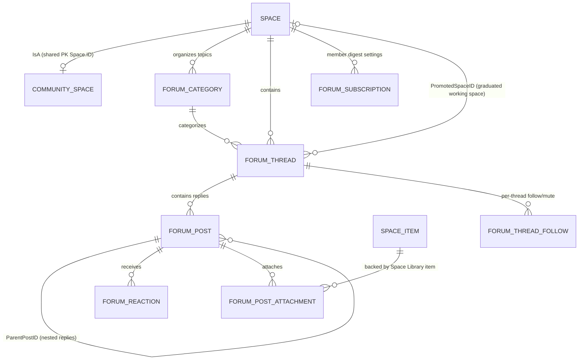

# BizApps Community — Architecture & Implementation Plan

- **Open App Name:** `mj-bizapps-community`
- **Database Schema:** `__mj_BizAppsCommunity`
- **License:** BUSL-1.1 (Free & Open Code on MemberJunction)
- **Dependencies:** `mj-bizapps-common`, `mj-bizapps-tasks`, `mj-bizapps-collaboration`

---

## 1. Purpose & Product Vision

**BizApps Community** brings an AI-native, open-code member community and forum layer to MemberJunction, built directly on top of [**BizApps Collaboration**](https://github.com/MemberJunction/bizapps-collaboration) (`__mj_BizAppsCollaboration`).

Our goal is to give member organizations, professional societies, trade associations, chapters, and learning cohorts a modern, clean, and completely free community application where:
1. **Forums collapse noise into living knowledge:** Multi-reply threads automatically maintain a citation-backed **Living Thread Synthesis** (`AISummary`) at the top of the thread, collapsing repetitive *"+1 / Following"* replies while keeping every member's full post one click away.
2. **Questions are answered before duplicates are posted:** An **Ask-First Composer** searches existing threads, Space Library documents (`SpaceItem`), and organizational Canon (`MJ: Graph Concepts`) in real time as a member types—answering common questions immediately or suggesting the best peers in the community to `@invite`.
3. **Discussions graduate seamlessly into Collaboration Working Spaces:** Any active forum thread can spin up a child Collaboration `Space` (`PromotedSpaceID` — such as a task force, working group, or committee) in one click, seeding the thread's contributors as `SpaceMember` seats, mounting shared attachments into the Space Library (`SpaceItem`), and generating initial `BizApps Tasks`.
4. **Email is a first-class experience:** Members receive a **personalized daily or weekly brief** ranked by their individual profile, topic tags, and peer affinity, and can reply to any discussion directly from their email client via HMAC-authenticated inbound reply-by-email.
5. **Every conversation enriches the organization's own AI and Canon:** Because all community data lives inside the organization's own MemberJunction database, every approved discussion and shared file feeds their knowledge, analytics, and executive AI agents under the exact same database-level permission boundary (`__mj_BizAppsCollaboration.fnCollaborationAccess(@UserID)`).

---

## 2. Architectural Relationship to `BizApps Collaboration`

`BizApps Community` never duplicates Collaboration's container, roster, permission, or file-storage tables. Instead, it extends them cleanly:

| Collaboration Primitive (`__mj_BizAppsCollaboration`) | How `BizApps Community` (`__mj_BizAppsCommunity`) Uses It |
|---|---|
| `Space` & `SpaceType` (`Community`) | Every community, chapter forum, special interest group (SIG), or cohort forum is a `Space`. `CommunitySpace` is an IsA shared-PK child table on `Space(ID)`. |
| `SpaceMember` & `SpaceRoleType` | Community membership, moderator roles (`IsOwnerRole`), contributor permissions (`CanContribute`), Team-band visibility (`CanSeeTeamBand`), and automated roster sync (`SyncSource`, `PersonID`) are managed by `SpaceMember`. |
| `fnCollaborationAccess(@UserID)` | Every read and write on `ForumCategory`, `ForumThread`, and `ForumPost` evaluates reach through `__mj_BizAppsCollaboration.fnCollaborationAccess(@UserID)` across `Team` and `Shared` bands. |
| `SpaceItem` & `ContentUploadIngestor` | Every attachment uploaded to a `ForumPost` (or sent via inbound email reply) is created as a `SpaceItem` backed by `MJ: Files`, automatically appearing in the Space's Resource Library and running through `ContentUploadIngestor` for chunking, tagging, and vector embedding. |
| `COLLABORATION_SPACE_SCOPE_ID` | Extends Collaboration's audience-bounded Scoped Search so AI agents in a Space can retrieve and cite approved `ForumPost` records alongside `SpaceItem` files and `BizApps Tasks`. |

---

## 3. Data Model (`__mj_BizAppsCommunity`)

### 3.1 Table Specifications

#### 1. `CommunitySpace` (IsA Extension on `__mj_BizAppsCollaboration.Space`)
- `ID UNIQUEIDENTIFIER NOT NULL PRIMARY KEY` (FK → `__mj_BizAppsCollaboration.Space(ID)`)
- `Slug NVARCHAR(120) NOT NULL UNIQUE`
- `DefaultDigestFrequency NVARCHAR(20) NOT NULL DEFAULT N'Daily'` (`CHECK (DefaultDigestFrequency IN (N'Realtime', N'Daily', N'Weekly', N'None'))`)
- `ModerationMode NVARCHAR(30) NOT NULL DEFAULT N'AI_Assisted'` (`CHECK (ModerationMode IN (N'None', N'FirstPost', N'AllPosts', N'AI_Assisted'))`)
- `AllowInboundEmailPost BIT NOT NULL DEFAULT 1`
- `InboundEmailAddress NVARCHAR(255) NULL`
- `AutoCollapseThreshold INT NOT NULL DEFAULT 5` — Number of replies at which the Living Thread Synthesizer automatically generates/refreshes `ForumThread.AISummary`.
- `ExternalSourceSystem NVARCHAR(50) NULL`
- `ExternalSourceID NVARCHAR(255) NULL`

#### 2. `ForumCategory` (Topic Channels within a Space)
- `ID UNIQUEIDENTIFIER NOT NULL DEFAULT NEWSEQUENTIALID() PRIMARY KEY`
- `SpaceID UNIQUEIDENTIFIER NOT NULL` (FK → `__mj_BizAppsCollaboration.Space(ID)`)
- `ParentCategoryID UNIQUEIDENTIFIER NULL` (FK → `__mj_BizAppsCommunity.ForumCategory(ID)`)
- `Name NVARCHAR(200) NOT NULL`
- `Slug NVARCHAR(120) NOT NULL`
- `Description NVARCHAR(1000) NULL`
- `IconClass NVARCHAR(100) NULL`
- `Color NVARCHAR(20) NULL`
- `Band NVARCHAR(20) NOT NULL DEFAULT N'Shared'` (`CHECK (Band IN (N'Team', N'Shared'))`)
- `DefaultThreadType NVARCHAR(30) NOT NULL DEFAULT N'Discussion'` (`CHECK (DefaultThreadType IN (N'Discussion', N'Question', N'Announcement', N'Poll', N'Idea'))`)
- `Sequence INT NOT NULL DEFAULT 0`
- `Status NVARCHAR(20) NOT NULL DEFAULT N'Active'` (`CHECK (Status IN (N'Active', N'Archived'))`)

#### 3. `ForumThread` (Discussion Threads & Living Synthesis Container)
- `ID UNIQUEIDENTIFIER NOT NULL DEFAULT NEWSEQUENTIALID() PRIMARY KEY`
- `SpaceID UNIQUEIDENTIFIER NOT NULL` (FK → `__mj_BizAppsCollaboration.Space(ID)`)
- `CategoryID UNIQUEIDENTIFIER NULL` (FK → `__mj_BizAppsCommunity.ForumCategory(ID)`)
- `Title NVARCHAR(500) NOT NULL`
- `Slug NVARCHAR(255) NOT NULL`
- `ThreadType NVARCHAR(30) NOT NULL DEFAULT N'Discussion'` (`CHECK (ThreadType IN (N'Discussion', N'Question', N'Announcement', N'Poll', N'Idea'))`)
- `Band NVARCHAR(20) NOT NULL DEFAULT N'Shared'` (`CHECK (Band IN (N'Team', N'Shared'))`)
- `AuthorUserID UNIQUEIDENTIFIER NULL` (FK → `__mj.[User](ID)`)
- `AuthorPersonID UNIQUEIDENTIFIER NULL` (FK → `__mj_BizAppsCommon.Person(ID)`)
- `Status NVARCHAR(30) NOT NULL DEFAULT N'Published'` (`CHECK (Status IN (N'Draft', N'PendingModeration', N'Published', N'Locked', N'Archived', N'Rejected'))`)
- `IsPinned BIT NOT NULL DEFAULT 0`
- `IsLocked BIT NOT NULL DEFAULT 0`
- `AcceptedPostID UNIQUEIDENTIFIER NULL` (FK → `__mj_BizAppsCommunity.ForumPost(ID)`)
- `ReplyCount INT NOT NULL DEFAULT 0`
- `HighSignalReplyCount INT NOT NULL DEFAULT 0`
- `ViewCount INT NOT NULL DEFAULT 0`
- `LastActivityAt DATETIMEOFFSET NOT NULL DEFAULT SYSDATETIMEOFFSET()`
- `LastPostID UNIQUEIDENTIFIER NULL`
- `AISummary NVARCHAR(MAX) NULL` — Living markdown synthesis of the thread's consensus takeaways and open questions.
- `AISummaryJSON NVARCHAR(MAX) NULL` — Structured JSON takeaways with cited `PostID`s, `AuthorPersonID`s, and `SpaceItemID`s.
- `PromotedSpaceID UNIQUEIDENTIFIER NULL` (FK → `__mj_BizAppsCollaboration.Space(ID)`) — Populated when a thread graduates into a child Collaboration Working Space.
- `PromotedGraphConceptID UNIQUEIDENTIFIER NULL` — Populated when a resolved thread is promoted to an `MJ: Graph Concept` in Canon.
- `ExternalSourceID NVARCHAR(255) NULL`
- `ExternalURL NVARCHAR(1000) NULL`

#### 4. `ForumPost` (Posts & Replies)
- `ID UNIQUEIDENTIFIER NOT NULL DEFAULT NEWSEQUENTIALID() PRIMARY KEY`
- `ThreadID UNIQUEIDENTIFIER NOT NULL` (FK → `__mj_BizAppsCommunity.ForumThread(ID)`)
- `SpaceID UNIQUEIDENTIFIER NOT NULL` (FK → `__mj_BizAppsCollaboration.Space(ID)`) — Denormalized for single-join RLS evaluation via `fnCollaborationAccess(@UserID)`.
- `ParentPostID UNIQUEIDENTIFIER NULL` (FK → `__mj_BizAppsCommunity.ForumPost(ID)`)
- `AuthorUserID UNIQUEIDENTIFIER NULL` (FK → `__mj.[User](ID)`)
- `AuthorPersonID UNIQUEIDENTIFIER NULL` (FK → `__mj_BizAppsCommon.Person(ID)`)
- `BodyHTML NVARCHAR(MAX) NOT NULL`
- `BodyMarkdown NVARCHAR(MAX) NOT NULL`
- `PlainText NVARCHAR(MAX) NOT NULL`
- `IsLowSignalNoise BIT NOT NULL DEFAULT 0` — Automatically set for short acknowledgment replies (*"+1"*, *"Following"*, *"Thanks!"*) so the UI can collapse them into reaction strips by default.
- `PostedVia NVARCHAR(20) NOT NULL DEFAULT N'Web'` (`CHECK (PostedVia IN (N'Web', N'Email', N'Agent', N'Import'))`)
- `InboundMessageID NVARCHAR(255) NULL`
- `Status NVARCHAR(30) NOT NULL DEFAULT N'Approved'` (`CHECK (Status IN (N'Approved', N'PendingModeration', N'Quarantined', N'Deleted'))`)
- `ModerationReasonJSON NVARCHAR(MAX) NULL`
- `HelpfulCount INT NOT NULL DEFAULT 0`
- `ExternalSourceID NVARCHAR(255) NULL`

#### 5. `ForumPostAttachment` & `ForumReaction`
- `ForumPostAttachment`: Links `PostID` → `SpaceItemID` (`__mj_BizAppsCollaboration.SpaceItem(ID)`).
- `ForumReaction`: `(PostID, UserID, PersonID, ReactionType)` where `ReactionType IN (N'Helpful', N'Like', N'Insightful', N'Agree', N'Endorse')`.

#### 6. `ForumSubscription` & `ForumThreadFollow`
- `ForumSubscription`: Per-member, per-space subscription settings (`SpaceID`, `UserID`, `PersonID`, `DeliveryChannel`, `DigestFrequency`, `IncludeSubSpaces`, `TopicInterestsJSON`).
- `ForumThreadFollow`: Per-thread explicit `Follow` or `Mute` overrides.

---

## 4. Core Engines & Workflows

### 4.1 The "Collapsed Forum" & Living Synthesis Engine
1. **Low-Signal Classification on Save (`MJForumPostEntityServer`):**
   - When a reply is saved, a deterministic + lightweight classifier checks if the reply is a short acknowledgment (e.g., < 40 characters matching `+1`, `Following`, `Thanks`, etc. with no attachments or substantive claims) and marks `IsLowSignalNoise = 1`.
2. **Living Thread Synthesis (`ThreadSynthesisService`):**
   - Triggered asynchronously when `HighSignalReplyCount >= CommunitySpace.AutoCollapseThreshold` (default 5) or when `AcceptedPostID` is marked.
   - Synthesizes key takeaways, cites the specific `ForumPost.ID` and author for each point, links any `SpaceItem` attachments shared in the thread, and writes `ForumThread.AISummary` + `AISummaryJSON`.

### 4.2 Collaboration Bridge: 1-Click "Spin Up Working Space"
When a discussion in a broad community space needs structured execution (e.g., drafting a policy response, building a shared template, or running a task force):
- The **`SpinUpWorkingSpaceFromThreadAction`** creates a child `Space` under the community space (or specified parent), links `ForumThread.PromotedSpaceID`, adds the thread's active contributors as `SpaceMember` seats, links the thread's `SpaceItem` attachments into the new Space's Library, pins the thread's `AISummary` as a `SpaceNote`, and optionally creates starter `BizApps Tasks`.

### 4.3 Personalized Digest & Zero-Login Reply-by-Email Engine
1. **Per-Member Relevance Scoring:**
   $$\text{Score}(M, T) = 0.40 \cdot \text{TagSim}(\vec{V}_M, \vec{V}_T) + 0.25 \cdot \text{PeerAffinity}(M, T) + 0.20 \cdot \text{Velocity}(T) + 0.15 \cdot \text{UnansweredExpertiseMatch}(M, T)$$
   - Each member receives a personalized daily or weekly brief containing their top-scoring active threads (rendered using each thread's concise `AISummary`), new library files, and 1–2 unanswered peer questions matching their expertise tags.
2. **Inbound Reply-by-Email Server Extension:**
   - Outbound digest and notification emails set `Reply-To: reply+<HMAC_Token>@<domain>` encoding `(SpaceID, ThreadID, ParentPostID, PersonID, IssuedAt)`.
   - The inbound email webhook verifies the HMAC signature, strips quoted email history and signatures, verifies write reach via `fnCollaborationAccess`, creates the `ForumPost` (`PostedVia = 'Email'`), and saves any email attachments into `SpaceItem` (`MJ: Files`).

---

## 5. Phased Implementation Plan

| Phase | Scope | Deliverables |
|---|---|---|
| **Phase 1: Core Schema, Drivers & Collapsed Forum UX** | Baseline migration (`__mj_BizAppsCommunity`), RLS filters on `fnCollaborationAccess`, `CommunitySpaceServerDriver` & `CommunitySpaceUIDriver`, Ask-First Composer, Living Thread Synthesis card, and 1-Click "Spin Up Working Space". | Working AI-native forum inside any `Community`, `Committee`, or `Cohort` space. |
| **Phase 2: Personalized Digest & Reply-by-Email** | `ForumSubscription` relevance scoring, scheduled Personalized Digest runner (`@memberjunction/scheduling-engine` + `@memberjunction/communication-engine`), and Inbound Reply-by-Email Server Extension. | Full inbox-first workflow with per-member AI personalization. |
| **Phase 3: Moderation, Expert Directory & Canon Promotion** | AI-assisted moderation queue, Member & Expert Directory with expertise badges derived from accepted answers, and 1-Click "Promote Thread to Canon (`GraphConcept`)". | Complete community governance and Canon feedback loop. |
| **Phase 4: Health Probes, Embeddable Widgets & Archive Import** | `BIZAPPS.COMMUNITY.*` health signals and rolled-back live verification probes, embeddable `<mj-community-space>` widget, and bulk archive import pipeline with verification reporting. | Fleet-ready observability and turnkey onboarding. |
