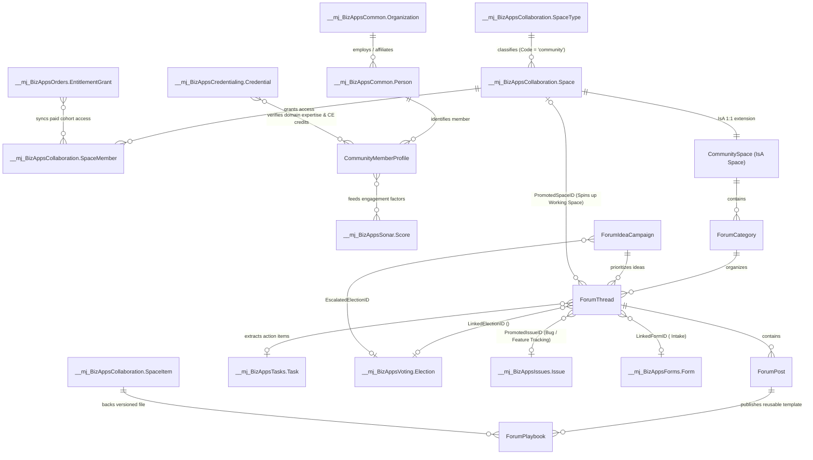
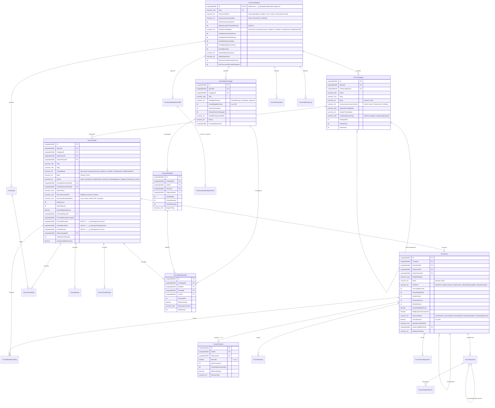

# BizApps Community (`mj-bizapps-community`) — Master Architecture, Full Schema & Engineering Work Plan

## 1. Architectural Vision

**BizApps Community** (`__mj_BizAppsCommunity`) is an AI-native community, epistemic Q&A, participatory ideation, and knowledge-synthesis Open App for **MemberJunction (MJ)** built directly on top of **BizApps Collaboration** (`__mj_BizAppsCollaboration`).

Rather than isolating member discussions in a disconnected forum silo, `mj-bizapps-community` treats **broad community discourse, structured Q&A, point-allocation roadmaps, and deep small-group execution as a single continuum**:

1. **Collapsed, High-Signal Feed + Multi-Mode Threads:** Supports six first-class thread modes—`Discussion`, `QuestionAnswer` (Stack Overflow-style upvote/downvote + AI epistemic rubric grading), `Ideation` (100-point budget allocation & quadratic voting), `LiveAMA`, `CaseReview` ("Grand Rounds"), and `DeliberationRFC` (inline standards/policy review with formal ballot escalation).
2. **Pre-Post AI Synthesis ("Ask-First Composer"):** Before a new question is posted, the composer searches existing threads, working spaces, and the MJ Knowledge Hub (`Canon`) to synthesize an instant answer with citations—preventing duplicate threads without hostile moderation.
3. **Dual Human + AI Epistemic Answer Grading:** Answers are evaluated both by the community (`+1 / -1` upvotes/downvotes, optionally weighted by verified credentials) and by an asynchronous MJ Agent Rubric (**Canon Alignment**, **Completeness**, and **Temporal Freshness / Supersession detection**).
4. **Participatory Point Allocation & Quadratic Voting:** Members receive point wallets (e.g., `100 points` per release or program cycle) to allocate across ideas—or vote via Quadratic Voting ($\text{Cost} = \text{Votes}^2$)—with real-time demographic/tier slicing and 1-click escalation to a certified `<mj-ballot>` in `BizApps Voting`.
5. **1-Click Escalation to Working Spaces, Issues & Canon:** High-velocity threads promote directly into a `BizApps Collaboration` `Space` (with tasks, files, and meetings), escalate into a tracked `BizApps Issues` record, or publish reusable **Forkable Playbooks**.
6. **Configurable Anonymous Access (`None` | `TeaserOnly` | `FullRead`):** Organizations can keep communities strictly private, expose SEO-friendly teaser views (root question + AI synthesis + accepted answer with login gate for replies), or allow full anonymous read of `Shared`-band public categories while requiring authentication for all writes, votes, and point allocations.

---

## 2. Upstream BizApps Integration Matrix (Hard vs. Soft Dependencies)

To keep installation fast and modular, `mj-bizapps-community` declares only **`mj-bizapps-common`**, **`mj-bizapps-tasks`**, and **`mj-bizapps-collaboration`** as hard dependencies in [`mj-app.json`](../mj-app.json), while wiring into six sibling MJ BizApps via soft polymorphic foreign keys and optional `@RegisterClass` server adapters:

| Upstream BizApp | Schema | Dependency Type | What It Unlocks in `mj-bizapps-community` |
|---|---|---|---|
| **BizApps Collaboration** | `__mj_BizAppsCollaboration` | **Hard Dependency** | `CommunitySpace` extends `Space` (IsA). Inherits `SpaceMember`, `SpaceRoleType`, `SpaceItem` (versioned artifacts), `SpaceChat`, `SpaceNote`, and `fnCollaborationAccess(@UserID)` (`Team` vs `Shared` bands). |
| **BizApps Common** | `__mj_BizAppsCommon` | **Hard Dependency** | Links every post, vote, point wallet, and reputation profile to `Person`, `Organization`, and `Relationship`—enabling demographic/tier slicing (e.g., *"How did Enterprise orgs allocate their 100 points?"*). |
| **BizApps Tasks** | `__mj_BizAppsTasks` | **Hard Dependency** | Action items extracted by AI from threads or created in promoted Working Spaces land directly in `Task` with dependencies and Kanban/Gantt tracking. |
| **BizApps Voting** | `__mj_BizAppsVoting` | **Soft / Adapter** | Embeds `<mj-ballot>` inside `DeliberationRFC` and `Ideation` threads (`ForumThread.LinkedElectionID` / `ForumIdeaCampaign.EscalatedElectionID`) for secret board elections, bylaw ratifications, and roll-call standards ballots. |
| **BizApps Issues** | `__mj_BizAppsIssues` | **Soft / Adapter** | 1-click promotion of bug reports, member escalations, or `"Planned"` roadmap ideas into `Issue` (`ForumThread.PromotedIssueID`), syncing `IssueStatus` transitions back to thread subscribers and point voters. |
| **BizApps Credentialing** | `__mj_BizAppsCredentialing` | **Soft / Adapter** | Displays contextual verified credential badges on posts when a member's active credential matches `ForumCategory.CredentialDomainTag`, weights expert Q&A votes (`IsVerifiedDomainExpert`), and awards **CE micro-credits** for peer-reviewed/AI-verified answers. |
| **BizApps Sonar** | `__mj_BizAppsSonar` | **Soft / Adapter** | Feeds community contributions (`ForumThread`, `ForumPost`, `ForumPostVote`, `ForumPlaybookClone`) into Sonar's configurable `ScoreModel` / `Factor` engine on `Person` and `Organization`. |
| **BizApps Forms** | `__mj_BizAppsForms` | **Soft / Adapter** | Embeds `<mj-form>` surveys or structured intake questionnaires (`ForumThread.LinkedFormID`) directly inside `CaseReview` and `LiveAMA` threads. |
| **BizApps Orders** | `__mj_BizAppsOrders` | **Soft / Adapter** | Synchronizes `SpaceMember` access for paid cohorts, premium masterminds, or sponsor spaces from `ProductEntitlement` and `EntitlementGrant`. |

---

## 3. Mermaid Entity-Relationship Diagrams (ERD)

### 3.1 Cross-BizApp Ecosystem ERD



### 3.2 Complete Internal `__mj_BizAppsCommunity` Schema ERD (All 21 Tables)



---

## 4. Full Production SQL Schema Specification (`migrations/B202611060000__v0.1.x__Baseline.sql`)

Below is the complete baseline DDL for schema `__mj_BizAppsCommunity` (SQL Server syntax shown; PostgreSQL equivalent ships in `migrations-pg/`). Every table uses `NEWSEQUENTIALID()` defaults, explicit `CHECK` constraints, foreign keys with `ON DELETE NO ACTION`, and `sp_addextendedproperty` documentation descriptions required by MJ CodeGen.

```sql
IF NOT EXISTS (SELECT 1 FROM sys.schemas WHERE name = N'${flyway:defaultSchema}')
    EXEC('CREATE SCHEMA [${flyway:defaultSchema}]');
GO

-- ============================================================================
-- 1. CommunitySpace (1:1 IsA Extension of __mj_BizAppsCollaboration.Space)
-- ============================================================================
CREATE TABLE [${flyway:defaultSchema}].[CommunitySpace] (
    [ID] UNIQUEIDENTIFIER NOT NULL,
    [Slug] NVARCHAR(120) NOT NULL,
    [CommunityKind] NVARCHAR(30) NOT NULL CONSTRAINT [DF_CommunitySpace_Kind] DEFAULT (N'AssociationWide'),
    [AnonymousAccessMode] NVARCHAR(20) NOT NULL CONSTRAINT [DF_CommunitySpace_AnonMode] DEFAULT (N'None'),
    [AllowAnonymousSearch] BIT NOT NULL CONSTRAINT [DF_CommunitySpace_AnonSearch] DEFAULT (0),
    [RequireLoginPromptAfterPosts] INT NOT NULL CONSTRAINT [DF_CommunitySpace_TeaserCount] DEFAULT (3),
    [DefaultThreadMode] NVARCHAR(30) NOT NULL CONSTRAINT [DF_CommunitySpace_ThreadMode] DEFAULT (N'Discussion'),
    [EnableAIAnswerSynthesis] BIT NOT NULL CONSTRAINT [DF_CommunitySpace_AISynth] DEFAULT (1),
    [EnableAIPrePostDeflection] BIT NOT NULL CONSTRAINT [DF_CommunitySpace_AIDeflect] DEFAULT (1),
    [EnableAIRubricGrading] BIT NOT NULL CONSTRAINT [DF_CommunitySpace_AIGrade] DEFAULT (1),
    [EnableBridgingConsensus] BIT NOT NULL CONSTRAINT [DF_CommunitySpace_Bridging] DEFAULT (1),
    [EnableBounties] BIT NOT NULL CONSTRAINT [DF_CommunitySpace_Bounties] DEFAULT (1),
    [DefaultDigestFrequency] NVARCHAR(20) NOT NULL CONSTRAINT [DF_CommunitySpace_Digest] DEFAULT (N'Daily'),
    [InboundEmailDomain] NVARCHAR(255) NULL,
    [ModerationPolicy] NVARCHAR(30) NOT NULL CONSTRAINT [DF_CommunitySpace_ModPolicy] DEFAULT (N'PostFirst'),
    [MinTrustLevelToCreateThread] INT NOT NULL CONSTRAINT [DF_CommunitySpace_MinTLThread] DEFAULT (0),
    [MinTrustLevelToCreatePlaybook] INT NOT NULL CONSTRAINT [DF_CommunitySpace_MinTLPlaybook] DEFAULT (1),
    CONSTRAINT [PK_CommunitySpace] PRIMARY KEY CLUSTERED ([ID]),
    CONSTRAINT [UQ_CommunitySpace_Slug] UNIQUE NONCLUSTERED ([Slug]),
    CONSTRAINT [FK_CommunitySpace_Space] FOREIGN KEY ([ID]) REFERENCES [__mj_BizAppsCollaboration].[Space]([ID]),
    CONSTRAINT [CK_CommunitySpace_Kind] CHECK ([CommunityKind] IN (N'AssociationWide', N'Chapter', N'SpecialInterestGroup', N'Cohort', N'ProductCommunity', N'WorkingGroup')),
    CONSTRAINT [CK_CommunitySpace_AnonMode] CHECK ([AnonymousAccessMode] IN (N'None', N'TeaserOnly', N'FullRead')),
    CONSTRAINT [CK_CommunitySpace_ThreadMode] CHECK ([DefaultThreadMode] IN (N'Discussion', N'QuestionAnswer', N'Ideation', N'LiveAMA', N'CaseReview', N'DeliberationRFC')),
    CONSTRAINT [CK_CommunitySpace_Digest] CHECK ([DefaultDigestFrequency] IN (N'None', N'Daily', N'Weekly', N'Realtime')),
    CONSTRAINT [CK_CommunitySpace_ModPolicy] CHECK ([ModerationPolicy] IN (N'PostFirst', N'AIQuarantineLowTrust', N'PreModerateAll'))
);
GO

-- ============================================================================
-- 2. ForumCategory (Hierarchical Channels, Band Boundary & Credential Domain)
-- ============================================================================
CREATE TABLE [${flyway:defaultSchema}].[ForumCategory] (
    [ID] UNIQUEIDENTIFIER NOT NULL CONSTRAINT [DF_ForumCategory_ID] DEFAULT (NEWSEQUENTIALID()),
    [SpaceID] UNIQUEIDENTIFIER NOT NULL,
    [ParentCategoryID] UNIQUEIDENTIFIER NULL,
    [Name] NVARCHAR(200) NOT NULL,
    [Slug] NVARCHAR(120) NOT NULL,
    [Description] NVARCHAR(MAX) NULL,
    [IconClass] NVARCHAR(100) NULL,
    [Color] NVARCHAR(50) NULL,
    [Band] NVARCHAR(20) NOT NULL CONSTRAINT [DF_ForumCategory_Band] DEFAULT (N'Shared'),
    [AnonymousAccessOverride] NVARCHAR(20) NOT NULL CONSTRAINT [DF_ForumCategory_AnonOverride] DEFAULT (N'Inherit'),
    [AllowedThreadModes] NVARCHAR(250) NOT NULL CONSTRAINT [DF_ForumCategory_Modes] DEFAULT (N'["Discussion","QuestionAnswer","Ideation","LiveAMA","CaseReview","DeliberationRFC"]'),
    [DefaultThreadMode] NVARCHAR(30) NOT NULL CONSTRAINT [DF_ForumCategory_DefMode] DEFAULT (N'Discussion'),
    [CredentialDomainTag] NVARCHAR(100) NULL,
    [DisplayRank] INT NOT NULL CONSTRAINT [DF_ForumCategory_Rank] DEFAULT (0),
    [IsReadOnly] BIT NOT NULL CONSTRAINT [DF_ForumCategory_ReadOnly] DEFAULT (0),
    [IsArchived] BIT NOT NULL CONSTRAINT [DF_ForumCategory_Archived] DEFAULT (0),
    [ThreadCount] INT NOT NULL CONSTRAINT [DF_ForumCategory_ThreadCount] DEFAULT (0),
    [PostCount] INT NOT NULL CONSTRAINT [DF_ForumCategory_PostCount] DEFAULT (0),
    [LastActivityAt] DATETIMEOFFSET(7) NULL,
    CONSTRAINT [PK_ForumCategory] PRIMARY KEY CLUSTERED ([ID]),
    CONSTRAINT [UQ_ForumCategory_Space_Slug] UNIQUE NONCLUSTERED ([SpaceID], [Slug]),
    CONSTRAINT [FK_ForumCategory_Space] FOREIGN KEY ([SpaceID]) REFERENCES [__mj_BizAppsCollaboration].[Space]([ID]),
    CONSTRAINT [FK_ForumCategory_Parent] FOREIGN KEY ([ParentCategoryID]) REFERENCES [${flyway:defaultSchema}].[ForumCategory]([ID]),
    CONSTRAINT [CK_ForumCategory_Band] CHECK ([Band] IN (N'Shared', N'Team')),
    CONSTRAINT [CK_ForumCategory_AnonOverride] CHECK ([AnonymousAccessOverride] IN (N'Inherit', N'None', N'TeaserOnly', N'FullRead'))
);
GO

-- ============================================================================
-- 3. ForumTag (Taxonomy & Canon Concept Mapping)
-- ============================================================================
CREATE TABLE [${flyway:defaultSchema}].[ForumTag] (
    [ID] UNIQUEIDENTIFIER NOT NULL CONSTRAINT [DF_ForumTag_ID] DEFAULT (NEWSEQUENTIALID()),
    [SpaceID] UNIQUEIDENTIFIER NOT NULL,
    [Name] NVARCHAR(100) NOT NULL,
    [Slug] NVARCHAR(100) NOT NULL,
    [Description] NVARCHAR(500) NULL,
    [Color] NVARCHAR(50) NULL,
    [SynonymOfTagID] UNIQUEIDENTIFIER NULL,
    [MinTrustLevelToUse] INT NOT NULL CONSTRAINT [DF_ForumTag_MinTL] DEFAULT (0),
    [IsOfficialCanonTag] BIT NOT NULL CONSTRAINT [DF_ForumTag_Canon] DEFAULT (0),
    [KnowledgeGraphConceptID] UNIQUEIDENTIFIER NULL,
    [UsageCount] INT NOT NULL CONSTRAINT [DF_ForumTag_Usage] DEFAULT (0),
    CONSTRAINT [PK_ForumTag] PRIMARY KEY CLUSTERED ([ID]),
    CONSTRAINT [UQ_ForumTag_Space_Slug] UNIQUE NONCLUSTERED ([SpaceID], [Slug]),
    CONSTRAINT [FK_ForumTag_Space] FOREIGN KEY ([SpaceID]) REFERENCES [__mj_BizAppsCollaboration].[Space]([ID]),
    CONSTRAINT [FK_ForumTag_Synonym] FOREIGN KEY ([SynonymOfTagID]) REFERENCES [${flyway:defaultSchema}].[ForumTag]([ID])
);
GO

-- ============================================================================
-- 4. ForumIdeaCampaign (Point-Allocation & Quadratic Voting Campaigns)
-- ============================================================================
CREATE TABLE [${flyway:defaultSchema}].[ForumIdeaCampaign] (
    [ID] UNIQUEIDENTIFIER NOT NULL CONSTRAINT [DF_ForumIdeaCampaign_ID] DEFAULT (NEWSEQUENTIALID()),
    [SpaceID] UNIQUEIDENTIFIER NOT NULL,
    [CategoryID] UNIQUEIDENTIFIER NULL,
    [Title] NVARCHAR(200) NOT NULL,
    [Slug] NVARCHAR(120) NOT NULL,
    [Description] NVARCHAR(MAX) NULL,
    [VotingMechanism] NVARCHAR(30) NOT NULL CONSTRAINT [DF_ForumIdeaCampaign_Mech] DEFAULT (N'PointAllocation'),
    [PointsBudgetPerUser] INT NOT NULL CONSTRAINT [DF_ForumIdeaCampaign_Budget] DEFAULT (100),
    [MaxPointsPerIdea] INT NULL,
    [RefundPointsOnShipped] BIT NOT NULL CONSTRAINT [DF_ForumIdeaCampaign_Refund] DEFAULT (1),
    [WeightBySegmentMode] NVARCHAR(30) NOT NULL CONSTRAINT [DF_ForumIdeaCampaign_Weight] DEFAULT (N'EqualOnePersonOneBudget'),
    [Status] NVARCHAR(30) NOT NULL CONSTRAINT [DF_ForumIdeaCampaign_Status] DEFAULT (N'Draft'),
    [OpensAt] DATETIMEOFFSET(7) NULL,
    [ClosesAt] DATETIMEOFFSET(7) NULL,
    [EscalatedElectionID] UNIQUEIDENTIFIER NULL,
    CONSTRAINT [PK_ForumIdeaCampaign] PRIMARY KEY CLUSTERED ([ID]),
    CONSTRAINT [UQ_ForumIdeaCampaign_Space_Slug] UNIQUE NONCLUSTERED ([SpaceID], [Slug]),
    CONSTRAINT [FK_ForumIdeaCampaign_Space] FOREIGN KEY ([SpaceID]) REFERENCES [__mj_BizAppsCollaboration].[Space]([ID]),
    CONSTRAINT [FK_ForumIdeaCampaign_Category] FOREIGN KEY ([CategoryID]) REFERENCES [${flyway:defaultSchema}].[ForumCategory]([ID]),
    CONSTRAINT [CK_ForumIdeaCampaign_Mech] CHECK ([VotingMechanism] IN (N'PointAllocation', N'Quadratic', N'Approval')),
    CONSTRAINT [CK_ForumIdeaCampaign_Weight] CHECK ([WeightBySegmentMode] IN (N'EqualOnePersonOneBudget', N'TierWeighted', N'CredentialWeighted')),
    CONSTRAINT [CK_ForumIdeaCampaign_Status] CHECK ([Status] IN (N'Draft', N'OpenForSubmissions', N'VotingOpen', N'Closed', N'Archived')),
    CONSTRAINT [CK_ForumIdeaCampaign_BudgetPositive] CHECK ([PointsBudgetPerUser] > 0)
);
GO

-- ============================================================================
-- 5. ForumThread (Multi-Mode Discussions, Q&A, Ideation, AMA, Case Review, RFC)
-- ============================================================================
CREATE TABLE [${flyway:defaultSchema}].[ForumThread] (
    [ID] UNIQUEIDENTIFIER NOT NULL CONSTRAINT [DF_ForumThread_ID] DEFAULT (NEWSEQUENTIALID()),
    [SpaceID] UNIQUEIDENTIFIER NOT NULL,
    [CategoryID] UNIQUEIDENTIFIER NOT NULL,
    [AuthorUserID] UNIQUEIDENTIFIER NOT NULL,
    [AuthorPersonID] UNIQUEIDENTIFIER NULL,
    [Title] NVARCHAR(300) NOT NULL,
    [Slug] NVARCHAR(220) NOT NULL,
    [ThreadMode] NVARCHAR(30) NOT NULL CONSTRAINT [DF_ForumThread_Mode] DEFAULT (N'Discussion'),
    [Band] NVARCHAR(20) NOT NULL CONSTRAINT [DF_ForumThread_Band] DEFAULT (N'Shared'),
    [Status] NVARCHAR(30) NOT NULL CONSTRAINT [DF_ForumThread_Status] DEFAULT (N'Open'),
    [IsPinned] BIT NOT NULL CONSTRAINT [DF_ForumThread_Pinned] DEFAULT (0),
    [PinScope] NVARCHAR(20) NOT NULL CONSTRAINT [DF_ForumThread_PinScope] DEFAULT (N'None'),
    [PinnedUntil] DATETIMEOFFSET(7) NULL,
    [AcceptedAnswerPostID] UNIQUEIDENTIFIER NULL,
    [AIVerifiedAnswerPostID] UNIQUEIDENTIFIER NULL,
    [AISummary] NVARCHAR(MAX) NULL,
    [AIConsensusJSON] NVARCHAR(MAX) NULL,
    [AISummaryUpdatedAt] DATETIMEOFFSET(7) NULL,
    [AISummaryReplyWatermark] INT NOT NULL CONSTRAINT [DF_ForumThread_Watermark] DEFAULT (0),
    [StructuredPayloadJSON] NVARCHAR(MAX) NULL,
    [ReplyCount] INT NOT NULL CONSTRAINT [DF_ForumThread_ReplyCount] DEFAULT (0),
    [ParticipantCount] INT NOT NULL CONSTRAINT [DF_ForumThread_PartCount] DEFAULT (1),
    [ViewCount] INT NOT NULL CONSTRAINT [DF_ForumThread_ViewCount] DEFAULT (0),
    [AnonymousViewCount] INT NOT NULL CONSTRAINT [DF_ForumThread_AnonViews] DEFAULT (0),
    [NetVoteScore] INT NOT NULL CONSTRAINT [DF_ForumThread_NetVote] DEFAULT (0),
    [ExpertWeightedScore] DECIMAL(12,2) NOT NULL CONSTRAINT [DF_ForumThread_ExpScore] DEFAULT (0),
    [HotnessScore] DECIMAL(18,6) NOT NULL CONSTRAINT [DF_ForumThread_Hotness] DEFAULT (0),
    [LastActivityAt] DATETIMEOFFSET(7) NOT NULL CONSTRAINT [DF_ForumThread_LastAct] DEFAULT (SYSDATETIMEOFFSET()),
    [LastPostID] UNIQUEIDENTIFIER NULL,
    [PromotedSpaceID] UNIQUEIDENTIFIER NULL,
    [PromotedGraphConceptID] UNIQUEIDENTIFIER NULL,
    [PromotedIssueID] UNIQUEIDENTIFIER NULL,
    [LinkedElectionID] UNIQUEIDENTIFIER NULL,
    [LinkedFormID] UNIQUEIDENTIFIER NULL,
    [IdeaCampaignID] UNIQUEIDENTIFIER NULL,
    [TotalPointsAllocated] INT NOT NULL CONSTRAINT [DF_ForumThread_Points] DEFAULT (0),
    [QuadraticEffectiveScore] DECIMAL(12,4) NOT NULL CONSTRAINT [DF_ForumThread_QuadScore] DEFAULT (0),
    CONSTRAINT [PK_ForumThread] PRIMARY KEY CLUSTERED ([ID]),
    CONSTRAINT [UQ_ForumThread_Space_Slug] UNIQUE NONCLUSTERED ([SpaceID], [Slug]),
    CONSTRAINT [FK_ForumThread_Space] FOREIGN KEY ([SpaceID]) REFERENCES [__mj_BizAppsCollaboration].[Space]([ID]),
    CONSTRAINT [FK_ForumThread_Category] FOREIGN KEY ([CategoryID]) REFERENCES [${flyway:defaultSchema}].[ForumCategory]([ID]),
    CONSTRAINT [FK_ForumThread_AuthorUser] FOREIGN KEY ([AuthorUserID]) REFERENCES [__mj].[User]([ID]),
    CONSTRAINT [FK_ForumThread_AuthorPerson] FOREIGN KEY ([AuthorPersonID]) REFERENCES [__mj_BizAppsCommon].[Person]([ID]),
    CONSTRAINT [FK_ForumThread_PromotedSpace] FOREIGN KEY ([PromotedSpaceID]) REFERENCES [__mj_BizAppsCollaboration].[Space]([ID]),
    CONSTRAINT [FK_ForumThread_IdeaCampaign] FOREIGN KEY ([IdeaCampaignID]) REFERENCES [${flyway:defaultSchema}].[ForumIdeaCampaign]([ID]),
    CONSTRAINT [CK_ForumThread_Mode] CHECK ([ThreadMode] IN (N'Discussion', N'QuestionAnswer', N'Ideation', N'LiveAMA', N'CaseReview', N'DeliberationRFC')),
    CONSTRAINT [CK_ForumThread_Band] CHECK ([Band] IN (N'Shared', N'Team')),
    CONSTRAINT [CK_ForumThread_Status] CHECK ([Status] IN (N'Open', N'Answered', N'UnderReview', N'Planned', N'InWorkingSpace', N'Shipped', N'Resolved', N'Archived', N'Locked')),
    CONSTRAINT [CK_ForumThread_PinScope] CHECK ([PinScope] IN (N'None', N'Category', N'Space'))
);
GO

-- ============================================================================
-- 6. ForumPost (Root Posts, Replies, Graded Q&A Answers & Inline Comments)
-- ============================================================================
CREATE TABLE [${flyway:defaultSchema}].[ForumPost] (
    [ID] UNIQUEIDENTIFIER NOT NULL CONSTRAINT [DF_ForumPost_ID] DEFAULT (NEWSEQUENTIALID()),
    [ThreadID] UNIQUEIDENTIFIER NOT NULL,
    [ParentPostID] UNIQUEIDENTIFIER NULL,
    [AuthorUserID] UNIQUEIDENTIFIER NOT NULL,
    [AuthorPersonID] UNIQUEIDENTIFIER NULL,
    [BodyMarkdown] NVARCHAR(MAX) NOT NULL,
    [BodyPlainText] NVARCHAR(MAX) NULL,
    [Band] NVARCHAR(20) NOT NULL CONSTRAINT [DF_ForumPost_Band] DEFAULT (N'Shared'),
    [PostKind] NVARCHAR(30) NOT NULL CONSTRAINT [DF_ForumPost_Kind] DEFAULT (N'Reply'),
    [PostedVia] NVARCHAR(20) NOT NULL CONSTRAINT [DF_ForumPost_Via] DEFAULT (N'Web'),
    [IsAcceptedAnswer] BIT NOT NULL CONSTRAINT [DF_ForumPost_Accepted] DEFAULT (0),
    [IsLowSignalNoise] BIT NOT NULL CONSTRAINT [DF_ForumPost_LowSignal] DEFAULT (0),
    [UpvoteCount] INT NOT NULL CONSTRAINT [DF_ForumPost_Upvotes] DEFAULT (0),
    [DownvoteCount] INT NOT NULL CONSTRAINT [DF_ForumPost_Downvotes] DEFAULT (0),
    [NetVoteScore] INT NOT NULL CONSTRAINT [DF_ForumPost_NetVotes] DEFAULT (0),
    [ExpertWeightedScore] DECIMAL(12,2) NOT NULL CONSTRAINT [DF_ForumPost_ExpScore] DEFAULT (0),
    [BridgingConsensusScore] DECIMAL(8,4) NULL,
    [AICanonStatus] NVARCHAR(30) NOT NULL CONSTRAINT [DF_ForumPost_CanonStatus] DEFAULT (N'Unchecked'),
    [AIGradeScore] DECIMAL(5,2) NULL,
    [AIRubricGradeJSON] NVARCHAR(MAX) NULL,
    [AIGradedAt] DATETIMEOFFSET(7) NULL,
    [SupersededByPostID] UNIQUEIDENTIFIER NULL,
    [ModerationStatus] NVARCHAR(30) NOT NULL CONSTRAINT [DF_ForumPost_ModStatus] DEFAULT (N'Visible'),
    [EditedAt] DATETIMEOFFSET(7) NULL,
    [EditedByUserID] UNIQUEIDENTIFIER NULL,
    [EditReason] NVARCHAR(300) NULL,
    CONSTRAINT [PK_ForumPost] PRIMARY KEY CLUSTERED ([ID]),
    CONSTRAINT [FK_ForumPost_Thread] FOREIGN KEY ([ThreadID]) REFERENCES [${flyway:defaultSchema}].[ForumThread]([ID]),
    CONSTRAINT [FK_ForumPost_Parent] FOREIGN KEY ([ParentPostID]) REFERENCES [${flyway:defaultSchema}].[ForumPost]([ID]),
    CONSTRAINT [FK_ForumPost_AuthorUser] FOREIGN KEY ([AuthorUserID]) REFERENCES [__mj].[User]([ID]),
    CONSTRAINT [FK_ForumPost_AuthorPerson] FOREIGN KEY ([AuthorPersonID]) REFERENCES [__mj_BizAppsCommon].[Person]([ID]),
    CONSTRAINT [FK_ForumPost_SupersededBy] FOREIGN KEY ([SupersededByPostID]) REFERENCES [${flyway:defaultSchema}].[ForumPost]([ID]),
    CONSTRAINT [FK_ForumPost_EditedBy] FOREIGN KEY ([EditedByUserID]) REFERENCES [__mj].[User]([ID]),
    CONSTRAINT [CK_ForumPost_Band] CHECK ([Band] IN (N'Shared', N'Team')),
    CONSTRAINT [CK_ForumPost_Kind] CHECK ([PostKind] IN (N'RootPost', N'Reply', N'Answer', N'AMAAnswer', N'OfficialStatusUpdate', N'AISynthesisNote')),
    CONSTRAINT [CK_ForumPost_Via] CHECK ([PostedVia] IN (N'Web', N'Mobile', N'EmailReply', N'Agent', N'MigratedImport')),
    CONSTRAINT [CK_ForumPost_CanonStatus] CHECK ([AICanonStatus] IN (N'Unchecked', N'CanonVerified', N'NovelInsight', N'PartiallyOutdated', N'ConflictsWithCanon')),
    CONSTRAINT [CK_ForumPost_ModStatus] CHECK ([ModerationStatus] IN (N'Visible', N'CollapsedByCommunity', N'QuarantinedByAI', N'RemovedByModerator'))
);
GO

ALTER TABLE [${flyway:defaultSchema}].[ForumThread]
    ADD CONSTRAINT [FK_ForumThread_AcceptedPost] FOREIGN KEY ([AcceptedAnswerPostID]) REFERENCES [${flyway:defaultSchema}].[ForumPost]([ID]),
        CONSTRAINT [FK_ForumThread_AIVerifiedPost] FOREIGN KEY ([AIVerifiedAnswerPostID]) REFERENCES [${flyway:defaultSchema}].[ForumPost]([ID]),
        CONSTRAINT [FK_ForumThread_LastPost] FOREIGN KEY ([LastPostID]) REFERENCES [${flyway:defaultSchema}].[ForumPost]([ID]);
GO

-- ============================================================================
-- 7. ForumThreadTag (Thread-to-Tag Join with AI Classifier Confidence)
-- ============================================================================
CREATE TABLE [${flyway:defaultSchema}].[ForumThreadTag] (
    [ID] UNIQUEIDENTIFIER NOT NULL CONSTRAINT [DF_ForumThreadTag_ID] DEFAULT (NEWSEQUENTIALID()),
    [ThreadID] UNIQUEIDENTIFIER NOT NULL,
    [TagID] UNIQUEIDENTIFIER NOT NULL,
    [TaggedByKind] NVARCHAR(20) NOT NULL CONSTRAINT [DF_ForumThreadTag_Kind] DEFAULT (N'Author'),
    [ConfidenceScore] DECIMAL(5,4) NULL,
    CONSTRAINT [PK_ForumThreadTag] PRIMARY KEY CLUSTERED ([ID]),
    CONSTRAINT [UQ_ForumThreadTag_Thread_Tag] UNIQUE NONCLUSTERED ([ThreadID], [TagID]),
    CONSTRAINT [FK_ForumThreadTag_Thread] FOREIGN KEY ([ThreadID]) REFERENCES [${flyway:defaultSchema}].[ForumThread]([ID]),
    CONSTRAINT [FK_ForumThreadTag_Tag] FOREIGN KEY ([TagID]) REFERENCES [${flyway:defaultSchema}].[ForumTag]([ID]),
    CONSTRAINT [CK_ForumThreadTag_Kind] CHECK ([TaggedByKind] IN (N'Author', N'Moderator', N'AIClassifier'))
);
GO

-- ============================================================================
-- 8. ForumPostVote (Stack Overflow Upvote/Downvote + Expert Weighting)
-- ============================================================================
CREATE TABLE [${flyway:defaultSchema}].[ForumPostVote] (
    [ID] UNIQUEIDENTIFIER NOT NULL CONSTRAINT [DF_ForumPostVote_ID] DEFAULT (NEWSEQUENTIALID()),
    [PostID] UNIQUEIDENTIFIER NOT NULL,
    [VoterUserID] UNIQUEIDENTIFIER NOT NULL,
    [VoterPersonID] UNIQUEIDENTIFIER NULL,
    [Direction] SMALLINT NOT NULL,
    [VoterTrustLevel] INT NOT NULL CONSTRAINT [DF_ForumPostVote_TL] DEFAULT (1),
    [IsVerifiedDomainExpert] BIT NOT NULL CONSTRAINT [DF_ForumPostVote_Expert] DEFAULT (0),
    [EffectiveWeight] DECIMAL(6,2) NOT NULL CONSTRAINT [DF_ForumPostVote_Weight] DEFAULT (1.00),
    [ReasonCode] NVARCHAR(40) NULL,
    CONSTRAINT [PK_ForumPostVote] PRIMARY KEY CLUSTERED ([ID]),
    CONSTRAINT [UQ_ForumPostVote_Post_Voter] UNIQUE NONCLUSTERED ([PostID], [VoterUserID]),
    CONSTRAINT [FK_ForumPostVote_Post] FOREIGN KEY ([PostID]) REFERENCES [${flyway:defaultSchema}].[ForumPost]([ID]),
    CONSTRAINT [FK_ForumPostVote_VoterUser] FOREIGN KEY ([VoterUserID]) REFERENCES [__mj].[User]([ID]),
    CONSTRAINT [FK_ForumPostVote_VoterPerson] FOREIGN KEY ([VoterPersonID]) REFERENCES [__mj_BizAppsCommon].[Person]([ID]),
    CONSTRAINT [CK_ForumPostVote_Direction] CHECK ([Direction] IN (1, -1)),
    CONSTRAINT [CK_ForumPostVote_Reason] CHECK ([ReasonCode] IS NULL OR [ReasonCode] IN (N'AccurateAndComplete', N'VerifiedInPractice', N'Outdated', N'Incomplete', N'IncorrectPerPolicy', N'OffTopic'))
);
GO

-- ============================================================================
-- 9. ForumReaction (Semantic Micro-Reactions)
-- ============================================================================
CREATE TABLE [${flyway:defaultSchema}].[ForumReaction] (
    [ID] UNIQUEIDENTIFIER NOT NULL CONSTRAINT [DF_ForumReaction_ID] DEFAULT (NEWSEQUENTIALID()),
    [PostID] UNIQUEIDENTIFIER NOT NULL,
    [UserID] UNIQUEIDENTIFIER NOT NULL,
    [ReactionType] NVARCHAR(30) NOT NULL,
    CONSTRAINT [PK_ForumReaction] PRIMARY KEY CLUSTERED ([ID]),
    CONSTRAINT [UQ_ForumReaction_Post_User_Type] UNIQUE NONCLUSTERED ([PostID], [UserID], [ReactionType]),
    CONSTRAINT [FK_ForumReaction_Post] FOREIGN KEY ([PostID]) REFERENCES [${flyway:defaultSchema}].[ForumPost]([ID]),
    CONSTRAINT [FK_ForumReaction_User] FOREIGN KEY ([UserID]) REFERENCES [__mj].[User]([ID]),
    CONSTRAINT [CK_ForumReaction_Type] CHECK ([ReactionType] IN (N'Helpful', N'Insightful', N'Agree', N'Celebrate', N'Curious', N'EndorseForCanon'))
);
GO

-- ============================================================================
-- 10. ForumPostAttachment (Bridges ForumPost to Collaboration SpaceItem)
-- ============================================================================
CREATE TABLE [${flyway:defaultSchema}].[ForumPostAttachment] (
    [ID] UNIQUEIDENTIFIER NOT NULL CONSTRAINT [DF_ForumPostAttachment_ID] DEFAULT (NEWSEQUENTIALID()),
    [PostID] UNIQUEIDENTIFIER NOT NULL,
    [SpaceItemID] UNIQUEIDENTIFIER NOT NULL,
    [DisplayOrder] INT NOT NULL CONSTRAINT [DF_ForumPostAttachment_Order] DEFAULT (0),
    [IsPlaybookTemplate] BIT NOT NULL CONSTRAINT [DF_ForumPostAttachment_Playbook] DEFAULT (0),
    CONSTRAINT [PK_ForumPostAttachment] PRIMARY KEY CLUSTERED ([ID]),
    CONSTRAINT [UQ_ForumPostAttachment_Post_Item] UNIQUE NONCLUSTERED ([PostID], [SpaceItemID]),
    CONSTRAINT [FK_ForumPostAttachment_Post] FOREIGN KEY ([PostID]) REFERENCES [${flyway:defaultSchema}].[ForumPost]([ID]),
    CONSTRAINT [FK_ForumPostAttachment_SpaceItem] FOREIGN KEY ([SpaceItemID]) REFERENCES [__mj_BizAppsCollaboration].[SpaceItem]([ID])
);
GO

-- ============================================================================
-- 11. ForumIdeaWallet (Member Point Budget in an Ideation Campaign)
-- ============================================================================
CREATE TABLE [${flyway:defaultSchema}].[ForumIdeaWallet] (
    [ID] UNIQUEIDENTIFIER NOT NULL CONSTRAINT [DF_ForumIdeaWallet_ID] DEFAULT (NEWSEQUENTIALID()),
    [CampaignID] UNIQUEIDENTIFIER NOT NULL,
    [UserID] UNIQUEIDENTIFIER NOT NULL,
    [PersonID] UNIQUEIDENTIFIER NULL,
    [OrganizationID] UNIQUEIDENTIFIER NULL,
    [InitialBudget] INT NOT NULL,
    [PointsAllocated] INT NOT NULL CONSTRAINT [DF_ForumIdeaWallet_Allocated] DEFAULT (0),
    [PointsRefunded] INT NOT NULL CONSTRAINT [DF_ForumIdeaWallet_Refunded] DEFAULT (0),
    [SegmentTag] NVARCHAR(100) NULL,
    CONSTRAINT [PK_ForumIdeaWallet] PRIMARY KEY CLUSTERED ([ID]),
    CONSTRAINT [UQ_ForumIdeaWallet_Campaign_User] UNIQUE NONCLUSTERED ([CampaignID], [UserID]),
    CONSTRAINT [FK_ForumIdeaWallet_Campaign] FOREIGN KEY ([CampaignID]) REFERENCES [${flyway:defaultSchema}].[ForumIdeaCampaign]([ID]),
    CONSTRAINT [FK_ForumIdeaWallet_User] FOREIGN KEY ([UserID]) REFERENCES [__mj].[User]([ID]),
    CONSTRAINT [FK_ForumIdeaWallet_Person] FOREIGN KEY ([PersonID]) REFERENCES [__mj_BizAppsCommon].[Person]([ID]),
    CONSTRAINT [FK_ForumIdeaWallet_Org] FOREIGN KEY ([OrganizationID]) REFERENCES [__mj_BizAppsCommon].[Organization]([ID]),
    CONSTRAINT [CK_ForumIdeaWallet_Balance] CHECK ([PointsAllocated] <= [InitialBudget] + [PointsRefunded])
);
GO

-- ============================================================================
-- 12. ForumIdeaAllocation (Point & Quadratic Allocations on Ideation Threads)
-- ============================================================================
CREATE TABLE [${flyway:defaultSchema}].[ForumIdeaAllocation] (
    [ID] UNIQUEIDENTIFIER NOT NULL CONSTRAINT [DF_ForumIdeaAllocation_ID] DEFAULT (NEWSEQUENTIALID()),
    [CampaignID] UNIQUEIDENTIFIER NOT NULL,
    [WalletID] UNIQUEIDENTIFIER NOT NULL,
    [ThreadID] UNIQUEIDENTIFIER NOT NULL,
    [UserID] UNIQUEIDENTIFIER NOT NULL,
    [PointsSpent] INT NOT NULL,
    [EffectiveVotes] DECIMAL(12,4) NOT NULL,
    [RationaleComment] NVARCHAR(500) NULL,
    [IsRefunded] BIT NOT NULL CONSTRAINT [DF_ForumIdeaAllocation_Refunded] DEFAULT (0),
    CONSTRAINT [PK_ForumIdeaAllocation] PRIMARY KEY CLUSTERED ([ID]),
    CONSTRAINT [UQ_ForumIdeaAllocation_Campaign_Thread_User] UNIQUE NONCLUSTERED ([CampaignID], [ThreadID], [UserID]),
    CONSTRAINT [FK_ForumIdeaAllocation_Campaign] FOREIGN KEY ([CampaignID]) REFERENCES [${flyway:defaultSchema}].[ForumIdeaCampaign]([ID]),
    CONSTRAINT [FK_ForumIdeaAllocation_Wallet] FOREIGN KEY ([WalletID]) REFERENCES [${flyway:defaultSchema}].[ForumIdeaWallet]([ID]),
    CONSTRAINT [FK_ForumIdeaAllocation_Thread] FOREIGN KEY ([ThreadID]) REFERENCES [${flyway:defaultSchema}].[ForumThread]([ID]),
    CONSTRAINT [FK_ForumIdeaAllocation_User] FOREIGN KEY ([UserID]) REFERENCES [__mj].[User]([ID]),
    CONSTRAINT [CK_ForumIdeaAllocation_PointsPositive] CHECK ([PointsSpent] > 0)
);
GO

-- ============================================================================
-- 13. ForumBounty (Question Bounties for Expert Answers & CE Credits)
-- ============================================================================
CREATE TABLE [${flyway:defaultSchema}].[ForumBounty] (
    [ID] UNIQUEIDENTIFIER NOT NULL CONSTRAINT [DF_ForumBounty_ID] DEFAULT (NEWSEQUENTIALID()),
    [ThreadID] UNIQUEIDENTIFIER NOT NULL,
    [SponsoredByUserID] UNIQUEIDENTIFIER NOT NULL,
    [BountyKind] NVARCHAR(30) NOT NULL CONSTRAINT [DF_ForumBounty_Kind] DEFAULT (N'ReputationPoints'),
    [BountyPoints] INT NOT NULL CONSTRAINT [DF_ForumBounty_Points] DEFAULT (50),
    [CECreditHours] DECIMAL(5,2) NULL,
    [RewardDescription] NVARCHAR(500) NULL,
    [Status] NVARCHAR(20) NOT NULL CONSTRAINT [DF_ForumBounty_Status] DEFAULT (N'Active'),
    [ExpiresAt] DATETIMEOFFSET(7) NOT NULL,
    [AwardedToPostID] UNIQUEIDENTIFIER NULL,
    [AwardedToUserID] UNIQUEIDENTIFIER NULL,
    [AwardedAt] DATETIMEOFFSET(7) NULL,
    CONSTRAINT [PK_ForumBounty] PRIMARY KEY CLUSTERED ([ID]),
    CONSTRAINT [FK_ForumBounty_Thread] FOREIGN KEY ([ThreadID]) REFERENCES [${flyway:defaultSchema}].[ForumThread]([ID]),
    CONSTRAINT [FK_ForumBounty_Sponsor] FOREIGN KEY ([SponsoredByUserID]) REFERENCES [__mj].[User]([ID]),
    CONSTRAINT [FK_ForumBounty_Post] FOREIGN KEY ([AwardedToPostID]) REFERENCES [${flyway:defaultSchema}].[ForumPost]([ID]),
    CONSTRAINT [FK_ForumBounty_Winner] FOREIGN KEY ([AwardedToUserID]) REFERENCES [__mj].[User]([ID]),
    CONSTRAINT [CK_ForumBounty_Kind] CHECK ([BountyKind] IN (N'ReputationPoints', N'CECreditEligible', N'RecognitionBadge', N'SponsorPrize')),
    CONSTRAINT [CK_ForumBounty_Status] CHECK ([Status] IN (N'Active', N'Awarded', N'Expired', N'Cancelled'))
);
GO

-- ============================================================================
-- 14. ForumPlaybook (Forkable Community Templates & Living Artifacts)
-- ============================================================================
CREATE TABLE [${flyway:defaultSchema}].[ForumPlaybook] (
    [ID] UNIQUEIDENTIFIER NOT NULL CONSTRAINT [DF_ForumPlaybook_ID] DEFAULT (NEWSEQUENTIALID()),
    [SpaceID] UNIQUEIDENTIFIER NOT NULL,
    [CategoryID] UNIQUEIDENTIFIER NULL,
    [OriginThreadID] UNIQUEIDENTIFIER NULL,
    [OriginPostID] UNIQUEIDENTIFIER NULL,
    [SpaceItemID] UNIQUEIDENTIFIER NOT NULL,
    [AuthorUserID] UNIQUEIDENTIFIER NOT NULL,
    [ParentPlaybookID] UNIQUEIDENTIFIER NULL,
    [Title] NVARCHAR(250) NOT NULL,
    [Slug] NVARCHAR(150) NOT NULL,
    [Summary] NVARCHAR(MAX) NULL,
    [VersionLabel] NVARCHAR(40) NOT NULL CONSTRAINT [DF_ForumPlaybook_Ver] DEFAULT (N'1.0.0'),
    [CloneCount] INT NOT NULL CONSTRAINT [DF_ForumPlaybook_Clones] DEFAULT (0),
    [UpvoteCount] INT NOT NULL CONSTRAINT [DF_ForumPlaybook_Upvotes] DEFAULT (0),
    [IsCanonEndorsed] BIT NOT NULL CONSTRAINT [DF_ForumPlaybook_Canon] DEFAULT (0),
    CONSTRAINT [PK_ForumPlaybook] PRIMARY KEY CLUSTERED ([ID]),
    CONSTRAINT [UQ_ForumPlaybook_Space_Slug] UNIQUE NONCLUSTERED ([SpaceID], [Slug]),
    CONSTRAINT [FK_ForumPlaybook_Space] FOREIGN KEY ([SpaceID]) REFERENCES [__mj_BizAppsCollaboration].[Space]([ID]),
    CONSTRAINT [FK_ForumPlaybook_Category] FOREIGN KEY ([CategoryID]) REFERENCES [${flyway:defaultSchema}].[ForumCategory]([ID]),
    CONSTRAINT [FK_ForumPlaybook_Thread] FOREIGN KEY ([OriginThreadID]) REFERENCES [${flyway:defaultSchema}].[ForumThread]([ID]),
    CONSTRAINT [FK_ForumPlaybook_Post] FOREIGN KEY ([OriginPostID]) REFERENCES [${flyway:defaultSchema}].[ForumPost]([ID]),
    CONSTRAINT [FK_ForumPlaybook_SpaceItem] FOREIGN KEY ([SpaceItemID]) REFERENCES [__mj_BizAppsCollaboration].[SpaceItem]([ID]),
    CONSTRAINT [FK_ForumPlaybook_Author] FOREIGN KEY ([AuthorUserID]) REFERENCES [__mj].[User]([ID]),
    CONSTRAINT [FK_ForumPlaybook_Parent] FOREIGN KEY ([ParentPlaybookID]) REFERENCES [${flyway:defaultSchema}].[ForumPlaybook]([ID])
);
GO

-- ============================================================================
-- 15. ForumPlaybookClone (Lineage When Members Clone a Playbook into a Space)
-- ============================================================================
CREATE TABLE [${flyway:defaultSchema}].[ForumPlaybookClone] (
    [ID] UNIQUEIDENTIFIER NOT NULL CONSTRAINT [DF_ForumPlaybookClone_ID] DEFAULT (NEWSEQUENTIALID()),
    [PlaybookID] UNIQUEIDENTIFIER NOT NULL,
    [ClonedByUserID] UNIQUEIDENTIFIER NOT NULL,
    [DestinationSpaceID] UNIQUEIDENTIFIER NULL,
    [DestinationSpaceItemID] UNIQUEIDENTIFIER NULL,
    [ClonedAt] DATETIMEOFFSET(7) NOT NULL CONSTRAINT [DF_ForumPlaybookClone_At] DEFAULT (SYSDATETIMEOFFSET()),
    CONSTRAINT [PK_ForumPlaybookClone] PRIMARY KEY CLUSTERED ([ID]),
    CONSTRAINT [FK_ForumPlaybookClone_Playbook] FOREIGN KEY ([PlaybookID]) REFERENCES [${flyway:defaultSchema}].[ForumPlaybook]([ID]),
    CONSTRAINT [FK_ForumPlaybookClone_User] FOREIGN KEY ([ClonedByUserID]) REFERENCES [__mj].[User]([ID]),
    CONSTRAINT [FK_ForumPlaybookClone_DestSpace] FOREIGN KEY ([DestinationSpaceID]) REFERENCES [__mj_BizAppsCollaboration].[Space]([ID]),
    CONSTRAINT [FK_ForumPlaybookClone_DestItem] FOREIGN KEY ([DestinationSpaceItemID]) REFERENCES [__mj_BizAppsCollaboration].[SpaceItem]([ID])
);
GO

-- ============================================================================
-- 16. CommunityMemberProfile (Trust Levels, Outcome Reputation & Peer Matching)
-- ============================================================================
CREATE TABLE [${flyway:defaultSchema}].[CommunityMemberProfile] (
    [ID] UNIQUEIDENTIFIER NOT NULL CONSTRAINT [DF_CommunityMemberProfile_ID] DEFAULT (NEWSEQUENTIALID()),
    [SpaceID] UNIQUEIDENTIFIER NOT NULL,
    [UserID] UNIQUEIDENTIFIER NOT NULL,
    [PersonID] UNIQUEIDENTIFIER NULL,
    [TrustLevel] INT NOT NULL CONSTRAINT [DF_CommunityMemberProfile_TL] DEFAULT (0),
    [ReputationScore] INT NOT NULL CONSTRAINT [DF_CommunityMemberProfile_Rep] DEFAULT (0),
    [AcceptedAnswersCount] INT NOT NULL CONSTRAINT [DF_CommunityMemberProfile_Acc] DEFAULT (0),
    [CanonVerifiedPostsCount] INT NOT NULL CONSTRAINT [DF_CommunityMemberProfile_Canon] DEFAULT (0),
    [PlaybooksClonedCount] INT NOT NULL CONSTRAINT [DF_CommunityMemberProfile_Clones] DEFAULT (0),
    [BountiesWonCount] INT NOT NULL CONSTRAINT [DF_CommunityMemberProfile_Bounties] DEFAULT (0),
    [OptInPeerMatching] BIT NOT NULL CONSTRAINT [DF_CommunityMemberProfile_Peer] DEFAULT (0),
    [ExpertiseTagsJSON] NVARCHAR(MAX) NULL,
    [VerifiedCredentialsCacheJSON] NVARCHAR(MAX) NULL,
    CONSTRAINT [PK_CommunityMemberProfile] PRIMARY KEY CLUSTERED ([ID]),
    CONSTRAINT [UQ_CommunityMemberProfile_Space_User] UNIQUE NONCLUSTERED ([SpaceID], [UserID]),
    CONSTRAINT [FK_CommunityMemberProfile_Space] FOREIGN KEY ([SpaceID]) REFERENCES [__mj_BizAppsCollaboration].[Space]([ID]),
    CONSTRAINT [FK_CommunityMemberProfile_User] FOREIGN KEY ([UserID]) REFERENCES [__mj].[User]([ID]),
    CONSTRAINT [FK_CommunityMemberProfile_Person] FOREIGN KEY ([PersonID]) REFERENCES [__mj_BizAppsCommon].[Person]([ID]),
    CONSTRAINT [CK_CommunityMemberProfile_TL] CHECK ([TrustLevel] BETWEEN 0 AND 4)
);
GO

-- ============================================================================
-- 17. CommunityReputationEvent (Outcome-Based Reputation & CE Micro-Credit Log)
-- ============================================================================
CREATE TABLE [${flyway:defaultSchema}].[CommunityReputationEvent] (
    [ID] UNIQUEIDENTIFIER NOT NULL CONSTRAINT [DF_CommunityReputationEvent_ID] DEFAULT (NEWSEQUENTIALID()),
    [SpaceID] UNIQUEIDENTIFIER NOT NULL,
    [UserID] UNIQUEIDENTIFIER NOT NULL,
    [EventKind] NVARCHAR(40) NOT NULL,
    [PointsDelta] INT NOT NULL,
    [SourceThreadID] UNIQUEIDENTIFIER NULL,
    [SourcePostID] UNIQUEIDENTIFIER NULL,
    [ExternalCredentialCreditID] UNIQUEIDENTIFIER NULL,
    CONSTRAINT [PK_CommunityReputationEvent] PRIMARY KEY CLUSTERED ([ID]),
    CONSTRAINT [FK_CommunityReputationEvent_Space] FOREIGN KEY ([SpaceID]) REFERENCES [__mj_BizAppsCollaboration].[Space]([ID]),
    CONSTRAINT [FK_CommunityReputationEvent_User] FOREIGN KEY ([UserID]) REFERENCES [__mj].[User]([ID]),
    CONSTRAINT [FK_CommunityReputationEvent_Thread] FOREIGN KEY ([SourceThreadID]) REFERENCES [${flyway:defaultSchema}].[ForumThread]([ID]),
    CONSTRAINT [FK_CommunityReputationEvent_Post] FOREIGN KEY ([SourcePostID]) REFERENCES [${flyway:defaultSchema}].[ForumPost]([ID]),
    CONSTRAINT [CK_CommunityReputationEvent_Kind] CHECK ([EventKind] IN (
        N'AnswerUpvoted', N'AnswerDownvoted', N'AnswerAccepted', N'AICanonVerified',
        N'BountySponsored', N'BountyAwarded', N'ThreadPromotedToSpace', N'PlaybookCloned', N'ModeratorAdjustment'
    ))
);
GO

-- ============================================================================
-- 18. ForumSubscription (Category & Space Digest Preferences)
-- ============================================================================
CREATE TABLE [${flyway:defaultSchema}].[ForumSubscription] (
    [ID] UNIQUEIDENTIFIER NOT NULL CONSTRAINT [DF_ForumSubscription_ID] DEFAULT (NEWSEQUENTIALID()),
    [UserID] UNIQUEIDENTIFIER NOT NULL,
    [SpaceID] UNIQUEIDENTIFIER NOT NULL,
    [CategoryID] UNIQUEIDENTIFIER NULL,
    [DeliveryChannel] NVARCHAR(20) NOT NULL CONSTRAINT [DF_ForumSubscription_Chan] DEFAULT (N'EmailDigest'),
    [DigestFrequency] NVARCHAR(20) NOT NULL CONSTRAINT [DF_ForumSubscription_Freq] DEFAULT (N'Daily'),
    [IncludeAISynthesis] BIT NOT NULL CONSTRAINT [DF_ForumSubscription_AI] DEFAULT (1),
    [TopicsFilterJSON] NVARCHAR(MAX) NULL,
    CONSTRAINT [PK_ForumSubscription] PRIMARY KEY CLUSTERED ([ID]),
    CONSTRAINT [FK_ForumSubscription_User] FOREIGN KEY ([UserID]) REFERENCES [__mj].[User]([ID]),
    CONSTRAINT [FK_ForumSubscription_Space] FOREIGN KEY ([SpaceID]) REFERENCES [__mj_BizAppsCollaboration].[Space]([ID]),
    CONSTRAINT [FK_ForumSubscription_Category] FOREIGN KEY ([CategoryID]) REFERENCES [${flyway:defaultSchema}].[ForumCategory]([ID]),
    CONSTRAINT [CK_ForumSubscription_Chan] CHECK ([DeliveryChannel] IN (N'InApp', N'EmailDigest', N'RealtimeEmail')),
    CONSTRAINT [CK_ForumSubscription_Freq] CHECK ([DigestFrequency] IN (N'None', N'Daily', N'Weekly', N'Realtime'))
);
GO

-- ============================================================================
-- 19. ForumThreadFollow (Per-Thread Read Watermarks & Notification State)
-- ============================================================================
CREATE TABLE [${flyway:defaultSchema}].[ForumThreadFollow] (
    [ID] UNIQUEIDENTIFIER NOT NULL CONSTRAINT [DF_ForumThreadFollow_ID] DEFAULT (NEWSEQUENTIALID()),
    [ThreadID] UNIQUEIDENTIFIER NOT NULL,
    [UserID] UNIQUEIDENTIFIER NOT NULL,
    [FollowReason] NVARCHAR(30) NOT NULL CONSTRAINT [DF_ForumThreadFollow_Reason] DEFAULT (N'Manual'),
    [IsMuted] BIT NOT NULL CONSTRAINT [DF_ForumThreadFollow_Muted] DEFAULT (0),
    [LastReadPostID] UNIQUEIDENTIFIER NULL,
    [LastReadAt] DATETIMEOFFSET(7) NULL,
    CONSTRAINT [PK_ForumThreadFollow] PRIMARY KEY CLUSTERED ([ID]),
    CONSTRAINT [UQ_ForumThreadFollow_Thread_User] UNIQUE NONCLUSTERED ([ThreadID], [UserID]),
    CONSTRAINT [FK_ForumThreadFollow_Thread] FOREIGN KEY ([ThreadID]) REFERENCES [${flyway:defaultSchema}].[ForumThread]([ID]),
    CONSTRAINT [FK_ForumThreadFollow_User] FOREIGN KEY ([UserID]) REFERENCES [__mj].[User]([ID]),
    CONSTRAINT [FK_ForumThreadFollow_LastPost] FOREIGN KEY ([LastReadPostID]) REFERENCES [${flyway:defaultSchema}].[ForumPost]([ID]),
    CONSTRAINT [CK_ForumThreadFollow_Reason] CHECK ([FollowReason] IN (N'Author', N'Replied', N'AllocatedPoints', N'UpvotedQuestion', N'Manual'))
);
GO

-- ============================================================================
-- 20. ForumModerationFlag (Community & AI Co-Moderator Flag Queue)
-- ============================================================================
CREATE TABLE [${flyway:defaultSchema}].[ForumModerationFlag] (
    [ID] UNIQUEIDENTIFIER NOT NULL CONSTRAINT [DF_ForumModerationFlag_ID] DEFAULT (NEWSEQUENTIALID()),
    [SpaceID] UNIQUEIDENTIFIER NOT NULL,
    [ThreadID] UNIQUEIDENTIFIER NULL,
    [PostID] UNIQUEIDENTIFIER NULL,
    [ReportedByUserID] UNIQUEIDENTIFIER NULL,
    [FlagKind] NVARCHAR(30) NOT NULL,
    [AIConfidence] DECIMAL(5,4) NULL,
    [Notes] NVARCHAR(1000) NULL,
    [Status] NVARCHAR(20) NOT NULL CONSTRAINT [DF_ForumModerationFlag_Status] DEFAULT (N'Open'),
    [ResolvedByUserID] UNIQUEIDENTIFIER NULL,
    [ResolutionAction] NVARCHAR(50) NULL,
    [ResolvedAt] DATETIMEOFFSET(7) NULL,
    CONSTRAINT [PK_ForumModerationFlag] PRIMARY KEY CLUSTERED ([ID]),
    CONSTRAINT [FK_ForumModerationFlag_Space] FOREIGN KEY ([SpaceID]) REFERENCES [__mj_BizAppsCollaboration].[Space]([ID]),
    CONSTRAINT [FK_ForumModerationFlag_Thread] FOREIGN KEY ([ThreadID]) REFERENCES [${flyway:defaultSchema}].[ForumThread]([ID]),
    CONSTRAINT [FK_ForumModerationFlag_Post] FOREIGN KEY ([PostID]) REFERENCES [${flyway:defaultSchema}].[ForumPost]([ID]),
    CONSTRAINT [FK_ForumModerationFlag_Reporter] FOREIGN KEY ([ReportedByUserID]) REFERENCES [__mj].[User]([ID]),
    CONSTRAINT [FK_ForumModerationFlag_Resolver] FOREIGN KEY ([ResolvedByUserID]) REFERENCES [__mj].[User]([ID]),
    CONSTRAINT [CK_ForumModerationFlag_Kind] CHECK ([FlagKind] IN (N'Spam', N'Uncivil', N'DuplicateQuestion', N'OutdatedInfo', N'ConfidentialLeak', N'NeedsSplitOrMerge')),
    CONSTRAINT [CK_ForumModerationFlag_Status] CHECK ([Status] IN (N'Open', N'Resolved', N'Dismissed'))
);
GO

-- ============================================================================
-- 21. ForumDeflectionLog (Ask-First Pre-Post Deflection Telemetry)
-- ============================================================================
CREATE TABLE [${flyway:defaultSchema}].[ForumDeflectionLog] (
    [ID] UNIQUEIDENTIFIER NOT NULL CONSTRAINT [DF_ForumDeflectionLog_ID] DEFAULT (NEWSEQUENTIALID()),
    [SpaceID] UNIQUEIDENTIFIER NOT NULL,
    [UserID] UNIQUEIDENTIFIER NULL,
    [QueryText] NVARCHAR(1000) NOT NULL,
    [DeflectedOutcome] NVARCHAR(40) NOT NULL,
    [MatchedThreadIDsJSON] NVARCHAR(MAX) NULL,
    [CreatedThreadID] UNIQUEIDENTIFIER NULL,
    CONSTRAINT [PK_ForumDeflectionLog] PRIMARY KEY CLUSTERED ([ID]),
    CONSTRAINT [FK_ForumDeflectionLog_Space] FOREIGN KEY ([SpaceID]) REFERENCES [__mj_BizAppsCollaboration].[Space]([ID]),
    CONSTRAINT [FK_ForumDeflectionLog_User] FOREIGN KEY ([UserID]) REFERENCES [__mj].[User]([ID]),
    CONSTRAINT [FK_ForumDeflectionLog_CreatedThread] FOREIGN KEY ([CreatedThreadID]) REFERENCES [${flyway:defaultSchema}].[ForumThread]([ID]),
    CONSTRAINT [CK_ForumDeflectionLog_Outcome] CHECK ([DeflectedOutcome] IN (N'SolvedBeforePost', N'PostedAnywayWithNuance', N'ConvertedToExistingThreadUpvote'))
);
GO
```

---

## 5. Anonymous Read & Authenticated Write Architecture

Many organizations want their community (or specific categories within it) to be **publicly readable without logging in**—driving organic search discovery, member acquisition, and open knowledge sharing—while **strictly requiring authentication for posting, replying, voting, allocating points, cloning playbooks, or viewing internal `Team`-band discussions**.

### 5.1 Three-Tier Anonymous Access Policy
Configured on `CommunitySpace.AnonymousAccessMode` and overridable per channel via `ForumCategory.AnonymousAccessOverride`:

| Effective Mode | What Anonymous Visitors Can See | What Requires Login (`AUTH_REQUIRED`) |
|---|---|---|
| **`None`** | Nothing (redirected to login / SSO gate). | Everything. |
| **`TeaserOnly`** | Category list, thread titles, root question/post, the **AI Living Synthesis Card**, the **Accepted / AI-Verified Answer**, and the first `RequireLoginPromptAfterPosts` (default `3`) `Shared`-band replies. Remaining replies are replaced with a *"Sign in to read X more expert replies and join the discussion"* card. | Reading full thread history, downloading attachments, posting, replying, upvoting/downvoting, allocating points, following. |
| **`FullRead`** | Full read access to all `Shared`-band threads, replies, dual human/AI answer grades, and public roadmap point leaderboards in that category. | Creating threads, replying, upvoting/downvoting, allocating roadmap points, cloning playbooks, viewing any `Team`-band post or category, or spinning up a Working Space. |

### 5.2 SQL Access Function (`fnCommunityCategoryAccess`)
Wraps `__mj_BizAppsCollaboration.fnCollaborationAccess(@UserID)` so both authenticated members and anonymous sessions are governed by a single deterministic SQL table-valued function:

```sql
CREATE FUNCTION [${flyway:defaultSchema}].[fnCommunityCategoryAccess](
    @UserID UNIQUEIDENTIFIER
)
RETURNS TABLE
AS
RETURN
(
    -- 1. Authenticated SpaceMembers (via Collaboration recursive membership & inheritance)
    SELECT
        c.ID AS CategoryID,
        c.SpaceID,
        CAST(1 AS BIT) AS CanReadFull,
        CAST(0 AS BIT) AS IsTeaserOnly,
        access.CanSeeTeam,
        CASE WHEN c.IsReadOnly = 1 OR c.IsArchived = 1 THEN CAST(0 AS BIT) ELSE access.CanContribute END AS CanContribute,
        access.CanInvite
    FROM [${flyway:defaultSchema}].[ForumCategory] AS c
    INNER JOIN [__mj_BizAppsCollaboration].[fnCollaborationAccess](@UserID) AS access
        ON access.SpaceID = c.SpaceID
    WHERE @UserID IS NOT NULL
      AND (c.Band = N'Shared' OR access.CanSeeTeam = 1)

    UNION ALL

    -- 2. Anonymous / Non-Member Public Access (Shared band ONLY; never Team band; never CanContribute)
    SELECT
        c.ID AS CategoryID,
        c.SpaceID,
        CASE
            WHEN (CASE WHEN c.AnonymousAccessOverride = N'Inherit' THEN cs.AnonymousAccessMode ELSE c.AnonymousAccessOverride END) = N'FullRead'
            THEN CAST(1 AS BIT)
            ELSE CAST(0 AS BIT)
        END AS CanReadFull,
        CASE
            WHEN (CASE WHEN c.AnonymousAccessOverride = N'Inherit' THEN cs.AnonymousAccessMode ELSE c.AnonymousAccessOverride END) = N'TeaserOnly'
            THEN CAST(1 AS BIT)
            ELSE CAST(0 AS BIT)
        END AS IsTeaserOnly,
        CAST(0 AS BIT) AS CanSeeTeam,
        CAST(0 AS BIT) AS CanContribute,
        CAST(0 AS BIT) AS CanInvite
    FROM [${flyway:defaultSchema}].[ForumCategory] AS c
    INNER JOIN [${flyway:defaultSchema}].[CommunitySpace] AS cs ON cs.ID = c.SpaceID
    INNER JOIN [__mj_BizAppsCollaboration].[fnCollaborationSpaceStatuses]() AS st ON st.SpaceID = c.SpaceID
    WHERE c.Band = N'Shared'
      AND st.Visible = 1
      AND (CASE WHEN c.AnonymousAccessOverride = N'Inherit' THEN cs.AnonymousAccessMode ELSE c.AnonymousAccessOverride END) IN (N'TeaserOnly', N'FullRead')
      AND (
          @UserID IS NULL
          OR NOT EXISTS (
              SELECT 1
              FROM [__mj_BizAppsCollaboration].[fnCollaborationAccess](@UserID) AS existing
              WHERE existing.SpaceID = c.SpaceID
          )
      )
);
GO
```

### 5.3 Pre-Auth Public Edge (`CommunityPublicEdge` at `/community`) & Intent-Preserving Login
Following the exact pattern established in `BizApps Voting` (`VotingBallotEdge`) and `BizApps Forms` (`RespondentHostMiddleware`):
1. **`CommunityPublicEdge` (`MJ_SERVER_EXTENSIONS`, root `/community`):**
   - Serves public/anonymous read routes (`GET /community/:spaceSlug`, `GET /community/:spaceSlug/t/:threadSlug`, `POST /community/:spaceSlug/ask`) with rate limiting per salted IP hash and strict `TeaserOnly` truncation on the server (never sending hidden replies over the wire).
   - Emits clean `<script type="application/ld+json">` (`QAPage` and `DiscussionForumPosting` Schema.org structured data) on `TeaserOnly` and `FullRead` threads so search engines and AI answer engines index canonical answers.
2. **Intent-Preserving Authentication Gate:**
   - When an anonymous visitor clicks **Upvote**, **Reply**, **Allocate 20 Points**, or **Ask Question**, the client stores the pending intent in session storage, triggers the host's login / magic-link flow, and automatically replays or pre-fills the action once authenticated.

---

## 6. Detailed Multi-Phase Engineering Work Plan

### Phase 1: Foundation — SQL Migrations, Metadata, RLS & `@mj-biz-apps/community-entities`
* **Deliverables:**
  1. Author `migrations/B202611060000__v0.1.x__Baseline.sql` (SQL Server) and `migrations-pg/B202611060000__v0.1.x__Baseline.sql` (PostgreSQL) with all 21 tables, indexes, `fnCommunityCategoryAccess`, and extended property descriptions.
  2. Author `metadata/` JSON files:
     - `metadata/applications/.mj-bizapps-community-application.json`
     - `metadata/application-roles/` (`Community Member`, `Community Steward`, `Community Moderator`, `Community Anonymous Reader`)
     - `metadata/space-types/.community-space-type.json` (`Code: 'community'`, `SpaceExtensionEntity: 'MJ: BizApps Community: Community Spaces'`, `ServerDriverClass: 'CommunitySpaceServerDriver'`, `UIDriverClass: 'CommunitySpaceUIDriver'`)
  3. Run `mj:migrate`, `mj sync push`, and `mj:codegen` to generate `@mj-biz-apps/community-entities`.
* **Verification Gate:** All 21 entities compile cleanly; SQL Server and PostgreSQL baseline migrations apply and tear down cleanly.

### Phase 2: Pure Domain Logic & Server Engines (`@mj-biz-apps/community-core` & `@mj-biz-apps/community-core-entities-server`)
* **Deliverables:**
  1. **`@mj-biz-apps/community-core` (`packages/Core/src/rules.ts`):**
     - Low-signal noise detection (`isLowSignalReply`)
     - Anonymous access resolution & server-side teaser truncation (`resolveEffectiveAnonymousAccess`, `truncatePostsForAnonymousReader`)
     - Dual Human + AI Answer Ranking (`computeCompositeAnswerRank` combining human net votes, verified expert votes, AI rubric grade, and freshness)
     - Point-Allocation & Quadratic Voting math (`computeQuadraticEffectiveVotes`, `validateIdeaAllocationBudget`)
     - Bridging Consensus scoring (`computeBridgingConsensusScore`)
  2. **`@mj-biz-apps/community-core-entities-server`:**
     - `CommunitySpaceServerDriver` (`@RegisterClass(BaseSpaceTypeServerDriver, 'CommunitySpaceServerDriver')`): automatically provisions default categories (`General Discussion`, `Q&A & Troubleshooting`, `Feature & Roadmap Ideas`, `Playbooks & Templates`, `Steward Backstage [Team]`) when a `CommunitySpace` is created.
     - `MJForumThreadEntityServer` & `MJForumPostEntityServer`:
       - Enforces `CanContribute` and `MinTrustLevelToCreateThread`.
       - Rejects writes from anonymous/scope-limited principals.
       - Automatically marks `IsLowSignalNoise = 1` on short ack replies (`+1`, `"Thanks!"`).
       - Queues asynchronous AI Living Synthesis refresh and AI Epistemic Rubric Grading when `ReplyCount` crosses the watermark or a new `Answer` post is saved.
     - `MJForumPostVoteEntityServer`:
       - Enforces `1` vote per user per post (`+1` or `-1`), snapshots `IsVerifiedDomainExpert` via the optional `BizApps Credentialing` adapter, updates `ForumPost.NetVoteScore` and `ExpertWeightedScore`, and writes a `CommunityReputationEvent` row.
     - `MJForumIdeaAllocationEntityServer`:
       - Enforces wallet budget constraints (`PointsAllocated <= InitialBudget + PointsRefunded`) and `MaxPointsPerIdea`, computes `EffectiveVotes` (`PointsSpent` vs $\sqrt{\text{PointsSpent}}$), and updates `ForumThread.TotalPointsAllocated` and `QuadraticEffectiveScore` atomically.
* **Verification Gate:** Unit and database integration tests covering all entity invariants, anonymous write rejection, quadratic math, and automatic point refunds when `ForumThread.Status` transitions to `'Shipped'`.

### Phase 3: Remote Operations, Public Edge & AI Actions (`@mj-biz-apps/community-actions` & `@mj-biz-apps/community-server`)
* **Deliverables:**
  1. **Typed Remote Operations (`Community.*`):**
     - `Community.GetFeed` / `Community.GetPublicFeed`
     - `Community.GetThreadDetail` / `Community.GetPublicThreadDetail` (enforces `TeaserOnly` vs `FullRead` vs `None`)
     - `Community.AskFirstPrePostCheck` (returns synthesized answer, cited threads/spaces, and logs `ForumDeflectionLog`)
     - `Community.CastPostVote` (`+1 / -1` with optional reason code)
     - `Community.AllocateIdeaPoints` (allocates/updates points from `ForumIdeaWallet`)
     - `Community.ClonePlaybookToSpace` (clones a `ForumPlaybook`'s `SpaceItem` into the user's target `Space` and logs `ForumPlaybookClone`)
  2. **AI & Cross-BizApp Actions (`@mj-biz-apps/community-actions`):**
     - `SynthesizeForumThreadAction`: Generates `AISummary` and `AIConsensusJSON` (Bridging Consensus clusters) while strictly respecting `Team` vs `Shared` band boundaries.
     - `GradeForumAnswerAction`: Evaluates Q&A answers against MJ Knowledge Hub (`CanonVerified` / `NovelInsight` / `PartiallyOutdated` / `ConflictsWithCanon`) and writes `AIRubricGradeJSON` + `AIGradeScore`.
     - `SpinUpWorkingSpaceFromThreadAction`: Creates a child `BizApps Collaboration` `Space`, invites selected thread participants as `SpaceMember` rows, seeds a `SpaceNote` charter, creates initial `BizApps Tasks`, and sets `ForumThread.PromotedSpaceID`.
     - `EscalateThreadToIssueOrBallotAction`: Soft-wires to `BizApps Issues` (`PromotedIssueID`) or `BizApps Voting` (`LinkedElectionID`).
  3. **Pre-Auth Public Edge (`CommunityPublicEdge` at `/community`):**
     - Mounts anonymous read endpoints, rate limiters, and Schema.org `QAPage` JSON-LD metadata.
* **Verification Gate:** End-to-end tests for anonymous `TeaserOnly` truncation, `FullRead` access, `AUTH_REQUIRED` write guards, AI grading, and 1-click Working Space promotion.

### Phase 4: Angular Explorer UI, Space Driver & Embeddable Widget (`@mj-biz-apps/community-ng-widgets` & `@mj-biz-apps/community-ng`)
* **Deliverables:**
  1. **`CommunitySpaceUIDriver` (`@RegisterClass(BaseSpaceTypeUIDriver, 'CommunitySpaceUIDriver')`):**
     - Plugs the Community canvas directly into `BizApps Collaboration` Spaces.
  2. **Core Interactive Components (`@mj-biz-apps/community-ng-widgets`):**
     - **Ask-First Composer (`<mj-community-ask-composer>`):** Live semantic search + instant AI synthesis card + mode selector (`Discussion`, `Q&A`, `Ideation`, `AMA`, `Case Review`, `RFC`).
     - **Collapsed Feed & Living Synthesis Banner (`<mj-community-feed>`, `<mj-community-thread>`):** Displays the AI Living Synthesis Card, Bridging Consensus Map, auto-collapsed low-signal pill, and Working Space / Issue / Ballot status badges.
     - **Stack Overflow + AI Graded Answer Card (`<mj-community-answer-card>`):** Net vote stepper (`▲ 42 ▼`), `Expert-Weighted` toggle, `Accepted Answer` ribbon, and the expandable **AI Epistemic Rubric Badge** (`Canon Verified · 96/100`).
     - **100-Point Wallet & Quadratic Ideation Board (`<mj-community-ideation-board>`):** Interactive point sliders, live wallet balance bar (`65 / 100 pts remaining`), quadratic cost calculator, demographic segment filter, and inline `<mj-ballot>` escalation.
     - **Forkable Playbook Drawer & Spin-Up Working Space Modal.**
     - **Anonymous Teaser Banner & Intent-Preserving Sign-In Prompt.**
* **Verification Gate:** Playwright visual and functional verification across all 6 thread modes, anonymous `TeaserOnly` / `FullRead` views, Q&A grading, point allocation, and Working Space spin-up.
