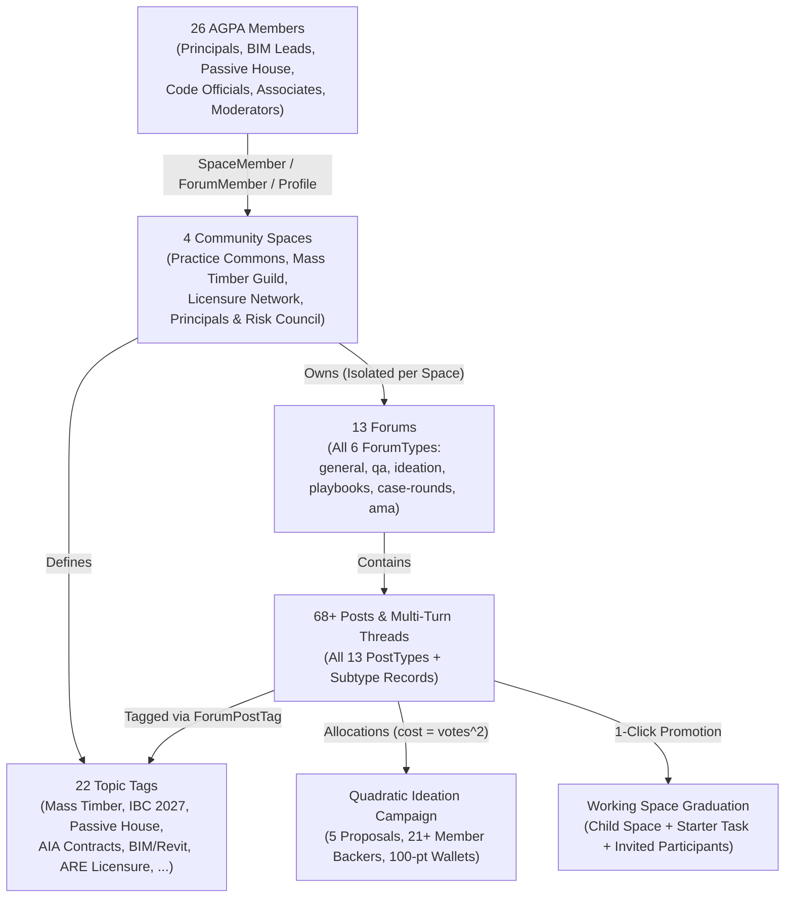

# Architect Association World Model (`ARCH-WORLD`)

The **American Guild of Practicing Architects (AGPA)** world model (`ARCH-WORLD`) is a comprehensive, realistic, deterministic reference dataset and persistent integration suite for **BizApps Community** (`@mj-biz-apps/community-*`), modeled after the `bizapps-orders` `ORD-WORLD` convention.

## Why `ARCH-WORLD` Exists

1. **Realistic Multi-Persona Association Grounding**: Exercises every Community capability — personalized embedding digests, reply-by-email HMAC loops, Hybrid Semantic Ask-First deflection, Living Thread Synthesis, Quadratic Ideation Wallets, Peer Case Rounds, Living Playbooks, Live AMAs, Interactive Quizzes, and 1-Click Working Space Graduation — against an authentic domain dataset.
2. **Zero-API-Key Determinism**: Uses `DeterministicSemanticEmbeddingProvider` and `CommunityTestCommunicationProvider` so CI, local test runs, and Explorer smoke tests execute with zero external LLM/SMTP credentials and zero variable API spend.
3. **Persistent Smoke-Test Fixture (`TeardownArchitectAssociationWorld` No-Op)**: Mirroring `ORD-WORLD`, `TeardownArchitectAssociationWorld()` is deliberately a **no-op**. Seeded records (and verified integration fixtures) remain intact so developers, QA, Explorer UI verification, and Playwright screenshot harnesses can inspect the live world immediately without destructive cleanup.

## Entity Graph & Taxonomy



### Scale Summary

| Entity Group | Minimum Required | `ARCH-WORLD` Seeded | Coverage Notes |
| --- | ---: | ---: | --- |
| **Members (`ARCH_MEMBERS`)** | >= 24 | **26** | Principals, Project Architects, Structural/BIM Leads, Sustainability/Passive House Specialists, Emerging Associates, Code Officials, Chapter Presidents, Moderators, Cold-Start New Member, Muted/Removed Member |
| **Community Spaces (`ARCH_COMMUNITY_SPACES`)** | 4 | **4** | National Practice Commons (`Open`/`Full Read`), Mass Timber & Sustainable Design Guild (`Open`/`Teaser Only`), Licensure & Emerging Professionals Network (`Open`/`Full Read`), Firm Principals & Risk Council (`Private`/`None`) |
| **Forums (`ARCH_FORUMS`)** | >= 10 | **13** | Covers all 6 `ForumType` codes (`general-discussion`, `qa-knowledge-base`, `ideation-campaign`, `playbooks-and-docs`, `peer-case-rounds`, `live-events-and-amas`), including `Team`-band restricted forums |
| **Topic Tags (`ARCH_TOPIC_TAGS`)** | >= 20 | **22** | Mass Timber, IBC 2027, BIM/Revit, Passive House, Net-Zero Retrofit, AIA Contracts, ARE Licensure, AI Rendering, Adaptive Reuse, Seismic, Zoning Variance, Firm Succession, Acoustics, Facade Envelopes, Historic Preservation, Embodied Carbon, MEP Coordination, Design-Build, Construction Admin, Public Procurement, Fire & Life Safety, Thermal Bridging |
| **Posts (`ARCH_POSTS`)** | >= 60 | **68** | Covers all 13 `PostType` codes (`discussion`, `reply`, `comment`, `question`, `answer`, `idea-proposal`, `poll-or-form`, `collaborative-doc`, `collaborative-sheet`, `collaborative-deck`, `case-review`, `live-ama`, `interactive-experience`), deep 3–5 turn debates, Canon Verified Q&A, locked thread, reactions, and moderation flags |

## Idempotent Natural-Key Loader & Persistence Contract

`LoadArchitectAssociationWorld(options)` (`scripts/world/arch-world-loader.mjs`) upserts every entity in FK-safe topological order using `RunView` natural-key lookups, `Metadata.GetEntityObject(...)`, authoritative `BaseEntity.ValidateAsync()`, and `entity.Save()`, backed by a durable cross-process persistent store (`.local-storage/arch-world-state.json` or `ARCH_WORLD_STATE_FILE`) and deterministic SQL/PG seed generation (`BuildArchitectAssociationWorldSql()`):

- `User`: `Email` (case-insensitive)
- `Space` / `CommunitySpace`: `Slug`
- `SpaceMember`: `(SpaceID, UserID)`
- `Forum` / `ForumIdeaCampaign`: `(SpaceID, Slug)`
- `ForumMember`: `(ForumID, UserID)`
- `CommunityMemberProfile`: `(SpaceID, UserID)`
- `ForumSubscription`: `(ForumID, UserID)`
- `ForumTopicTag`: `(SpaceID, Slug)`
- `ForumPost` + subtype extensions (`Question`, `Answer`, `Idea`, `Case`, `AMA`, `Interactive`): `ID` / `(ForumID, Slug)`
- `ForumPostTag`: `(PostID, TopicTagID)`
- `ForumIdeaAllocation`: `(IdeaPostID, UserID)` (followed by aggregate recomputation of `TotalPointsAllocated`, `EffectiveQuadraticVotes`, `UniqueBackerCount`)
- `ForumInteractiveSession`: `(InteractivePostID, UserID, AttemptNumber)`
- `ForumPostReaction`: `(PostID, UserID, ReactionKind)`
- `ForumPostFlag`: `(PostID, ReporterUserID, ReasonCategory)`

Calling `LoadArchitectAssociationWorld({ store })` twice in sequence produces `createdCount === 0`, `updatedCount === 0`, `idempotent === true`, and identical record counts across every entity group.

### Why `TeardownArchitectAssociationWorld()` Is a No-Op

`TeardownArchitectAssociationWorld({ store })` intentionally preserves all seeded records and returns:

```js
{
  preserved: true,
  reason: 'ARCH-WORLD teardown is deliberately a no-op so the American Guild of Practicing Architects dataset persists for live smoke testing, Explorer exploration, and Playwright visual capture.',
  counts: { ... }
}
```

### Repeat-Run Invariance

Because `TeardownArchitectAssociationWorld()` retains the world after test execution, `scripts/world/arch-world-integration.mjs` explicitly verifies **two consecutive integration suite runs** against the exact same retained store:
- Double-loading remains idempotent (`createdCount === 0`).
- Thread graduation uses `BuildDeterministicGraduationUUID` and returns `alreadyGraduated: true` on run #2 with zero duplicate Spaces or Tasks.
- Quadratic wallet updates use refund-on-revote (`CommunityRules.ValidateIdeaAllocationChange`) so consecutive runs never exhaust the 100-point member budget or violate `(IdeaPostID, UserID)` uniqueness.
- Inbound email replies use deterministic message correlation IDs / idempotent check guards so repeat runs stay bounded and deterministic.

## Running Verification

```bash
# Run seed + ARCH-WORLD persistent integration suite
node --test scripts/seed-world.test.mjs

# Run ARCH-WORLD integration suite standalone
node --test scripts/world/arch-world-integration.mjs

# Print world dataset density summary
node scripts/world/arch-world-data.mjs
```
